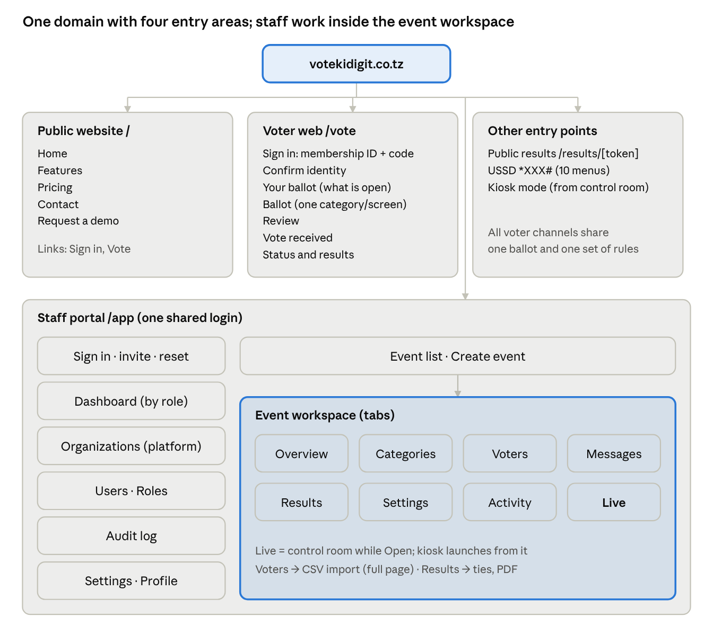
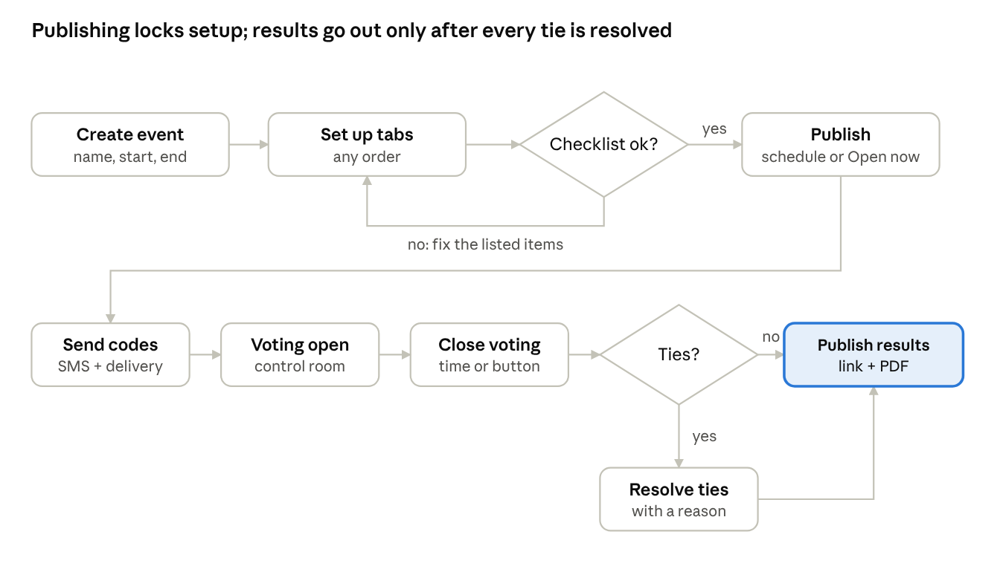
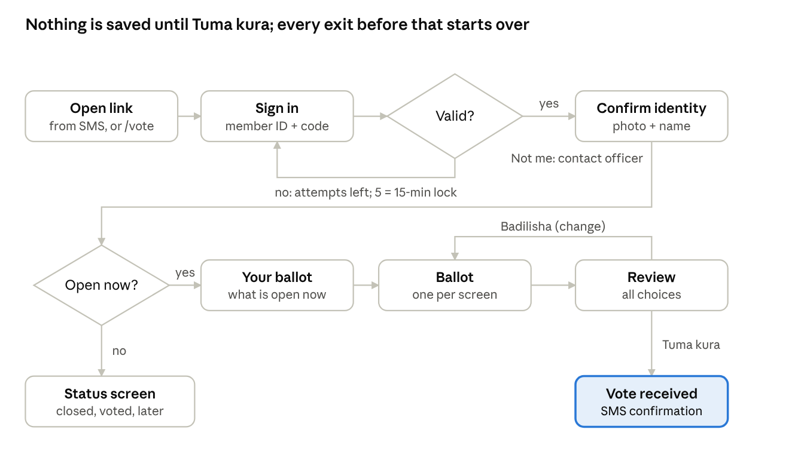
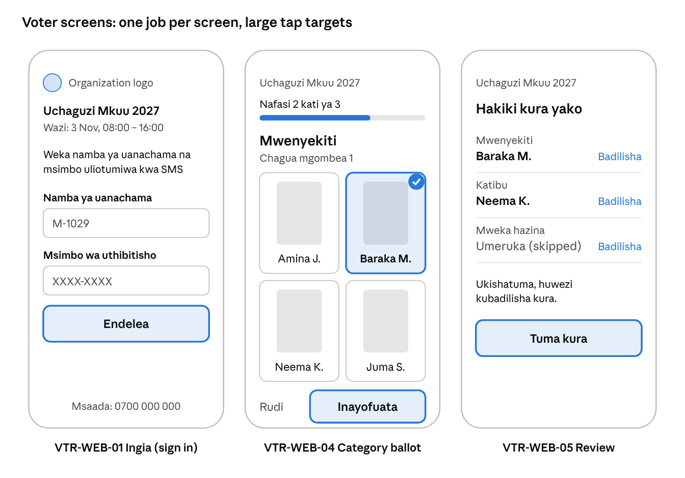
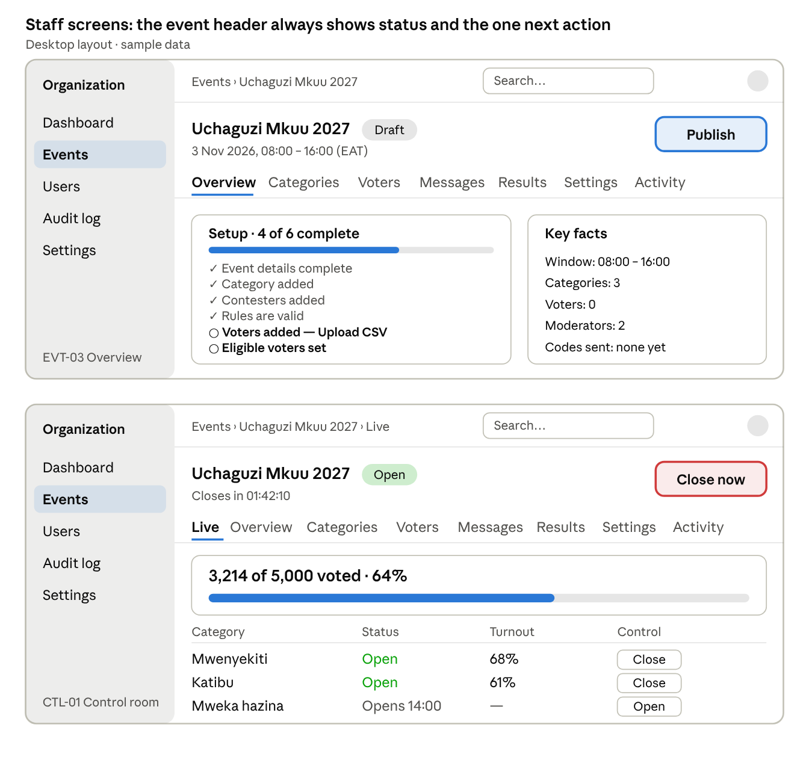

# Vote-Kidigit — App Flow Document (V1)

Nov 3, 2026 · @Smartone

## 1. Overview

This document maps every screen, page and user journey in Vote-Kidigit V1. It sits on top of the PRD (V1): the PRD says what the system does, this document says where each thing happens, how users move between screens, and what every screen shows when it is empty or something goes wrong.

### 1.1 Who uses it

- **Designers** — build wireframes and high-fidelity screens from section 4 onward.
- **Developers** — use screen IDs, routes and state tables to build pages and test them.
- **The client** — approves journeys before design starts.

### 1.2 Screen ID scheme

Every screen has a unique ID so designers, developers and testers can refer to it precisely.

| Prefix | Area | Example |
|---|---|---|
| PUB | Public website | PUB-01 Home |
| AUTH | Staff sign-in and account access | AUTH-02 Set password |
| DSH | Staff dashboards | DSH-02 Org Admin dashboard |
| PLT | Platform Super Admin | PLT-03 Organization detail |
| EVT | Event list and event workspace | EVT-05 Voters tab |
| CTL | Live event control room | CTL-01 Control room |
| RES | Results (staff, public, voter) | RES-04 Public results |
| USR | Users, roles and permissions | USR-04 Role editor |
| SYS | Audit log, settings, profile, onboarding | SYS-03 Organization settings |
| VTR-WEB | Voter mobile web | VTR-WEB-04 Ballot |
| VTR-USSD | Voter USSD menus | VTR-USSD-05 Category menu |
| KSK | Kiosk mode | KSK-02 Membership ID entry |
| ERR | Shared error pages | ERR-03 Not found |

### 1.3 Screen states

Every screen is specified for up to five states. A table that leaves a state out means it does not apply.

| State | Meaning |
|---|---|
| Loading | Data is being fetched. Show skeleton placeholders, never a blank page. |
| Empty | The screen has nothing to show yet. One message and one main action (section 12). |
| Populated | Normal content. |
| Locked | Content exists but cannot be changed, e.g. an event after publish. Shown read-only with a lock icon and a one-line reason. |
| Error | Something failed. Plain message, what to do next, and a retry where it makes sense (section 13). |

### 1.4 Decisions in this document that update the PRD

Your answers on 3 Nov 2026 change six PRD points. The PRD should be updated to match.

| Topic | PRD said | This document uses |
|---|---|---|
| Review before submit | No review screen (VOT-03) | A review screen on **all** channels: web, USSD and kiosk |
| Category windows | Voter completes all open categories in one session | Each category opens and closes on its own, manually or by schedule. A voter may return for a category that opened later. A closed category never accepts votes. |
| Kiosk identity | Open issue | Voter enters membership ID at the kiosk; the system sends their code by SMS; voter enters the code. A voter with no phone can have the code sent to someone else's phone, with staff approval |
| Unpublish | Locked after publish | A Scheduled event can return to Draft until the first code SMS is sent |
| Voter login order | Code, then membership ID | Membership ID first, then verification code, on one screen |
| Staff notifications | Not specified | No notification bell or email alerts in V1; alerts show as banners on the relevant page |

## 2. Site map and URL structure

The whole product runs on one domain with four areas separated by path. Everyone shares one staff login; voters have their own entry page.

### 2.1 URL map

Domain shown as votekidigit.co.tz (to be confirmed). {e} = event ID, {c} = category ID, {t} = public results token.

| Area | Route | Screen | Who can open it |
|---|---|---|---|
| Public | / | PUB-01 Home | Anyone |
| Public | /features, /pricing, /contact | PUB-02 to PUB-04 | Anyone |
| Public | /demo | PUB-05 Request a demo | Anyone |
| Staff | /app/login | AUTH-01 Sign in | Staff |
| Staff | /app/invite/{token} | AUTH-02 Set password | Invited staff |
| Staff | /app/forgot, /app/reset/{token} | AUTH-03, AUTH-04 | Staff |
| Staff | /app | DSH-01 to DSH-04 Dashboard (by role) | Signed-in staff |
| Staff | /app/platform/orgs and below | PLT-01 to PLT-05 | Platform Super Admin |
| Staff | /app/events | EVT-01 Event list | Admin, Moderator, Observer |
| Staff | /app/events/{e} | EVT-03 Overview tab | Mapped staff |
| Staff | /app/events/{e}/categories | EVT-04 Categories tab | Mapped staff |
| Staff | /app/events/{e}/voters | EVT-05 Voters tab | Mapped staff |
| Staff | /app/events/{e}/messages | EVT-07 Messages tab | Mapped staff |
| Staff | /app/events/{e}/results | RES-01 Results tab | Mapped staff |
| Staff | /app/events/{e}/settings | EVT-09 Event settings tab | Mapped staff |
| Staff | /app/events/{e}/live | CTL-01 Control room | Mapped staff |
| Staff | /app/events/{e}/audit | SYS-01 Audit log (filtered) | Mapped staff |
| Staff | /app/users, /app/roles | USR-01 to USR-05 | Admin, Org Super Admin |
| Staff | /app/audit | SYS-01 Audit log | Admin, Org Super Admin |
| Staff | /app/settings | SYS-03 Organization settings | Admin, Org Super Admin |
| Staff | /app/profile | SYS-04 Profile | All staff |
| Kiosk | /app/events/{e}/kiosk | KSK-01 to KSK-06 | Staff launch; voters use |
| Voter | /vote | VTR-WEB-01 Voter sign-in | Voters |
| Voter | /vote/{e} | VTR-WEB-01 with the event pre-selected (link in SMS) | Voters |
| Voter | /vote/{e}/ballot and below | VTR-WEB-03 to VTR-WEB-08 | Signed-in voter |
| Results | /results/{t} | RES-04 Public results | Anyone with the link |
| USSD | Short code *XXX# | VTR-USSD-01 to VTR-USSD-10 | Voters on any phone |

### 2.2 Map of areas

The drawing below shows how the areas and their main screens relate.

site map · 4 areas, event workspace with 8 tabs

Voters never enter the staff portal; the kiosk is the only point where a staff device hands control to voters.

## 3. Navigation model

Staff navigate with a left sidebar plus tabs inside each event; voters move through a strict one-way sequence with no menu. The public site uses a normal top menu.

### 3.1 Public website

- Top bar: logo (to Home), Features, Pricing, Contact, **Request a demo** (button), **Sign in** (link to AUTH-01), **Vote** (link to VTR-WEB-01).
- Footer: privacy notice, terms, contact phone and email, language note (Swahili / English).
- On mobile the menu collapses behind a menu button.

### 3.2 Staff portal layout

Every signed-in staff page uses the same frame:

| Part | Contents |
|---|---|
| Left sidebar | Organization logo and name at top; menu items for the user's role (3.3); collapse arrow at bottom. On screens under 1024 px it is hidden behind a menu button. |
| Top bar | Breadcrumbs on the left; global search in the centre; profile menu (avatar) on the right with Profile, Language (English / Kiswahili) and Sign out. |
| Page header | Page title, status badge where relevant (e.g. event status), and the page's main action button on the right. |
| Banner area | Page-level alerts under the header, e.g. "3 ties need resolution" or "312 SMS failed". Replaces a notification bell. |
| Content | The page itself. |

### 3.3 Sidebar menu by role

A menu item appears only when the user holds at least one permission behind it.

| Menu item | Platform Super Admin | Org Super Admin | Admin | Moderator | Observer |
|---|---|---|---|---|---|
| Dashboard | Yes | Yes | Yes | Yes | Yes |
| Organizations | Yes | — | — | — | — |
| Events | — | Yes | Yes | Yes (mapped) | Yes (mapped) |
| Users | — | Yes | Yes | — | — |
| Roles & permissions | — | Yes | — | — | — |
| Audit log | Yes (platform) | Yes | Yes | — (inside each event) | — (inside each event) |
| Settings | Yes (platform) | Yes | Yes | — | — |

### 3.4 Inside an event: the event workspace

Opening an event leads to the event workspace. It keeps the sidebar and adds:

- **Event header**: event name, status badge (Draft, Scheduled, Open, Closed, Results Published, Cancelled, Archived), voting window, and one main action that changes with status (table below).
- **Tabs**: Overview · Categories · Voters · Messages · Results · Settings · Activity. When the event is Open, a **Live** tab appears first and opens the control room (CTL-01).
- A **"⋯ More"** menu for less common actions: Unpublish to Draft, Cancel event, Reopen / extend, Archive, Deactivate.

| Event status | Main header button | Tabs that are editable |
|---|---|---|
| Draft | Publish | All |
| Scheduled | Open now | None (read-only with lock). "Unpublish to Draft" in More until the first code SMS is sent. Messages tab can still send. |
| Open | Close now | None. Live tab added. Messages tab can send reminders. |
| Closed | Publish results (blocked while ties remain) | Results (tie resolution only) |
| Results Published | Download PDF | None |
| Cancelled / Archived | — | None |

### 3.5 Breadcrumbs and back

- Breadcrumbs on every inner page, e.g. Events › AGM 2027 › Categories › Chairperson.
- Each part is a link. The last part is the current page and is not a link.
- Detail pages and side panels also have a "← Back" link to their parent.
- The browser back button always works; tabs and filters are kept in the URL so back returns to the same view.

### 3.6 Global search

- One search box in the top bar. Typing 2+ characters shows results grouped as **Events**, **Voters** (by name or membership ID) and **Staff**.
- Results respect permissions: a moderator only finds events they are mapped to and voters in those events.
- Selecting a voter opens the Voters tab of their event with that voter's side panel open.
- No match: "No results for ‘{text}’".

### 3.7 Permissions in the interface

- Menu items and tabs the user cannot use are **hidden**.
- Action buttons the user cannot use are **shown greyed out**, with a tooltip: "You don’t have permission to do this. Ask your administrator."
- Opening a URL the user cannot access shows ERR-03 Not found (it does not reveal that the item exists).

### 3.8 Voter navigation

- No menu, sidebar or links away from the flow. Each screen has exactly one forward action and, where allowed, a Back action.
- The organization logo and event name stay at the top of every voter screen.
- A help line ("Msaada: {phone}") sits at the bottom of every voter screen.
- After submit, the voter cannot navigate back into the ballot; browser back returns to the confirmation screen.

### 3.9 Desktop and mobile

The staff portal is designed desktop first. These screens must also work fully on a phone: dashboard, event Overview, control room, Results, and the open/close/publish actions. Long tables become stacked cards on mobile. Voter screens are designed mobile first, from 320 px wide.

## 4. Public website and staff sign-in

The public website sells the product and routes people to the right door: staff to Sign in, voters to Vote.

### 4.1 Public website screens

| ID | Screen | Contents | Actions | States |
|---|---|---|---|---|
| PUB-01 | Home | Headline and one-line promise; how it works in 3 steps (set up, send codes, results at close); channels (web, USSD, kiosk); trust points (secret ballot, audit log, results PDF); call to action | Request a demo; Sign in; Vote | — |
| PUB-02 | Features | Feature sections matching the PRD modules, with screenshots | Request a demo | — |
| PUB-03 | Pricing | "Contact us for pricing" for V1 (no billing) | Request a demo | — |
| PUB-04 | Contact | Phone, email, address, contact form | Send message | Error: field-level messages; success: "Asante, tutawasiliana nawe" |
| PUB-05 | Request a demo | Form: name, organization, phone, email, expected voters, preferred date | Submit | Success screen with next steps; validation errors per field |

Demo and contact submissions are emailed to the Vote-Kidigit team. They are not stored as user accounts.

### 4.2 Staff authentication journey

1. Admin invites a user (USR-02). The user receives an email with a link valid for 48 hours.
2. The link opens **AUTH-02 Set password**. The user sets a password that meets the policy.
3. On success the user lands on **SYS-05 Welcome** the first time (one screen), then their dashboard.
4. Afterwards they sign in at **AUTH-01** and land on their role's dashboard (section 5), or on the page they were trying to open before signing in.

### 4.3 Authentication screens

| ID | Screen | Contents | Actions | Errors and edge cases |
|---|---|---|---|---|
| AUTH-01 | Sign in | Vote-Kidigit logo, email, password (show/hide), "Forgot password?" link, "Are you a voter? Vote here" link | Sign in | Wrong email or password: "Email or password is incorrect" (never says which). After 5 failures: "Account locked for 15 minutes" with countdown. Deactivated account: "Your account is inactive. Contact your administrator." Suspended organization: "Your organization’s access is suspended." |
| AUTH-02 | Set password (invitation) | Welcome line with organization name; name (pre-filled, editable); password and confirm; live checklist of the password rules | Create account | Expired link: "This invitation has expired. Ask your administrator to send a new one." Already used: "This invitation was already used. Sign in instead." with Sign in button. |
| AUTH-03 | Forgot password | Email field | Send reset link | Always shows "If this email has an account, a reset link has been sent" (does not reveal accounts). |
| AUTH-04 | Reset password | New password and confirm; rule checklist | Save password | Expired link (60 minutes): "Link expired" with Request new link. Reused password: "You used this password recently. Choose another." |
| AUTH-05 | Session expiry warning (dialog) | "You will be signed out in 60 seconds due to inactivity" with countdown | Stay signed in; Sign out | If time runs out: return to AUTH-01 with "You were signed out due to inactivity." Unsaved form text is lost. |

Password rules shown live: at least 10 characters, one upper-case letter, one lower-case letter, one number, not one of your last 5 passwords.

## 5. Dashboards and Platform Super Admin

Every staff member lands on a dashboard built for their role. A moderator mapped to exactly one active event skips the dashboard and lands straight in that event's Overview.

### 5.1 Landing rules after sign-in

| Role | Lands on |
|---|---|
| Platform Super Admin | DSH-01 Platform dashboard |
| Org Super Admin, Admin | DSH-02 Organization dashboard |
| Moderator with one active event | EVT-03 Overview of that event |
| Moderator with several or no events | DSH-03 Moderator dashboard |
| Observer | DSH-04 Observer dashboard |
| Anyone who opened a deep link before signing in | That page, if they have access |

"Active" means Draft, Scheduled, Open or Closed (results not yet published).

### 5.2 Dashboard contents

All dashboards use the same building blocks. Each card links to the screen it summarizes.

| Card | DSH-01 Platform | DSH-02 Organization | DSH-03 Moderator | DSH-04 Observer |
|---|---|---|---|---|
| Events by status (counts: Draft, Scheduled, Open, Closed, Results Published) | All organizations | Organization | Mapped events | Mapped events |
| Next event to open (name, organization, opens in countdown) | Yes | Yes | Yes | Yes |
| Live turnout for Open events (bar per event: voted / registered, %) | Yes | Yes | Yes | Yes |
| Ties waiting to be resolved (event, category, link to resolve) | Yes, read-only | Yes | Yes | Yes, read-only |
| Recent activity (last 10 audit entries) | Platform-wide | Organization | Mapped events | Mapped events |
| Organizations table (name, status, events, moderators, categories, voters, last activity) | Yes | — | — | — |
| Moderators per event (event, moderators mapped, categories) | Per organization, inside the table row | Yes | — | — |
| My events list (name, status, window, my role) | — | — | Yes | Yes |
| Setup checklist (onboarding, until dismissed) | — | Yes | — | — |

Each card has its own empty message (section 12). Cards load independently; one failing card shows "Couldn’t load this. Retry" without breaking the rest.

The organization dashboard header has a **Create event** button for users allowed to create events. The moderator dashboard has the same button when the moderator holds that permission.

### 5.3 Platform Super Admin screens

The Platform Super Admin oversees every organization: its events, moderators and categories. They never see ballot choices.

| ID | Screen | Contents | Actions | States |
|---|---|---|---|---|
| DSH-01 | Platform dashboard | Cards from 5.2, organizations table with expandable rows showing each organization's events, their moderators and their categories | Open organization; Create organization | Empty: "No organizations yet. Create the first one." |
| PLT-01 | Organizations list | Search, filter by status (Active, Suspended); columns: name, Org Super Admin, events, voters, created, status | Create organization; open row | Empty as above; no search match: "No organizations match" |
| PLT-02 | Create organization (side panel) | Name, logo, time zone (default Africa/Dar_es_Salaam), contact phone and email, first Org Super Admin name and email, SMS sender ID | Create and send invitation | Field errors; duplicate name warning; invite email failure: organization saved, "Invitation not sent. Resend" |
| PLT-03 | Organization detail | Tabs: Overview (counts, status), Events (read-only list with moderators and categories per event), Staff (read-only list), Settings (edit org details) | Suspend / Reactivate; Resend Org Super Admin invite | Suspend confirm: type organization name; blocked while an event is Open |
| PLT-04 | Platform settings | Default SMS templates, default session timeout, USSD short code, support contact shown on voter screens | Save | — |
| PLT-05 | Platform audit log | Same layout as SYS-01, across all organizations, with an Organization filter | Filter; export | — |

## 6. Event journey

Staff create an event with three fields, fill the workspace tabs in any order, publish once the checklist is green, run voting from the control room, then resolve ties and publish results. The drawing at the end of this section shows the whole journey.

### 6.1 Event list (EVT-01)

- **Contents:** filter chips by status (All, Draft, Scheduled, Open, Closed, Results Published, Cancelled, Archived); search by name; table with name, status badge, voting window, categories, voters, turnout (when Open or later), moderators.
- **Actions:** Create event (header); click a row to open its workspace.
- **Default sort:** Open first, then Scheduled by start time, then the rest by last updated.
- **Deactivated events** are hidden unless the "Show deactivated" toggle is on (Admins only); they appear greyed with a "Deactivated" label.
- **Empty:** "No events yet. Create your first event." Filter with no match: "No events with this status."

### 6.2 Create event (EVT-02)

A short dialog: event name, start date-time, end date-time (organization time zone shown beside the fields). **Create** saves a Draft and opens EVT-03 Overview.

- Errors: name required; end must be after start; start in the past shows a warning "This time has already passed. You can still save and use Open now."
- A moderator who creates an event is mapped to it automatically.

### 6.3 Overview tab (EVT-03)

The home of each event. Contents change with status.

| Status | Overview shows |
|---|---|
| Draft | Setup checklist with progress ("4 of 6 complete"); key facts (window, categories, voters, moderators); Publish button |
| Scheduled | Countdown to opening; codes sent / delivered / failed; checklist collapsed (all green) |
| Open | Summary turnout and "Go to control room" button (the Live tab) |
| Closed | "Voting closed at {time}"; ties banner if any; "Go to results" |
| Results Published | Results summary (winners per category); Download PDF; public link with Copy and Disable |
| Cancelled | Cancellation date, by whom, reason |

**Setup checklist** (each line links to the place to fix it):

1. Event details complete (name, start and end)
2. At least one active category
3. Every active category has at least one contester
4. Every category's rules are valid (e.g. "exactly 3" needs at least 3 contesters, or the category is Yes/No)
5. Voters added
6. Every active category has eligible voters

A seventh, optional line: "Review SMS templates" (never blocks publishing).

### 6.4 Categories tab (EVT-04)

Categories appear as cards in display order. Each card shows the category picture, name, rule summary (e.g. "Choose exactly 1 · 1 seat · skipping not allowed"), voting window, eligible voters count, and its contesters inside the card.

| Element | Behaviour |
|---|---|
| Add category | Opens side panel EVT-04a: name, picture (optional, crop 5:7), active toggle |
| Reorder | Drag a card by its handle; up/down arrows on mobile |
| Card menu | Edit, Rules, Voters, Deactivate / Activate, Delete (Draft only; confirm) |
| Contesters inside card | Photo, name, party (if enabled); Add contester opens panel EVT-04b (name, photo with 5:7 crop, party); each contester has Edit, Withdraw (before voting starts) and Remove (Draft only) |
| Rules | Panel EVT-04c: selection mode (Exactly N / Between min and max), seats, allow skipping, winner rule (Plurality / Threshold %), quorum %. A live sentence shows the result: "Voters choose between 1 and 3 contesters. Top 3 win." |
| Voters | Panel EVT-04d: "All event voters" or "Selected voters" with a searchable list, select all, and count |
| Voting window | On each card: scheduled open and close time (optional, must sit inside the event window) and, when the event is Open, an **Open category / Close category** switch |
| One contester | Card shows "Yes / No vote" badge automatically |
| Bulk photos | "Upload photos (ZIP)" in the tab header; result summary lists matched and unmatched files |

Category status badge on each card: Not open yet · Open · Closed · Inactive. Closing a category asks for confirmation: "Close {category}? No one will be able to vote in it again." Once closed, a category cannot be reopened unless an Admin reopens the whole event.

### 6.5 Voters tab (EVT-05)

- **Header:** totals (registered, by gender), Add voter, Upload CSV, Download template, Upload photos (ZIP), Export (PDF / Excel).
- **Table:** photo, full name, membership ID, phone (masked except last 3 digits), gender, categories, code status (Not sent, Sent, Delivered, Failed), voted (Yes / No, only from Open onward).
- **Filters:** category, gender, code status, voted.
- **Bulk actions on selected rows:** Assign to category, Remove from category, Resend code, Delete (Draft only).
- **Row click:** side panel EVT-05a with all details, SMS history, and actions Edit (Draft only), Resend code, Regenerate code (confirm), Delete.
- **Locked:** from Scheduled onward, add/edit/delete are greyed out with "Voters cannot be changed after the event is published." Resend and regenerate stay available.

### 6.6 CSV import (EVT-06, full page)

1. **Choose file** — drag-and-drop or browse; template link; accepted: .csv up to 10 MB.
2. **Map columns** — shown only when headers differ from the template; dropdown per column.
3. **Preview** — three counters: Ready, Warnings, Errors. Tabs list rows of each kind with the reason, e.g. "Row 14: phone number is not valid", "Row 22: membership ID M-1029 already exists".
4. **Confirm** — "Import 4,812 voters" (errors are skipped). Download error rows as CSV to fix and re-upload.
5. **Done** — summary and "Back to voters".

Leaving mid-import asks: "Leave? Nothing has been imported yet."

### 6.7 Messages tab (EVT-07)

| Section | Contents and actions |
|---|---|
| Templates | One card per message type (code delivery, reminder before opening, voting open, closing reminder, vote confirmation, results published, cancelled, extended). Edit opens an editor with placeholder chips, a live preview with sample data, and a character counter ("162 / 160 — sent as 2 SMS"). |
| Schedule | Reminder before opening (default 24 h) and before closing (default 1 h), each with on/off and offset. |
| Send | "Send codes" with audience choice: All voters, Not yet sent, Failed only. Confirm dialog shows count and estimated SMS count. Also "Send reminder now" to voters who have not voted (Open only). |
| Delivery | Table of batches (time, type, audience, sent, delivered, failed, pending) with drill-down to per-voter status; "Resend failed" per batch. |

If failures exceed 20% of a batch, sending pauses and a banner shows: "Sending paused: {n} messages failed. Check the SMS provider, then Resume or Cancel."

### 6.8 Publish flow (EVT-08)

1. User clicks **Publish** in the header.
2. If any checklist item fails, a dialog lists the problems, each with a "Fix" link. Nothing is published.
3. If all pass, a dialog asks: **Schedule** (opens automatically at {start}) or **Open now**, plus an optional "Send codes now" tick box.
4. Confirm → status becomes Scheduled or Open; a success message appears; setup tabs lock.

**Unpublish to Draft** (More menu, Scheduled only, until the first code SMS is sent): confirm dialog "Return to Draft? You can edit again, and must publish again before voting." After codes have been sent the item is greyed out with the reason.

### 6.9 Event Settings tab (EVT-09) and Activity tab

- **Settings:** name, start, end (Draft only); show party field; results visibility (full counts or winners only); moderators and observers mapped (Admins can add or remove); danger zone with Cancel event, Deactivate, Archive.
- **Activity:** the audit log filtered to this event (same layout as SYS-01).

### 6.10 Control room (CTL-01)

Shown as the **Live** tab while the event is Open. It refreshes every 30 seconds and shows "Updated 12 s ago".

| Area | Contents |
|---|---|
| Top | Large turnout number ("3,214 of 5,000 voted · 64%"), countdown to close, **Close now** button |
| Categories | One row per category: status (Not open / Open / Closed), its own countdown, turnout in that category, Open / Close switch |
| Channels | Ballots by channel today: web, USSD, kiosk (counts only) |
| Messages | Last batch status; "Send reminder to {n} voters who haven’t voted" |
| Kiosk | "Launch kiosk on this device" and list of kiosk sessions running |
| Alerts | Banners for repeated voter lockouts, SMS failures, or a category closing in 5 minutes |

No counts per contester appear anywhere before the event closes.

### 6.11 Confirmations for lifecycle actions

| Action | Who | Confirmation | After |
|---|---|---|---|
| Open now | Admin, Moderator | Simple confirm | Status Open; voting-open SMS goes out if enabled |
| Close now | Admin, Moderator | Type the event name | Status Closed; results calculated; redirect to Results tab |
| Cancel event | Admin, Moderator | Type the event name and enter a reason | Status Cancelled; cancellation SMS goes out |
| Reopen / extend | Admin | New end time and reason | Status Open; extension SMS goes out |
| Unpublish to Draft | Admin, Moderator | Simple confirm | Status Draft |
| Deactivate event | Admin | Simple confirm; blocked while Open | Hidden from non-admins |
| Archive | Admin | Simple confirm | Read-only, moved to Archived filter |
| Publish results | Admin, Moderator | Type the event name | Status Results Published; results SMS goes out if enabled |
| Regenerate a voter code | Admin, Moderator | Simple confirm | Old code stops working; new code sent |

### 6.12 The journey at a glance

event journey · setup to published results

A Scheduled event can still return to Draft until the first code SMS is sent; after that, the only way back is Cancel.

## 7. Users, roles, settings and onboarding

Admins manage people from Users, permissions from Roles, and the organization from Settings. Every staff member has a Profile page.

### 7.1 Users and roles screens

| ID | Screen | Contents | Actions | States and rules |
|---|---|---|---|---|
| USR-01 | Users list | Search; filters by role and status (Active, Invited, Deactivated); columns: name, email, phone, role, events mapped, status, last sign-in | Invite user; open row | Empty (only you): "You’re the only user. Invite moderators to help run events." |
| USR-02 | Invite user (side panel) | Name, email, phone, role, events to map (optional, multi-select) | Send invitation | Email already used: "This email already has an account." One organization per account in V1. |
| USR-03 | User detail (side panel) | Details, role, mapped events (add/remove), invitation status, recent activity | Edit; Resend invitation; Deactivate / Reactivate; Delete | Deactivating the only moderator of an Open event is blocked: "Map another moderator first." Otherwise a warning lists the events affected. Org Super Admins cannot be deactivated by Admins. |
| USR-04 | Roles list | Default roles (locked badge) and custom roles; users per role | Create role; Duplicate; Edit | Org Super Admin only |
| USR-05 | Role editor | Role name; permissions grouped by module (Events, Categories, Voters, Messages, Results, Users, Settings, Audit) with tick boxes and "select all in group" | Save; Cancel | Deleting a role in use asks to move its users to another role first. "Manage roles and permissions" cannot be removed from Org Super Admin. |

### 7.2 Mapping staff to events

There are two ways in, and both edit the same mapping:

- From the person: USR-03 → Mapped events → Add event.
- From the event: EVT-09 Settings → Moderators and observers → Add person.

A moderator who loses their last mapping sees their dashboard's empty state at their next page load.

### 7.3 Audit log, settings and profile

| ID | Screen | Contents | Actions | States |
|---|---|---|---|---|
| SYS-01 | Audit log | Filters: date range, user, event, action type; rows: time, user, action, item, IP; row expands to show before/after values | Export to Excel | Empty with filters: "No activity matches these filters." |
| SYS-03 | Organization settings | Sections: Profile (name, logo, primary colour), Regional (time zone), Security (session timeout 5–60 min), SMS (sender ID, default templates), Archive period | Save per section | Logo upload errors: wrong type or over 2 MB. Unsaved changes warning when leaving. |
| SYS-04 | Profile | Name, phone, email (read-only), language (English / Kiswahili), change password (current, new, confirm) | Save; Change password | Wrong current password: "Current password is incorrect." |

### 7.4 Onboarding for a new organization

1. Org Super Admin accepts the invitation (AUTH-02).
2. **SYS-05 Welcome**: "Karibu Vote-Kidigit, {organization}" with a one-paragraph explanation and **Get started**.
3. Dashboard shows the **setup checklist card** until all items are done or it is dismissed:
   1. Confirm time zone
   2. Upload logo and colour
   3. Check SMS sender ID
   4. Invite a moderator
   5. Create your first event
4. Each item links to its screen and ticks itself when done. "Dismiss" hides the card; it can be shown again from Settings.

Invited moderators and observers see SYS-05 once, with a version of the text for their role, then their dashboard.

## 8. Voter web journey

A voter goes from the SMS link to a confirmed ballot in six screens: sign in, confirm identity, see what is open, vote one category per screen, review, confirm. All voter text is Swahili; English translations are shown here in brackets for the team.

### 8.1 Screens

| ID | Screen | Contents | Actions |
|---|---|---|---|
| VTR-WEB-01 | Ingia (Sign in) | Organization logo, event name and voting window (when opened from the SMS link); short explanation: "Weka namba yako ya uanachama na msimbo wa uthibitisho uliotumiwa kwa SMS" (Enter your membership number and the verification code sent to you by SMS); fields: Namba ya uanachama (Membership ID), Msimbo wa uthibitisho (Verification code, 8 characters, shown as XXXX-XXXX, auto upper-case); help line | **Endelea** (Continue) |
| VTR-WEB-02 | Thibitisha utambulisho (Confirm identity) | Voter's photo (or initials if none), full name, membership ID | **Huyu ni mimi** (This is me); "Si mimi" (Not me) |
| VTR-WEB-03 | Kura yako (Your ballot) | List of the voter's assigned categories with status: Wazi (Open) — ready to vote; Itafunguliwa {time} (Opens at {time}); Imefungwa (Closed); Umeshapiga kura (Already voted). Line: "Utapiga kura katika nafasi {n} sasa" (You will vote in {n} positions now) | **Anza kupiga kura** (Start voting) |
| VTR-WEB-04 | Category ballot (one per open, unvoted category) | Progress "Nafasi 2 kati ya 3" (Position 2 of 3) with a bar; category name and picture; rule line, e.g. "Chagua mgombea 1" (Choose 1 candidate) or "Chagua kati ya 1 na 3" (Choose between 1 and 3); contester cards in random order (photo above name, party if enabled), two per row; a selected card shows a tick and coloured border. Yes/No categories show the contester's photo and two large buttons: Ndiyo (Yes) / Hapana (No). If skipping is allowed: "Ruka nafasi hii" (Skip this position) link. | **Inayofuata** (Next), enabled only when the rule is met; **Rudi** (Back) |
| VTR-WEB-05 | Hakiki kura yako (Review your ballot) | Every category with the chosen name(s) and photo, or "Umeruka" (Skipped); "Badilisha" (Change) link per category; warning line: "Ukishatuma, huwezi kubadilisha kura" (After you submit, you cannot change your vote) | **Tuma kura** (Submit vote); Badilisha per category |
| VTR-WEB-06 | Kura imepokelewa (Vote received) | Success icon; "Asante {first name}, kura yako imepokelewa saa {time}" (Thank you, your vote was received at {time}); "Matokeo yatatangazwa hapa baada ya upigaji kura kufungwa" (Results will be announced here after voting closes); if categories open later: "Nafasi {n} zitafunguliwa baadaye. Rudi saa {time}" (n positions open later, come back at {time}) | **Maliza** (Finish) — signs out and returns to VTR-WEB-01 |
| VTR-WEB-07 | Hali yako (Your status) | Shown when a voter signs in again: list of categories with Umeshapiga kura / Wazi / Itafunguliwa / Imefungwa; results link once published | **Piga kura** (Vote) for open, unvoted categories; **Angalia matokeo** (View results) |
| VTR-WEB-08 | Matokeo (Results) | Same content as the public results page (RES-04), plus the voter's own status line "Ulipiga kura saa {time}" (You voted at {time}) | Maliza |

A confirmation SMS follows a successful submit. It never lists choices.

### 8.2 Rules for the web flow

- **Sign in** finds the voter record that matches both membership ID and code. If the link has no event and the pair matches voters in more than one event, the voter picks the event from a list.
- **Identity check “Si mimi”** shows: "Tafadhali wasiliana na msimamizi wa uchaguzi: {phone}" (Please contact the election officer). The attempt is logged and the session ends.
- **Back and change** are allowed until Tuma kura. Choices live only in the open page; closing the browser loses them and nothing is recorded.
- **Inactivity:** after 10 minutes without a tap, the session ends with "Muda umeisha. Tafadhali ingia tena" (Time is up. Please sign in again).
- **Categories that open later:** the ballot includes only categories open at the moment of starting. A voter who returns later signs in again, lands on VTR-WEB-07 and votes only in categories newly opened that they have not voted in.
- **A category closes mid-ballot:** at submit, votes for the other categories are saved; the voter sees "Nafasi {name} ilifungwa kabla hujatuma. Kura yako kwa nafasi hiyo haikuhesabiwa." (Position {name} closed before you submitted. Your vote for it was not counted.)
- **The event closes mid-ballot:** nothing is saved; the voter sees the closed message (section 13).
- **After submit,** browser back shows VTR-WEB-06 again, never the ballot.

### 8.3 Status screens before and after voting

| Situation | Screen shown after sign-in |
|---|---|
| Event Scheduled | "Upigaji kura utaanza {date} saa {time}" (Voting starts on {date} at {time}) with a live countdown |
| Event Open, nothing open for this voter yet | VTR-WEB-07 with "Itafunguliwa {time}" against each category |
| Voted in everything open, more to come | VTR-WEB-07 |
| Event Closed, results not published | "Upigaji kura umefungwa. Matokeo bado hayajatangazwa" (Voting has closed. Results not yet announced) |
| Results Published | VTR-WEB-08 |
| Event Cancelled | "Uchaguzi huu umesitishwa" (This election has been cancelled). The reason is not shown. |

### 8.4 Flow

voter web flow · sign in to vote received

The kiosk follows the same flow after its own membership-ID and send-code steps (section 10); USSD follows it screen by screen (section 9).

## 9. Voter USSD journey

The USSD flow mirrors the web flow on any phone: menu, membership ID, code, identity, one category per screen, review, submit. Each screen fits within 182 characters; text below is the exact proposed wording.

### 9.1 Screens

| ID | Screen text | Voter enters | Goes to |
|---|---|---|---|
| VTR-USSD-01 | Karibu Vote-Kidigit 1. Piga kura 2. Angalia matokeo 3. Msaada | 1, 2 or 3 | 1 → 02 · 2 → 02 (then results) · 3 → 10 |
| VTR-USSD-02 | Weka namba yako ya uanachama: | Membership ID | 03 |
| VTR-USSD-03 | Weka msimbo wa uthibitisho (herufi 8): | Code (with or without the dash) | 04, or error |
| VTR-USSD-04 | {Org}: {Event} Jina: {Full name} 1. Ndiyo, ni mimi 2. Si mimi | 1 or 2 | 1 → 05 · 2 → contact message, end |
| VTR-USSD-05 | {Category} ({i}/{n}) Chagua 1: 1. {Name} 2. {Name} ... 99. Zaidi 0. Ruka | One number, or several separated by space or comma when the rule allows | Next category, or 06 after the last |
| VTR-USSD-05y | {Category} ({i}/{n}) {Contester name} 1. Ndiyo 2. Hapana | 1 or 2 | Next |
| VTR-USSD-06 | Hakiki: Mwenyekiti: {name} Katibu: {name} ... 1. Thibitisha 2. Rudi mwanzo | 1 or 2 | 1 → 07 · 2 → first category again |
| VTR-USSD-07 | Asante! Kura yako imepokelewa saa {time}. | — (session ends) | SMS confirmation follows |
| VTR-USSD-08 | Umeshapiga kura saa {time}. Matokeo: piga {code} chagua 2 baada ya kutangazwa. | — (ends) | Shown on redial after voting |
| VTR-USSD-09 | Results: {Category}: {Winner} ({votes}) per line, paged with 99. Zaidi | 99 for more | Ends after the last page |
| VTR-USSD-10 | Msaada: {support phone} Msimbo umepotea? Wasiliana na msimamizi wa uchaguzi. | — (ends) | — |

### 9.2 USSD rules

- **Contester names** use the optional short USSD name when staff entered one; otherwise names are shortened to 20 characters.
- **Paging:** up to 6 contesters per screen; 99. Zaidi shows the next page; the numbering continues (7, 8, 9...), so a number always means the same contester.
- **Multi-select:** "Chagua kati ya 1 na 3" (choose between 1 and 3); the voter types e.g. 1 4. Wrong count re-prompts: Chagua wagombea 3. Jaribu tena: (Choose 3 candidates. Try again).
- **Skipping:** 0. Ruka appears only when the category allows skipping.
- **Review** lists all choices; if it would exceed one screen, it pages with 99. Zaidi before showing 1. Thibitisha.
- **Session drop** (operator timeout, usually 2–3 minutes, or the voter hangs up) before 07: nothing is saved. On redial the voter starts again at 01.
- **Errors** cost an attempt counter shared with web: Namba au msimbo si sahihi. Majaribio yaliyobaki: {n} (Number or code incorrect. Attempts left: {n}). After 5: Umezuiwa kwa dakika 15 (You are blocked for 15 minutes).
- **Status messages** (not open, closed, cancelled) use the same wording as section 8.3, then end the session.

## 10. Kiosk journey

A staff member turns a tablet or PC into a locked voting station for one event. Voters identify themselves with their membership ID, receive their code by SMS on the spot, and then follow the same ballot screens as the web.

### 10.1 Staff: launch and exit

1. In the control room (CTL-01) or Overview, staff tap **Launch kiosk on this device**.
2. **KSK-00 Kiosk setup** asks for a device label (e.g. "Ukumbi A – Tablet 2") and a 4–6 digit staff PIN for exiting.
3. The device enters full-screen kiosk mode at KSK-01. The staff session is hidden; voters cannot reach any staff screen.
4. **Exit:** tap the organization logo 5 times, enter the staff PIN, choose "End kiosk session". Three wrong PINs lock exit for 5 minutes.
5. Kiosk mode can only be launched while the event is Scheduled or Open. When the event closes, the kiosk shows the closed message and stays there until staff exit.

### 10.2 Voter screens

| ID | Screen | Contents | Actions |
|---|---|---|---|
| KSK-01 | Karibu (Welcome) | Organization logo, event name, "Gusa kuanza" (Tap to start), help line | Tap anywhere |
| KSK-02 | Namba ya uanachama (Membership ID) | Large on-screen keypad (letters and numbers) | **Nitumie msimbo** (Send me my code) |
| KSK-03 | Msimbo umetumwa (Code sent) | "Tumetuma msimbo kwa simu inayoishia {last 3 digits}" (We sent a code to the phone ending {123}); code entry field; "Sijapata msimbo" (I didn't get it) link; "Tumia simu nyingine" (Use another phone) link | **Endelea**; Sijapata msimbo |
| KSK-04 | Thibitisha utambulisho | Same as VTR-WEB-02, with large photo | Huyu ni mimi; Si mimi |
| KSK-05 | Ballot, review and confirmation | Same as VTR-WEB-03 to 06, with larger buttons | As web |
| KSK-06 | Return to start | After confirmation, a 10-second countdown "Asante! Skrini itarudi mwanzo" (Thank you, the screen will return to start), then KSK-01 | — |

### 10.3 Kiosk rules

- **Sending the code** reuses the voter's existing code (resend), so a code already received by SMS also works. It counts toward SMS usage.
- **"Sijapata msimbo"** waits 60 seconds before allowing a second send; after two sends it shows "Tafadhali muone msimamizi wa uchaguzi" (Please see the election officer).
- **Already voted:** after the membership ID, the kiosk shows "Umeshapiga kura saa {time}" and returns to KSK-01 after 10 seconds. No code is sent.
- **Unknown membership ID:** "Namba hii haipo kwenye orodha ya wapiga kura" (This number is not on the voter list). Counts as a failed attempt for this device.
- **Idle:** 60 seconds without a tap on any screen returns to KSK-01 and discards choices.
- **One event per device** at a time. Several devices can run kiosks for the same event.

**Voter with no phone (KSK-03a).** A voter can receive their code on someone else's phone:

1. On KSK-03 the voter taps **Tumia simu nyingine** (Use another phone).
2. The kiosk asks for the staff PIN: "Msimamizi athibitishe" (An officer must approve). This stops anyone who knows a membership ID from sending that voter's code to their own phone.
3. After the PIN, the voter types the other phone number (+255 format check).
4. The system sends the voter's existing code to that number once. The number is **not** saved as the voter's phone.
5. The voter enters the code and continues at KSK-04.

The audit log records the kiosk device, the staff approval, the voter and the other number (masked except last 3 digits). The same number can receive codes for at most 3 voters per event; after that the kiosk shows "Namba hii imetumika mara nyingi. Muone msimamizi." (This number has been used too often. See the officer.)

## 11. Results journeys

Results stay hidden until the event closes. Staff then see a summary, resolve any ties, and publish; publishing opens the public link and the voter results view at the same moment.

### 11.1 Screens

| ID | Screen | Who | Contents | Actions |
|---|---|---|---|---|
| RES-01 | Results tab: before close | Mapped staff | "Matokeo yatapatikana upigaji kura ukifungwa saa {time}" (Results available when voting closes at {time}); live turnout total and per category | Go to control room |
| RES-01 | Results tab: after close | Mapped staff | Banner if ties exist; turnout summary; one card per category with winner(s), votes, %, skipped count, threshold/quorum status | Open category; Resolve tie; Publish results; Download PDF |
| RES-02 | Category result detail | Mapped staff | Table of contesters sorted by votes (votes, % of valid votes, winner mark), skipped count, eligible voters, turnout in category, rule applied, tie resolution note if any | Back to results |
| RES-03 | Resolve tie (dialog) | Admin, Moderator | The tied contesters with equal votes; choose the outcome (who takes the seat, or "No winner"); reason (required) | Save resolution (confirm) |
| RES-04 | Public results | Anyone with link | Organization logo, event name, closed time, turnout; per category: winners, and full counts and % if the event shows full results; generated-at time; QR code for this page | Download PDF (if allowed); language note |
| RES-05 | Results PDF | Download | As in PRD REP-01 | — |

### 11.2 Publishing results

1. Event closes. Results calculate within 1 minute; RES-01 shows "Inahesabu…" (Calculating) with a spinner, then the summary.
2. If any tie exists, a banner says "{n} ties need resolution before publishing". **Publish results** is disabled with the same reason.
3. Staff open each tie (RES-03), choose the outcome and give a reason. Each resolution is logged.
4. **Publish results** → type the event name → confirm.
5. Status becomes Results Published. The public link becomes live, voters see results after signing in or on USSD option 2, and the results SMS goes out if enabled.
6. The Overview shows the public link with **Copy** and **Disable link**. Disabling makes RES-04 show "Kiungo hiki hakipatikani" (This link is not available).

### 11.3 PDF downloads

- Events up to 5,000 voters: the PDF downloads immediately.
- Larger events: "Tunaandaa PDF…" (Preparing PDF) with progress; the download starts automatically when ready, and stays available in a "Recent downloads" list on the Results tab.
- Registered voters report (PDF / Excel) is downloaded from the Voters tab Export button the same way.

### 11.4 Public results page states

| State | Shown |
|---|---|
| Event not closed | "Upigaji kura bado unaendelea" (Voting is still in progress) |
| Closed, not published | "Matokeo bado hayajatangazwa" (Results not yet announced) |
| Published | Results as above |
| Link disabled or wrong token | "Kiungo hiki hakipatikani" |
| Event cancelled | "Uchaguzi huu umesitishwa" |

## 12. Empty states

Every empty screen shows a simple illustration, one sentence saying what belongs here, and at most one main action. The action is shown only if the user is allowed to do it; otherwise the sentence tells them who can.

| Screen | Message | Main action |
|---|---|---|
| DSH-01 Platform dashboard | "No organizations yet." | Create organization |
| DSH-02 Organization dashboard (new org) | Setup checklist card plus "No events yet. Create your first event to get started." | Create event |
| DSH-03 Moderator dashboard, no events | "You haven’t been assigned to any events yet. Contact your administrator." (with Create event if permitted) | Create event, if permitted |
| DSH-04 Observer dashboard, no events | "You haven’t been assigned to any events yet. Contact your administrator." | — |
| Dashboard card: live turnout | "No events are open right now." | — |
| Dashboard card: next event | "No events scheduled." | Create event, if permitted |
| Dashboard card: ties | "No ties to resolve." | — |
| Dashboard card: recent activity | "No activity yet." | — |
| EVT-01 Event list | "No events yet. Create your first event." | Create event |
| EVT-01 with a filter | "No {status} events." | Clear filter |
| EVT-04 Categories | "No categories yet. Add a position voters will elect, e.g. Chairperson." | Add category |
| Category card with no contesters | "No contesters yet." | Add contester |
| EVT-05 Voters | "No voters yet. Upload a CSV or add voters one by one." plus a one-line guide: "Download the template, fill one row per voter, then upload it." | Upload CSV (secondary: Add voter, Download template) |
| EVT-05 with a filter or search | "No voters match." | Clear filters |
| Category voters panel (selected mode, none picked) | "No voters selected for this category." | Select voters |
| EVT-07 Delivery | "No messages sent yet. Codes are sent after you publish." | Send codes (only when published) |
| RES-01 before close | Turnout and "Results available when voting closes at {time}." | Go to control room |
| RES-01 after close with zero ballots | "Voting closed with no ballots cast." | Download PDF |
| CTL-01 with zero ballots so far | "No one has voted yet. Codes delivered: {n}." | Send reminder |
| USR-01 Users (only the current user) | "You’re the only user. Invite moderators to help run events." | Invite user |
| USR-04 Roles (no custom roles) | Default roles listed, plus "Create a custom role to give someone a specific set of permissions." | Create role |
| SYS-01 Audit log with filters | "No activity matches these filters." | Clear filters |
| Global search | "No results for ‘{text}’." | — |
| VTR-WEB-03 nothing open for this voter | "Hakuna nafasi iliyo wazi kwa sasa. Itafunguliwa {time}." (Nothing is open right now. Opens at {time}.) | — |
| VTR-WEB-03 voter assigned to no category | "Hujapangiwa nafasi yoyote katika uchaguzi huu. Wasiliana na msimamizi." (You are not assigned to any position. Contact the officer.) | — |

## 13. Error states and edge cases

Every error tells the user what happened and what to do next, in plain words, without technical codes. Field errors appear under the field in red; page errors appear as a banner; blocking errors use a full page.

### 13.1 Voter errors (web, kiosk, USSD)

| Situation | Message (Swahili, with English) | Behaviour |
|---|---|---|
| Wrong membership ID or code | "Namba ya uanachama au msimbo si sahihi. Majaribio yaliyobaki: {n}" (Membership number or code is incorrect. Attempts left: {n}) | Never says which field was wrong |
| 5 failed attempts | "Umezuiwa kwa dakika 15. Jaribu tena saa {time}" (Blocked for 15 minutes. Try again at {time}) | Countdown; moderators see an alert after repeated lockouts |
| Code was regenerated (old code used) | Same as wrong code | Old code no longer exists |
| Voting not yet open | "Upigaji kura utaanza {date} saa {time}" | Countdown; page refreshes itself at opening time |
| Event closed while on the ballot | "Upigaji kura umefungwa saa {time}. Kura yako haikuhesabiwa." (Voting closed at {time}. Your vote was not counted.) | Nothing saved |
| Category closed while on the ballot | See 8.2 | Other categories saved |
| Category deactivated while on the ballot | "Nafasi {name} imeondolewa" (Position {name} was removed) | Skipped; the rest can be submitted |
| Already voted | "Umeshapiga kura saa {time}" | Shows status and results link if published |
| Network drop on submit | "Tunajaribu kutuma kura yako…" (Trying to send your vote) then, if it still fails: "Imeshindikana kutuma. Angalia hali yako kabla ya kujaribu tena" (Sending failed. Check your status before trying again) with **Angalia hali** (Check status) | Up to 3 automatic retries; the server accepts only one ballot per voter per category, so a retry can never double-count |
| Session timed out | "Muda umeisha. Tafadhali ingia tena" | Choices discarded |
| Rule not met (e.g. too few chosen) | "Chagua wagombea {n}" | Next button stays disabled |
| Voter not assigned to any category | See section 12 | — |
| Event cancelled | "Uchaguzi huu umesitishwa" | No reason shown |
| Service unavailable | "Huduma haipatikani kwa sasa. Tafadhali jaribu tena baadaye." (Service unavailable. Please try again later.) | Simple page, help line, auto-retry every 30 s |

### 13.2 Staff errors

| Situation | Behaviour |
|---|---|
| Form validation | Errors under each field; the first error field is focused; Save stays enabled and shows all errors when clicked |
| Leaving a page with unsaved changes | Dialog: "You have unsaved changes. Leave without saving?" Leave / Stay |
| Someone else changed the same Draft item | On save: "{Name} changed this at {time}. Reload to see their changes, or overwrite them." Reload / Overwrite |
| Action no longer allowed (e.g. editing after another moderator published) | Banner: "This event was published by {name} at {time}. It can no longer be edited." Page reloads read-only |
| Opening something you can't access | ERR-03 Not found: "We couldn’t find that page." with Back to dashboard |
| Session expired | AUTH-05 warning, then AUTH-01 with message |
| Upload too large or wrong type | "Use a JPG or PNG under 2 MB" / "Use a .csv file under 10 MB" |
| CSV with no valid rows | Preview shows 0 Ready; Import button disabled; "Fix the errors and upload again" |
| SMS failure rate above 20% | Batch paused; banner with Resume / Cancel (6.7) |
| SMS provider unreachable | Banner: "We can’t reach the SMS provider. Messages are queued and will send when it’s back." |
| Publish blocked | Checklist dialog with Fix links (6.8) |
| Publish results blocked by ties | Button disabled with reason; banner links to ties |
| Deactivating the only moderator of an Open event | Blocked with explanation (7.1) |
| PDF generation failed | "We couldn’t create the PDF. Try again." with Retry |
| Lost connection while using the portal | Top banner: "You’re offline. Changes won’t save until you reconnect." Save buttons disabled |
| Server error | ERR-05: "Something went wrong on our side. Try again, or contact support at {phone}." with Retry |
| Planned maintenance | Banner in the staff portal 24 h before: "Vote-Kidigit will be unavailable on {date} from {time} to {time}." Maintenance is never scheduled during an Open event. |

### 13.3 Shared error pages

| ID | Page | Message | Action |
|---|---|---|---|
| ERR-01 | Offline | "No internet connection" | Retry |
| ERR-03 | Not found (also used for no access) | "We couldn’t find that page" | Back to dashboard / Home |
| ERR-04 | Expired link | "This link has expired" | Context-specific: request a new one |
| ERR-05 | Server error | "Something went wrong on our side" | Retry; support contact |
| ERR-06 | Maintenance | "We’ll be back at {time}" | — |

Voter-facing versions of these pages are in Swahili and include the help line.

## 14. Key screen wireframes

These low-fidelity wireframes fix the layout and order of the most important screens; colours, fonts and illustrations come later in visual design. Names and numbers are sample data.

### 14.1 Voter screens

voter wireframes · sign in, category ballot, review (sample data)

Each voter screen has one main button at the bottom, within thumb reach, and the help line stays visible on sign-in.

### 14.2 Staff screens

staff wireframes · event Overview in Draft, control room while Open (sample data)

The header button changes with status (Publish in Draft, Close now while Open), so the next action is always in the same place.

## 15. Assumptions and open questions

Questions 1–27 follow your answers of 3 Nov 2026. Questions 28–86 use the proposed defaults, as you asked. The main defaults are below so they can be checked quickly.

### 15.1 Defaults applied

- Categories and contesters edited inline as cards; drag-and-drop ordering (6.4).
- Voter mapping possible from both the category and the voter list (6.4, 6.5).
- CSV import on a full page; errors fixed by re-uploading (6.6).
- Setup progress indicator and a publish checklist with Fix links (6.3, 6.8).
- Type the event name to confirm Close now, Cancel and Publish results (6.11).
- Control room as a Live tab; locked tabs shown read-only (3.4, 6.10).
- Warning when two people edit the same Draft item (13.2).
- Web ballot: one category per screen with progress; choices lost if the browser closes; 10-minute inactivity limit (8.2).
- USSD: optional short names, 6 contesters per screen, "0. Ruka" to skip (9.2).
- Kiosk: launched from the control room, exit by 5 logo taps plus PIN, one event per device (10.1).
- Ties resolved from a banner and dialog; PDFs instant up to 5,000 voters (11.2, 11.3).
- Voter interface Swahili only; dates in Swahili with a 24-hour clock, e.g. "Jumanne, 3 Novemba 2026, saa 14:00".
- Permissions: menu items hidden, action buttons greyed out (3.7).
- One organization per staff account (7.1).

### 15.2 Open questions

- ☐ **Domain name.** Confirm the final domain; votekidigit.co.tz is a placeholder.
- ☐ **Org Admin dashboard scope.** Resolved 3 Nov: each organization has its own Org Super Admin. The cross-organization view belongs to the Platform Super Admin only.
- ☐ **Voters with no phone at a kiosk.** Resolved 3 Nov: the voter can receive the code on someone else's phone, approved by staff PIN (section 10.3, KSK-03a).
- ☐ **Reopening a closed category.** This document allows reopening only by reopening the whole event (Admin). Should a single category be reopenable?
- ☐ **USSD review length.** With many categories, the USSD review screen pages over several screens and adds time against the operator's session limit. Confirm review is still wanted on USSD for events with more than 4 categories.
- ☐ **Cancellation reason for voters.** Currently hidden from voters. Confirm.
- ☐ **Contact and demo form handling.** Which email address receives demo requests?
