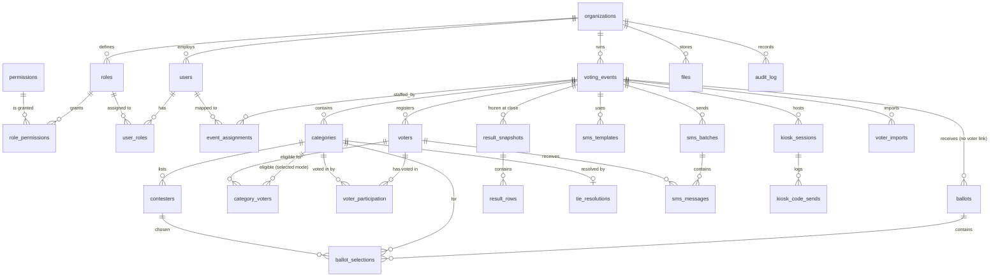
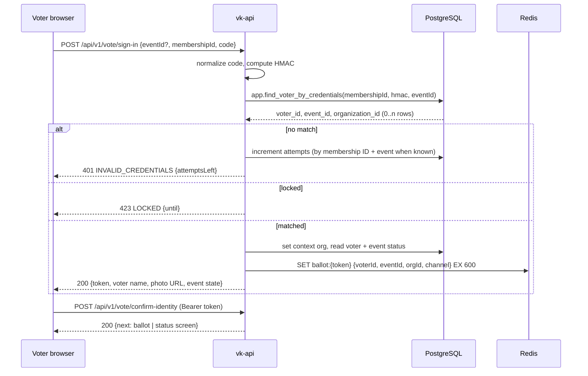

# Vote-Kidigit — Backend Schema (V1)

Nov 3, 2026 · @Smartone

**Change log**

| Date | Change |
|---|---|
| 10 Nov 2026 | SMS provider is Beem Africa instead of NextSMS (owner decision, Implementation Plan step 21): delivery reports arrive at POST /webhooks/beem/dlr checked with BEEM_DLR_SECRET; provider_message_id holds the Beem request id; sms_sender_id is the sender ID registered with Beem. |
| 5 Nov 2026 | Added 4.10 platform_settings (PLT-04 needed storage for the default session timeout, USSD short code and support contact; migration 009_platform_settings, Implementation Plan step 12). |
| 5 Nov 2026 | Added GET /users/roles (12.4): the invite and edit forms of USR-02/03 need the role list, which GET /roles keeps for roles.manage; each role says whether the caller may give it (Implementation Plan step 14). |
| 5 Nov 2026 | Step 15 clarifications (migrations 011, 012): app.category_is_votable() is also false once now() >= the event's end_at (hard close, PRD 4.3 rule 4), before the scheduler closes the event; app.transition_event() refuses to open an event whose end_at has passed, refuses any move of a deactivated event (PRD 4.3 rule 3), raises VALIDATION_FAILED for a missing or short cancel reason and NOT_FOUND for another organization's event; outside Draft results_visibility may also change (12.5); a category_voters row must link a voter and a category of the same event (NOT_FOUND otherwise); the guard triggers do not restrict vk_owner. |

## 1. Overview

This document defines the complete backend data model for Vote-Kidigit V1: every PostgreSQL table, relationship, enum, Row Level Security (RLS) policy, database function and trigger, the authentication and authorization flows, and the API endpoints. It implements the PRD (V1.1) and App Flow Document (V1) on the stack in the Tech Stack document (V1): PostgreSQL 18.6, Prisma ORM 7.10.1, NestJS 11.2.8, Redis 7.2. Place it in the repository as docs/BACKEND_SCHEMA.md.

### 1.1 How the parts fit

| Layer | Where it lives | Enforces |
|---|---|---|
| Tables, columns, relations, indexes, enums | apps/api/prisma/schema.prisma | Structure |
| RLS policies, roles, grants, functions, triggers | Raw SQL migrations in apps/api/prisma/migrations/*/migration.sql (added with prisma migrate dev --create-only, then edited) | Tenant isolation, secret ballot, immutability, hard close |
| Permission checks, validation, workflows | NestJS guards and services | Business rules, user-facing errors |
| Sessions, ballot tokens, rate limits, USSD state, live counters | Redis | Short-lived state |

The database is the **last line of defence**: every rule that protects the election result (one vote per voter per category, no votes after close, ballots never linked to voters, nothing edited after the fact) is enforced in PostgreSQL even if application code is wrong.

### 1.2 Conventions

| Item | Rule |
|---|---|
| Naming | Tables plural snake_case (voting_events); columns snake_case; Prisma models singular PascalCase with @@map / @map |
| Primary keys | id uuid DEFAULT uuidv7() (time-ordered, PostgreSQL 18 built-in). Exception: ballot.ballots.id uses gen_random_uuid() (v4) so ballot IDs carry no time order. |
| Time | timestamptz, stored in UTC. Event times are entered in the organization's time zone and converted by the API. |
| Standard columns | created_at timestamptz NOT NULL DEFAULT now(), updated_at timestamptz NOT NULL DEFAULT now() (trigger-maintained) on every mutable table |
| Soft delete | deleted_at timestamptz NULL on organizations, users, voting_events, voters. Queries exclude soft-deleted rows; unique indexes are partial (WHERE deleted_at IS NULL). Draft-only items (categories, contesters, category eligibility) are hard-deleted. |
| Tenant column | Every organization-owned table has organization_id uuid NOT NULL (even when derivable through a parent), so RLS policies are simple and indexed |
| Fixed lists | PostgreSQL enums (section 3) |
| Money | Not used in V1 |
| JSON | jsonb only for audit before/after values, SMS template placeholders and import error details |

### 1.3 Rules for Claude Code

1. Create tables only through Prisma migrations; add RLS, functions, triggers and grants as SQL in the same migration that creates the table.
2. Every table with organization_id gets RLS enabled with the policies in section 10 in its creating migration. A table without a policy is a failed review.
3. Never write to ballot.* or voter_participation except through app.cast_ballot() (section 11.4). Never read ballot.* except through app.tally_event().
4. Never add a column to ballot.* that identifies a voter, code, phone, device, IP address, channel or exact time.
5. Every request that touches the database runs inside PrismaService.withContext(ctx, fn), which opens a transaction and sets the request context (section 2.3) before running fn.

## 2. Database layout

One PostgreSQL database, vote_kidigit, with four schemas and three login roles. The API never connects as a role that can bypass RLS or read ballots.

### 2.1 Schemas

| Schema | Contents | Who can touch it |
|---|---|---|
| public | All application tables except ballots and audit | vk_api (with RLS), vk_readonly (read) |
| ballot | ballots, ballot_selections | **Nobody directly.** Only the SECURITY DEFINER functions app.cast_ballot() (insert) and app.tally_event() (aggregate read), owned by vk_owner |
| audit | audit_log | vk_api: INSERT and SELECT (with RLS), never UPDATE or DELETE; vk_readonly: SELECT |
| app | Helper functions, triggers, context functions | vk_api: EXECUTE on listed functions |

Prisma: datasource db { schemas = ["public", "ballot", "audit"] } with @@schema(...) on each model. Ballot models exist in Prisma only so migrations create them; application code must not query them (rule 1.3.3).

### 2.2 Database roles

| Role | Login | Attributes | Used by | Privileges |
|---|---|---|---|---|
| vk_owner | Yes | Owns all schemas, tables, functions | prisma migrate deploy only (MIGRATION_DATABASE_URL) | Everything on its objects |
| vk_api | Yes | NOBYPASSRLS, not owner of any table | vk-api and vk-worker (DATABASE_URL) | SELECT, INSERT, UPDATE, DELETE on public tables (minus revocations in 10.4); INSERT and SELECT on audit.audit_log; no privileges on ballot; EXECUTE on functions in app |
| vk_readonly | Yes | BYPASSRLS, read only | Ad-hoc support queries, reporting | SELECT on public and audit; **no** privileges on ballot; no access to voters.code_hmac (column revoked) |

Backups run as the postgres superuser with pg_dump (Tech Stack 9.8). RLS is **enabled but not forced** on every tenant table: vk_api is always filtered, while vk_owner (used only by migrations and as the owner of the SECURITY DEFINER functions) is exempt, so those functions must filter by organization themselves.

### 2.3 Request context

Every database call runs in a transaction that first sets transaction-local settings, read by RLS policies through helper functions:

```sql
SELECT set_config('app.org_id', $1, true),           -- '' for platform-wide requests
       set_config('app.user_id', $2, true),          -- '' for voter / system requests
       set_config('app.is_platform_admin', $3, true),-- 'true' | 'false'
       set_config('app.request_id', $4, true);       -- for audit correlation
```

| Request type | app.org_id | app.user_id | app.is_platform_admin |
|---|---|---|---|
| Staff request | Staff user's organization | Staff user | false |
| Platform Super Admin request | Selected organization, or '' for platform lists | Platform admin | true |
| Voter / kiosk / USSD request | Organization of the event (resolved first, 2.4) | '' | false |
| Worker job | organization_id carried in the job payload | User who triggered it, or '' | false |
| Public results | Resolved from the token (2.4) | '' | false |

### 2.4 Context bootstrap functions

Some requests arrive before the organization is known. These SECURITY DEFINER functions (owned by vk_owner, search_path pinned) return only the minimum needed to set the context; they are the only cross-tenant reads vk_api can make.

| Function | Returns | Used by |
|---|---|---|
| app.resolve_event(p_event_id uuid) | organization_id, status | /vote/{eventId} pages, kiosk |
| app.find_voter_by_credentials(p_membership_id text, p_code_hmac bytea, p_event_id uuid DEFAULT NULL) | Rows of voter_id, event_id, organization_id | Voter sign-in on web, kiosk, USSD |
| app.find_voter_for_kiosk(p_event_id uuid, p_membership_id text) | voter_id, organization_id, has_phone | Kiosk send-code step |
| app.resolve_results_token(p_token text) | event_id, organization_id | Public results page |
| app.resolve_sms_message(p_provider_message_id text) | sms_message_id, organization_id | Beem delivery-report webhook |
| app.due_transitions(p_now timestamptz) | Rows of event_id, category_id, organization_id, action | Worker 1-minute sweep |

### 2.5 Entity-relationship diagram



The one deliberate gap: there is **no relationship between** **voters** **/** **voter_participation** **and** **ballots**. That missing link is the secret ballot.

## 3. Enums

All fixed lists are PostgreSQL enums in the public schema, mirrored as Prisma enums and as Zod enums in packages/shared.

| Enum | Values |
|---|---|
| org_status | active, suspended |
| user_status | invited, active, deactivated |
| assignment_type | moderator, observer |
| event_status | draft, scheduled, open, closed, results_published, cancelled, archived |
| results_visibility | full, winners_only |
| category_manual_state | auto, open, closed (auto = follow opens_at / closes_at) |
| selection_mode | exact, range |
| winner_rule | plurality, threshold |
| eligibility_mode | all, selected |
| contester_status | active, withdrawn |
| gender | male, female |
| code_status | not_sent, sent, delivered, failed |
| vote_channel | web, ussd, kiosk (stored on participation only, never on ballots) |
| choice_kind | contester, yes, no, skipped |
| tie_outcome | contester, no_winner |
| message_type | code_delivery, reminder_before_open, voting_open, reminder_before_close, vote_confirmation, results_published, event_cancelled, event_extended |
| message_channel | sms, email |
| message_status | queued, sent, delivered, failed |
| batch_audience | all, not_sent, failed, not_voted, single |
| batch_status | queued, sending, paused, completed, cancelled |
| import_status | uploaded, validated, importing, completed, failed, abandoned |
| report_type | results_pdf, voters_pdf, voters_xlsx, audit_xlsx |
| job_status | queued, running, completed, failed |
| file_kind | org_logo, category_picture, contester_photo, voter_photo, csv_import, report |
| actor_type | user, voter, system |

## 4. Tables: tenancy, identity and access

Standard columns (id, created_at, updated_at) are listed once here and implied in every table below unless stated otherwise. "FK" means foreign key; the ON DELETE rule follows in brackets.

### 4.1 organizations

| Column | Type | Null | Default | Notes |
|---|---|---|---|---|
| id | uuid | no | uuidv7() | PK |
| name | text | no |  | 2–120 characters |
| slug | text | no |  | Unique where deleted_at IS NULL; lowercase letters, digits, hyphens |
| logo_file_id | uuid | yes |  | FK files.id (set null) |
| primary_color | char(7) | yes |  | CHECK (primary_color ~ '^#[0-9A-F]{6}$'); original value, adjustment is computed (Design 3.4) |
| time_zone | text | no | 'Africa/Dar_es_Salaam' | IANA name, validated by the API |
| contact_email | text | yes |  |  |
| contact_phone | text | yes |  | E.164 (+255…) |
| sms_sender_id | text | yes |  | Sender ID registered with Beem Africa, max 11 characters |
| help_phone | text | yes |  | Shown on voter screens |
| session_timeout_minutes | smallint | no | 15 | CHECK (BETWEEN 5 AND 60) |
| archive_after_days | integer | no | 90 | Days after results publication before auto-archive |
| onboarding_dismissed_at | timestamptz | yes |  | Hides the setup checklist card |
| status | org_status | no | 'active' |  |
| created_at, updated_at | timestamptz | no | now() |  |
| deleted_at | timestamptz | yes |  | Soft delete |

### 4.2 users (staff accounts)

| Column | Type | Null | Default | Notes |
|---|---|---|---|---|
| organization_id | uuid | yes |  | FK organizations.id (restrict). NULL only for Platform Super Admins. |
| email | text | no |  | As typed |
| email_normalized | text | no | generated: lower(trim(email)) | Unique where deleted_at IS NULL (one organization per account) |
| full_name | text | no |  |  |
| phone | text | yes |  | E.164 |
| password_hash | text | yes |  | Argon2id; NULL until the invitation is accepted |
| status | user_status | no | 'invited' |  |
| is_platform_admin | boolean | no | false | CHECK (is_platform_admin = (organization_id IS NULL)) |
| is_org_super_admin | boolean | no | false | Cannot be restricted or deleted by other admins; at least one per organization (trigger 11.3) |
| language | text | no | 'sw' | CHECK (language IN ('sw','en')) |
| theme_preference | text | no | 'system' | CHECK (theme_preference IN ('system','light','dark')) |
| failed_login_count | smallint | no | 0 | Reset on success |
| locked_until | timestamptz | yes |  | 15-minute lock after 5 failures |
| last_login_at | timestamptz | yes |  |  |
| password_changed_at | timestamptz | yes |  |  |
| deleted_at | timestamptz | yes |  | Soft delete |

### 4.3 password_history

| Column | Type | Null | Notes |
|---|---|---|---|
| user_id | uuid | no | FK users.id (cascade) |
| organization_id | uuid | yes | Copied from user, for RLS |
| password_hash | text | no | Argon2id; the API keeps the latest 5 per user and deletes older rows |

### 4.4 user_tokens (invitations and password resets)

| Column | Type | Null | Notes |
|---|---|---|---|
| user_id | uuid | no | FK users.id (cascade) |
| organization_id | uuid | yes | For RLS |
| purpose | text | no | CHECK (purpose IN ('invite','password_reset')) |
| token_hash | bytea | no | SHA-256 of the random 32-byte token sent by email; unique |
| expires_at | timestamptz | no | Invite: +48 h; reset: +60 min |
| used_at | timestamptz | yes | Set once; a used or expired token is rejected |
| created_by | uuid | yes | FK users.id (set null) |

### 4.5 permissions (global catalogue)

| Column | Type | Null | Notes |
|---|---|---|---|
| key | text | no | PK, e.g. event.publish (catalogue in 9.1) |
| module | text | no | Group shown in the role editor |
| description_en, description_sw | text | no | Shown in the role editor |
| is_fixed_for_super_admin | boolean | no | Cannot be removed from the Org Super Admin role |
| scope | text | no | CHECK (scope IN ('org','event','platform')): event permissions also require an event mapping for moderators and observers |

No id, organization_id or timestamps. Seeded by migration; vk_api has SELECT only.

### 4.6 roles

| Column | Type | Null | Notes |
|---|---|---|---|
| organization_id | uuid | no | FK (cascade) |
| name | text | no | Unique per organization |
| description | text | yes |  |
| system_key | text | yes | org_super_admin, admin, moderator, observer for the four default roles (unique per organization); NULL for custom roles |
| is_system | boolean | no | Default roles cannot be deleted or renamed |

The four default roles are created for every new organization by app.create_default_roles(org_id) (11.6).

### 4.7 role_permissions

| Column | Type | Null | Notes |
|---|---|---|---|
| role_id | uuid | no | FK roles.id (cascade) |
| permission_key | text | no | FK permissions.key (restrict) |
| organization_id | uuid | no | For RLS |

PK (role_id, permission_key). No id.

### 4.8 user_roles

| Column | Type | Null | Notes |
|---|---|---|---|
| user_id | uuid | no | FK users.id (cascade); unique (one role per user in V1) |
| role_id | uuid | no | FK roles.id (restrict: a role in use cannot be deleted) |
| organization_id | uuid | no | For RLS |

PK (user_id, role_id).

### 4.9 event_assignments

| Column | Type | Null | Notes |
|---|---|---|---|
| organization_id | uuid | no | For RLS |
| event_id | uuid | no | FK voting_events.id (cascade) |
| user_id | uuid | no | FK users.id (cascade) |
| type | assignment_type | no | moderator or observer |
| created_by | uuid | yes | FK users.id (set null) |

Unique (event_id, user_id). A moderator who creates an event is assigned automatically by the API in the same transaction.

### 4.10 platform_settings

One row (id = 1) of platform-wide settings, edited on PLT-04. A platform table: no organization_id. Who changed what is in the audit log (platform.settings.update).

| Column | Type | Null | Default | Notes |
|---|---|---|---|---|
| id | smallint | no | 1 | PK; CHECK (id = 1) |
| default_session_timeout_minutes | smallint | no | 15 | CHECK (BETWEEN 5 AND 60); copied to organizations.session_timeout_minutes when an organization is created |
| ussd_short_code | text | yes |  | Shown on voter screens; NULL falls back to USSD_SHORT_CODE |
| support_phone | text | yes |  | E.164; support contact shown on voter screens |
| support_email | text | yes |  |  |
| created_at, updated_at | timestamptz | no | now() |  |

RLS: SELECT for every vk_api context; UPDATE only when app.is_platform_admin(). Grants: vk_api SELECT, UPDATE (no INSERT or DELETE: the row is seeded by the migration); vk_readonly SELECT. Default SMS templates of PLT-04 live in sms_templates (7.1).

## 5. Tables: events, categories, contesters, voters

These tables hold everything a moderator sets up. Once an event leaves Draft, triggers (11.2) lock the setup columns.

### 5.1 voting_events

| Column | Type | Null | Default | Notes |
|---|---|---|---|---|
| organization_id | uuid | no |  | FK (restrict) |
| name | text | no |  | 2–150 characters |
| start_at | timestamptz | no |  |  |
| end_at | timestamptz | no |  | CHECK (end_at > start_at) |
| status | event_status | no | 'draft' | Changes only through app.transition_event() (11.5) |
| is_active | boolean | no | true | Deactivated events are hidden from non-admins; cannot be false while status = 'open' |
| show_party | boolean | no | false |  |
| results_visibility | results_visibility | no | 'full' |  |
| reminder_before_open_hours | smallint | yes | 24 | NULL = off |
| reminder_before_close_minutes | smallint | yes | 60 | NULL = off |
| public_results_token | text | yes |  | 32-character URL-safe random string, created at results publication; unique |
| public_results_enabled | boolean | no | true | "Disable link" sets false |
| first_code_sent_at | timestamptz | yes |  | Set by the first code SMS; after this, Unpublish to Draft is blocked |
| opened_at, closed_at, results_published_at, cancelled_at, archived_at | timestamptz | yes |  | Set by app.transition_event() |
| cancel_reason | text | yes |  | Required when cancelled |
| reopen_count | smallint | no | 0 | Incremented by each reopen / extend |
| created_by | uuid | yes |  | FK users.id (set null) |
| deleted_at | timestamptz | yes |  | Soft delete (Draft or Cancelled only) |

### 5.2 categories

| Column | Type | Null | Default | Notes |
|---|---|---|---|---|
| organization_id | uuid | no |  |  |
| event_id | uuid | no |  | FK voting_events.id (cascade) |
| name | text | no |  | 1–100 characters; unique per event |
| picture_file_id | uuid | yes |  | FK files.id (set null) |
| display_order | integer | no |  | Unique per event (DEFERRABLE INITIALLY DEFERRED so reordering can swap values) |
| is_active | boolean | no | true |  |
| opens_at | timestamptz | yes |  | Must be within the event window (trigger 11.2) |
| closes_at | timestamptz | yes |  | CHECK (closes_at IS NULL OR opens_at IS NULL OR closes_at > opens_at) |
| manual_state | category_manual_state | no | 'auto' | Staff Open / Close switch |
| closed_at | timestamptz | yes |  | Set the first time the category actually closes; a closed category never reopens unless the whole event is reopened by an Admin |
| selection_mode | selection_mode | no | 'exact' |  |
| exact_count | smallint | yes | 1 | Required when exact, ≥ 1 |
| min_count, max_count | smallint | yes |  | Required when range; 1 ≤ min_count ≤ max_count |
| seats | smallint | no | 1 | ≥ 1 |
| allow_skip | boolean | no | false |  |
| winner_rule | winner_rule | no | 'plurality' |  |
| threshold_pct | numeric(5,2) | yes |  | Required when threshold; > 0 AND <= 100 |
| quorum_pct | numeric(5,2) | yes |  | NULL = no quorum |
| eligibility | eligibility_mode | no | 'all' |  |

A category is **votable now** when: event status = 'open', is_active, closed_at IS NULL, and either manual_state = 'open', or manual_state = 'auto' and (opens_at IS NULL OR opens_at <= now()) and (closes_at IS NULL OR now() < closes_at). This expression lives in one SQL function, app.category_is_votable(category_id), used by the ballot function and the API.

A category with exactly one active contester is a Yes/No vote; this is derived, not stored.

### 5.3 contesters

| Column | Type | Null | Default | Notes |
|---|---|---|---|---|
| organization_id | uuid | no |  |  |
| event_id | uuid | no |  | Copied from the category, for checks |
| category_id | uuid | no |  | FK categories.id (cascade) |
| full_name | text | no |  | 1–120 characters |
| party | text | yes |  | Shown only when show_party |
| photo_file_id | uuid | yes |  | FK files.id (set null) |
| ussd_short_name | text | yes |  | Max 20 characters |
| status | contester_status | no | 'active' | Withdrawal only while the event is Draft or Scheduled |
| withdrawn_at | timestamptz | yes |  |  |

### 5.4 voters

| Column | Type | Null | Default | Notes |
|---|---|---|---|---|
| organization_id | uuid | no |  |  |
| event_id | uuid | no |  | FK voting_events.id (restrict) |
| full_name | text | no |  |  |
| membership_id | text | no |  | As provided |
| membership_id_normalized | text | no | generated: upper(regexp_replace(membership_id, '\s', '', 'g')) | Unique per event where deleted_at IS NULL |
| phone | text | no |  | E.164 (+2557XXXXXXXX) |
| email | text | yes |  |  |
| gender | gender | no |  |  |
| photo_file_id | uuid | yes |  | FK files.id (set null) |
| code_hmac | bytea | yes |  | HMAC-SHA256(server key, normalized code); not tied to the event so the generic /vote sign-in can find the voter, with the membership ID narrowing the match. Unique per event. The plain code exists only in memory while the SMS is sent. Column hidden from vk_readonly. |
| code_status | code_status | no | 'not_sent' |  |
| code_generated_at | timestamptz | yes |  |  |
| code_last_sent_at | timestamptz | yes |  |  |
| failed_attempts | smallint | no | 0 | Shared across web, kiosk and USSD |
| locked_until | timestamptz | yes |  | 15 minutes after 5 failures |
| deleted_at | timestamptz | yes |  | Soft delete (Draft only) |

Indexes: (event_id, membership_id_normalized) unique partial; (event_id, code_hmac) unique partial (WHERE code_hmac IS NOT NULL AND deleted_at IS NULL); (event_id, code_status); (organization_id, phone).

**Code generation** (in the API, never in SQL, because the HMAC key must stay out of the database): 8 characters from ABCDEFGHJKMNPQRSTUVWXYZ23456789 using crypto.randomInt; insert retries on unique conflict. Regenerating replaces code_hmac, so the old code stops working immediately.

**Additional column** **code_ciphertext bytea NULL** on voters: the code encrypted with AES-256-GCM (Node crypto, key CODE_ENCRYPTION_KEY, separate from the HMAC key, never stored in the database). It exists only so "Resend code" (PRD COD-05) and the kiosk can re-send the same code. Only the SMS worker decrypts it; no API endpoint returns it, and it is revoked from vk_readonly. Regenerating replaces both code_hmac and code_ciphertext. This refines PRD COD-02 ("stored hashed"): the code is fingerprinted for lookup and encrypted for re-sending, and staff can never view it.

### 5.5 category_voters (eligibility when eligibility = 'selected')

| Column | Type | Null | Notes |
|---|---|---|---|
| category_id | uuid | no | FK (cascade) |
| voter_id | uuid | no | FK (cascade) |
| organization_id | uuid | no | For RLS |

PK (category_id, voter_id); index (voter_id). A voter is eligible for a category when the category's eligibility = 'all', or a row exists here. Function: app.voter_is_eligible(voter_id, category_id).

## 6. Tables: participation, ballots and results

Who voted and what was voted are stored in two places that never reference each other. Participation lives in public; ballots live in the locked ballot schema.

### 6.1 voter_participation (who has voted, per category)

| Column | Type | Null | Notes |
|---|---|---|---|
| voter_id | uuid | no | FK voters.id (restrict) |
| category_id | uuid | no | FK categories.id (restrict) |
| event_id | uuid | no | For turnout queries |
| organization_id | uuid | no | For RLS |
| channel | vote_channel | no | For the control room's per-channel counts |
| voted_at | timestamptz | no | Shown to the voter ("Ulipiga kura saa 10:42") |

PK (voter_id, category_id) — the database-level guarantee of one vote per voter per category. Index (event_id, category_id) for turnout. No id, no updated_at; rows are never updated or deleted (trigger 11.1).

### 6.2 ballot.ballots

| Column | Type | Null | Default | Notes |
|---|---|---|---|---|
| id | uuid | no | gen_random_uuid() | Random v4, no time order |
| event_id | uuid | no |  | FK voting_events.id (restrict) |
| received_hour | timestamptz | no |  | date_trunc('hour', now()) — the only time stored |

No created_at, updated_at, organization_id, voter, code, channel, IP or device column. One row per submission (a voter who returns for a later category produces a second ballot). The table has no index on received_hour and no clustering, so physical order cannot be relied on to infer submission order.

### 6.3 ballot.ballot_selections

| Column | Type | Null | Default | Notes |
|---|---|---|---|---|
| id | uuid | no | gen_random_uuid() |  |
| ballot_id | uuid | no |  | FK ballot.ballots.id (restrict) |
| category_id | uuid | no |  | FK categories.id (restrict) |
| contester_id | uuid | yes |  | FK contesters.id (restrict); NULL only when choice = 'skipped' |
| choice | choice_kind | no |  | contester (normal vote), yes / no (single-contester category; contester_id = that contester), skipped |

UNIQUE NULLS NOT DISTINCT (ballot_id, category_id, contester_id); CHECK ((choice = 'skipped') = (contester_id IS NULL)). Index (category_id, contester_id) for tallying.

### 6.4 result_snapshots

Frozen results, created by app.freeze_results() (11.7) when an event closes. A reopened and re-closed event gets a new version; only the latest is current.

| Column | Type | Null | Notes |
|---|---|---|---|
| organization_id | uuid | no |  |
| event_id | uuid | no | FK (restrict) |
| version | smallint | no | 1, 2, …; unique (event_id, version) |
| is_current | boolean | no | Exactly one current per event (partial unique index WHERE is_current) |
| generated_at | timestamptz | no |  |
| registered_voters | integer | no |  |
| voters_voted | integer | no | Distinct voters in voter_participation |
| content_hash | char(64) | no | SHA-256 (hex) of the canonical JSON of the snapshot's stats and rows; printed on the PDF and public page |
| published_at | timestamptz | yes | Set when results are published |

### 6.5 result_category_stats

| Column | Type | Null | Notes |
|---|---|---|---|
| snapshot_id | uuid | no | FK (cascade) |
| organization_id | uuid | no |  |
| category_id | uuid | no | FK (restrict) |
| eligible_voters | integer | no |  |
| voters_voted | integer | no |  |
| valid_votes | integer | no | Selections excluding skipped |
| skipped | integer | no |  |
| quorum_met | boolean | yes | NULL when no quorum set |
| threshold_met | boolean | yes | NULL when plurality |
| has_tie | boolean | no | A tie affects who takes the last seat |

PK (snapshot_id, category_id).

### 6.6 result_rows

| Column | Type | Null | Notes |
|---|---|---|---|
| snapshot_id | uuid | no | FK (cascade) |
| organization_id | uuid | no |  |
| category_id | uuid | no |  |
| contester_id | uuid | no |  |
| choice | choice_kind | no | contester, or yes / no for single-contester categories (two rows) |
| votes | integer | no |  |
| percent | numeric(5,1) | no | Of valid votes in the category |
| rank | smallint | no | 1 = most votes; equal votes share a rank |
| is_winner | boolean | no | After rules and tie resolution |

PK (snapshot_id, category_id, contester_id, choice).

### 6.7 tie_resolutions

| Column | Type | Null | Notes |
|---|---|---|---|
| organization_id | uuid | no |  |
| snapshot_id | uuid | no | FK (cascade) |
| category_id | uuid | no | Unique (snapshot_id, category_id) |
| outcome | tie_outcome | no | contester or no_winner |
| winner_contester_ids | uuid[] | yes | Required when outcome = 'contester'; length ≤ remaining seats |
| reason | text | no | At least 10 characters |
| resolved_by | uuid | no | FK users.id (restrict) |
| resolved_at | timestamptz | no |  |

Publishing results is refused by app.transition_event() while any has_tie category in the current snapshot lacks a resolution.

## 7. Tables: messaging, kiosk, files, imports, reports and audit

These tables support the election without holding votes. Short-lived state stays in Redis (7.8).

### 7.1 sms_templates

| Column | Type | Null | Notes |
|---|---|---|---|
| organization_id | uuid | no |  |
| event_id | uuid | yes | NULL = organization default; event templates override |
| type | message_type | no |  |
| channel | message_channel | no | sms or email |
| language | text | no | 'sw' (voter messages are Swahili only) |
| subject | text | yes | Email only |
| body | text | no | With placeholders such as {voter_name}, {voting_code} (PRD SMS-03); validated against the allowed list |

Unique (organization_id, event_id, type, channel) NULLS NOT DISTINCT. Platform defaults are seeded into each new organization.

### 7.2 sms_batches (one send action)

| Column | Type | Null | Notes |
|---|---|---|---|
| organization_id | uuid | no |  |
| event_id | uuid | no | FK (restrict) |
| type | message_type | no |  |
| channel | message_channel | no |  |
| audience | batch_audience | no |  |
| status | batch_status | no | Paused automatically when failures exceed 20% |
| total_count, sent_count, delivered_count, failed_count | integer | no | Counters updated by the worker |
| paused_reason | text | yes |  |
| created_by | uuid | yes | NULL for scheduled reminders |
| started_at, completed_at | timestamptz | yes |  |

### 7.3 sms_messages (each SMS or email)

| Column | Type | Null | Notes |
|---|---|---|---|
| organization_id | uuid | no |  |
| event_id | uuid | no |  |
| batch_id | uuid | yes | FK sms_batches.id (set null) |
| voter_id | uuid | yes | FK voters.id (set null); NULL for staff emails |
| channel | message_channel | no |  |
| type | message_type | no |  |
| to_address | text | no | Phone (E.164) or email |
| body_redacted | text | no | Final text with the voting code replaced by ••••-••••; the real code is never stored |
| provider_message_id | text | yes | Beem request id of this message; unique |
| status | message_status | no |  |
| attempts | smallint | no | Up to 3 automatic retries |
| last_error | text | yes | Provider error text |
| sent_at, delivered_at, failed_at | timestamptz | yes |  |

Indexes: (batch_id, status), (voter_id, created_at DESC), provider_message_id unique.

### 7.4 kiosk_sessions

| Column | Type | Null | Notes |
|---|---|---|---|
| organization_id | uuid | no |  |
| event_id | uuid | no | FK (restrict) |
| device_label | text | no | e.g. "Ukumbi A – Tablet 2" |
| token_hash | bytea | no | SHA-256 of the kiosk session token in the device URL; unique |
| pin_hash | text | no | Argon2id of the 4–6 digit staff PIN |
| launched_by | uuid | no | FK users.id (restrict) |
| started_at | timestamptz | no |  |
| last_seen_at | timestamptz | yes | Heartbeat every 60 s |
| ended_at | timestamptz | yes |  |
| ended_by | uuid | yes |  |

### 7.5 kiosk_code_sends

| Column | Type | Null | Notes |
|---|---|---|---|
| organization_id | uuid | no |  |
| event_id | uuid | no |  |
| kiosk_session_id | uuid | no | FK (restrict) |
| voter_id | uuid | no | FK (restrict) |
| used_alternate_phone | boolean | no |  |
| alternate_phone_hmac | bytea | yes | HMAC of the other phone number, used only to enforce the 3-voters-per-number limit; the number itself is not stored |
| alternate_phone_last3 | char(3) | yes | Shown in the audit log |
| sms_message_id | uuid | yes | FK sms_messages.id (set null) |

Trigger 11.8 rejects a fourth distinct voter for the same (event_id, alternate_phone_hmac).

### 7.6 files

| Column | Type | Null | Notes |
|---|---|---|---|
| organization_id | uuid | no |  |
| kind | file_kind | no |  |
| storage_path | text | no | Relative to STORAGE_DIR, e.g. org/{orgId}/contesters/{uuid}.jpg; unique |
| original_name | text | yes |  |
| mime_type | text | no | image/jpeg, image/png, text/csv, application/pdf, application/vnd.openxmlformats-officedocument.spreadsheetml.sheet |
| size_bytes | integer | no |  |
| width, height | integer | yes | Images |
| sha256 | char(64) | no |  |
| created_by | uuid | yes |  |

Files are served only through GET /api/v1/files/:id after a permission and organization check; never from the web root.

### 7.7 voter_imports and report_jobs

voter_imports: organization_id, event_id, file_id, status (import_status), total_rows, valid_rows, warning_rows, error_rows, errors jsonb (array of {row, field, code, message}), column_mapping jsonb, created_by, completed_at.

report_jobs: organization_id, event_id (nullable for audit exports), type (report_type), status (job_status), file_id (nullable until done), requested_by, error, completed_at.

### 7.8 audit.audit_log

| Column | Type | Null | Notes |
|---|---|---|---|
| id | uuid | no | uuidv7() |
| organization_id | uuid | yes | NULL for platform actions |
| actor_type | actor_type | no |  |
| actor_user_id | uuid | yes | No FK, so history survives user deletion |
| actor_label | text | no | Name and email at the time, or "System", or "Voter" |
| event_id | uuid | yes |  |
| action | text | no | Dotted key, usually the permission used, e.g. event.publish, voter.code.regenerate, voter.login.failed |
| entity_type | text | no | Table name |
| entity_id | uuid | yes |  |
| before, after | jsonb | yes | Changed columns only; secrets and codes excluded by the API's redaction list |
| reason | text | yes | Close, cancel, reopen, tie reasons |
| ip | inet | yes |  |
| user_agent | text | yes |  |
| request_id | text | yes |  |
| created_at | timestamptz | no | now() |

Indexes: (organization_id, created_at DESC), (event_id, created_at DESC), (actor_user_id, created_at DESC), (action). Append-only (trigger 11.1 and grants). Voter actions are logged with actor_type = 'voter' and the voter ID only for sign-in events (failed attempts, lockouts, "Not me") — never for ballot submission.

### 7.9 Redis keys (not in PostgreSQL)

| Key | Value | Lifetime |
|---|---|---|
| sess:{sid} | Staff session (user ID, organization ID, CSRF secret) | 15 min rolling (organization setting) |
| ballot:{token} | Voter ID, event ID, organization ID, channel, categories offered | 10 min idle |
| ussd:{sessionId} | USSD step, voter ID, choices so far | 180 s |
| kiosk:{tokenHash} | Kiosk session ID, event ID | Until ended |
| turnout:{eventId} | Hash: total and per-category counts, incremented after each ballot | Until archive |
| rl:{scope}:{key} | Rate-limit counters (throttler) | Per window |
| bull:* | BullMQ queues: sms, email, reports, imports, schedule | Managed by BullMQ |

## 8. Authentication flows

Staff authenticate with email and password and get a server session in Redis. Voters authenticate with membership ID plus voting code and get a short-lived ballot token. Kiosk devices hold a kiosk session started by a staff member.

### 8.1 Staff sign-in

1. POST /api/v1/auth/login with {email, password}; rate-limited to 10 per minute per IP.
2. API finds the user by email_normalized (bootstrap read with app.is_platform_admin = 'false' and no org: done through app.find_user_for_login(email), a SECURITY DEFINER function returning id, organization_id, password_hash, status, locked_until, failed_login_count).
3. Rejections, all returning the same 401 INVALID_CREDENTIALS text except where noted: unknown email; wrong password (increments failed_login_count, sets locked_until = now() + 15 min at 5, returns 423 ACCOUNT_LOCKED with the unlock time); status = 'deactivated' (403 ACCOUNT_INACTIVE); organization suspended (403 ORG_SUSPENDED).
4. On success: reset counters, set last_login_at, regenerate the session ID, store {userId, orgId, isPlatformAdmin, csrf} in sess:{sid}, set cookie vk.sid (HttpOnly; Secure; SameSite=Strict; Path=/), audit auth.login.
5. Response: the user profile, role, permission keys and mapped event IDs (GET /api/v1/me returns the same later).

**Every staff request:** the session middleware loads the session; a guard re-reads the user's status, role and permissions from PostgreSQL (cached in Redis for 30 s, invalidated on any change to that user, role or assignment), so deactivation or a permission change takes effect within 30 s and logs the user out on the next request. State-changing requests must send header X-CSRF-Token matching the session's csrf value.

**Idle timeout:** the session TTL is the organization's session_timeout_minutes, refreshed on each request. The staff app shows the warning dialog 60 s before expiry using the expiresAt value returned in a response header X-Session-Expires.

**Sign-out:** POST /api/v1/auth/logout destroys the session and clears the cookie.

### 8.2 Invitation and password reset

| Step | Invitation | Password reset |
|---|---|---|
| Create | Admin calls POST /users; API creates the user (status = 'invited') and a user_tokens row (purpose = 'invite', 48 h), emails /app/invite/{token} | POST /auth/forgot always returns 202; if the email exists, creates a password_reset token (60 min) and emails /app/reset/{token} |
| Open link | GET /auth/tokens/{token} checks hash, expiry and used_at; returns organization name and the user's name | Same |
| Submit | POST /auth/invite/accept with {token, fullName, password}: validates policy, sets password_hash, status = 'active', marks token used, signs the user in | POST /auth/reset with {token, password}: validates policy and last 5 passwords, sets hash, marks token used, destroys all the user's sessions |
| Errors | 410 TOKEN_EXPIRED, 409 TOKEN_USED, 422 PASSWORD_POLICY | Same plus 422 PASSWORD_REUSED |

Password policy (PRD USR-06) is checked by a shared Zod schema in the API and the staff app.

### 8.3 Voter sign-in (web and kiosk)



| Rule | Detail |
|---|---|
| Attempts | 5 failures per voter (voters.failed_attempts) or per IP + membership ID (Redis) lock for 15 minutes; moderators see an alert after 3 lockouts in an event |
| Several events match | Only when eventId is absent: response 300 CHOOSE_EVENT with the event names; the client repeats sign-in with the chosen eventId |
| Token | 32 random bytes, base64url, sent as Authorization: Bearer; stored in Redis only; 10-minute idle expiry; deleted after submit, "Si mimi" or "Maliza" |
| "Si mimi" | POST /vote/not-me: audit voter.identity.rejected, delete token |
| Kiosk | Kiosk device sends X-Kiosk-Token; sign-in starts with POST /vote/kiosk/send-code {membershipId} (re-sends the existing code via code_ciphertext), then the normal sign-in; channel recorded as kiosk |
| Kiosk other phone | POST /vote/kiosk/send-code {membershipId, alternatePhone, staffPin}: verifies the PIN against kiosk_sessions.pin_hash, writes kiosk_code_sends, sends once to the other number |

### 8.4 Ballot submission

1. GET /api/v1/vote/ballot returns the open, eligible, not-yet-voted categories with contesters in a per-voter random order (shuffled server-side with a seed stored in the ballot token so a refresh keeps the order).
2. POST /api/v1/vote/ballot with {selections: [{categoryId, contesterIds: [], choice}]} after the review screen.
3. API validates shape with Zod, then calls SELECT app.cast_ballot(voter_id, event_id, selections_jsonb, channel) in the voter's context.
4. The function (11.4) re-checks everything inside one transaction and returns {recorded: [categoryIds], rejected: [{categoryId, reason}], votedAt}.
5. API increments turnout:{eventId} in Redis, deletes the ballot token, queues the vote-confirmation SMS, returns 200. Rejected categories (closed meanwhile) are shown with the App Flow message.

### 8.5 USSD

POST /ussd/{provider}/callback receives {sessionId, phoneNumber, text} (normalized by a small adapter per aggregator), verified by USSD_CALLBACK_SECRET. State per session in ussd:{sessionId}. Steps follow App Flow 9.1: membership ID → code → app.find_voter_by_credentials → identity → categories → review → app.cast_ballot(…, 'ussd'). Responses are plain text prefixed CON  (continue) or END  (finish), each under 182 characters. The caller's phone number is not required to match the voter's phone.

### 8.6 Platform Super Admin

Same login as staff. is_platform_admin = true users have no organization; the API sets app.is_platform_admin = 'true'. Platform screens list organizations with app.org_id = ''; opening an organization sets app.org_id to it (read-only except organization settings and suspension). Platform admins never get a voter context and have no path to ballot.*.

## 9. Authorization

A user may act when three things are true: their role has the permission, the target belongs to their organization (checked by the guard and again by RLS), and for event-scoped permissions they are mapped to the event or hold event.access_all. State rules (e.g. voters editable only in Draft) are then checked by the service and by triggers.

### 9.1 Permission catalogue (seed of permissions)

| Key | Scope | Module | Allows |
|---|---|---|---|
| roles.manage | org | Users | Create, edit, delete custom roles and set permissions (fixed for Org Super Admin) |
| admins.manage | org | Users | Invite, edit, deactivate, delete users with the Admin role |
| staff.manage | org | Users | Invite, edit, deactivate, delete moderators and observers |
| assignments.manage | org | Users | Map staff to events |
| org.settings.manage | org | Settings | Organization profile, branding, time zone, SMS sender, templates defaults |
| audit.view.org | org | Audit | Organization-wide audit log and export |
| event.create | org | Events | Create events |
| event.access_all | org | Events | Act on every event without being mapped (grants nothing by itself) |
| event.activate | event | Events | Activate / deactivate |
| event.reopen | event | Events | Reopen or extend a closed event |
| event.archive | event | Events | Archive |
| event.view | event | Events | View event workspace |
| event.edit | event | Events | Edit event details and settings (Draft) |
| event.publish | event | Events | Publish, Open now, Unpublish to Draft |
| event.close | event | Events | Close now; open/close categories manually |
| event.cancel | event | Events | Cancel |
| category.manage | event | Setup | Categories, rules, order, eligibility |
| contester.manage | event | Setup | Contesters, photos, withdrawal |
| voter.view | event | Voters | Voter list and details (phone masked) |
| voter.manage | event | Voters | Add, import, edit, delete voters; map to categories |
| messages.send | event | Messages | Edit event templates, send batches, resend codes |
| code.regenerate | event | Messages | Regenerate a voter's code |
| kiosk.operate | event | Kiosk | Launch and end kiosk sessions |
| turnout.view | event | Results | Live turnout and control room |
| results.view | event | Results | Results after close |
| results.resolve_tie | event | Results | Resolve ties |
| results.publish | event | Results | Publish results, enable/disable public link |
| reports.download | event | Results | Results PDF, voter reports |
| audit.view.event | event | Audit | Event activity tab |
| platform.orgs.manage | platform | Platform | Create, edit, suspend organizations |
| platform.settings.manage | platform | Platform | Platform settings |
| platform.audit.view | platform | Platform | Platform audit log |

### 9.2 Default roles (created per organization)

| Permission | Org Super Admin | Admin | Moderator | Observer |
|---|---|---|---|---|
| roles.manage | ✓ (fixed) |  |  |  |
| admins.manage | ✓ |  |  |  |
| staff.manage, assignments.manage, org.settings.manage, audit.view.org | ✓ | ✓ |  |  |
| event.access_all, event.activate, event.reopen, event.archive | ✓ | ✓ |  |  |
| event.create | ✓ | ✓ | ✓ |  |
| event.view, turnout.view, results.view, reports.download, audit.view.event, voter.view | ✓ | ✓ | ✓ | ✓ |
| event.edit, event.publish, event.close, event.cancel, category.manage, contester.manage, voter.manage, messages.send, code.regenerate, kiosk.operate, results.resolve_tie, results.publish | ✓ | ✓ | ✓ |  |

Platform permissions are not stored in roles: every is_platform_admin user has all three.

### 9.3 Guard algorithm (PermissionGuard)

```
for each request to a route decorated @RequirePermission(key):
  1. no valid session                                  -> 401 UNAUTHENTICATED
  2. user.status != active or org suspended            -> 401 (session destroyed)
  3. scope(key) == platform:  user.isPlatformAdmin ? allow : 404 NOT_FOUND
  4. key not in user.permissions                       -> 403 FORBIDDEN (buttons are greyed in UI)
  5. scope(key) == event:
       event = load :eventId within org context (RLS)  -> missing: 404 NOT_FOUND
       'event.access_all' in permissions OR assignment(user, event) exists ? allow : 404 NOT_FOUND
  6. allow; service checks state rules (409 with a code, e.g. EVENT_LOCKED)
```

Not-mapped and other-organization targets return 404, not 403, so their existence is not revealed (App Flow 3.7). Observers' assignments use type = 'observer'; their role simply lacks write permissions.

### 9.4 Server-enforced state rules

| Action | Allowed event status |
|---|---|
| Edit event, categories, contesters, rules, eligibility; add/edit/delete voters | draft |
| Withdraw contester | draft, scheduled |
| Send codes, reminders, resend, regenerate | scheduled, open (regenerate also draft for testing) |
| Unpublish to Draft | scheduled and first_code_sent_at IS NULL |
| Open category / close category manually | open |
| Launch kiosk | scheduled, open |
| Resolve ties | closed |
| Publish results | closed, no unresolved ties |
| Deactivate | any except open |

## 10. Row Level Security policies

Every tenant table is filtered by organization_id = app.current_org_id(); Platform Super Admins can read across organizations; the ballot schema has no policies at all, so nothing but its owner's functions can reach it. All SQL below goes in the migrations, run as vk_owner.

### 10.1 Roles, schemas and helpers

```sql
-- run once by the postgres superuser (deploy script), passwords from the server's secret store
CREATE ROLE vk_owner    LOGIN PASSWORD :'owner_pw';
CREATE ROLE vk_api      LOGIN PASSWORD :'api_pw' NOBYPASSRLS;
CREATE ROLE vk_readonly LOGIN PASSWORD :'ro_pw'  BYPASSRLS;
ALTER DATABASE vote_kidigit OWNER TO vk_owner;

-- first migration (as vk_owner)
CREATE SCHEMA IF NOT EXISTS app;
CREATE SCHEMA IF NOT EXISTS ballot;
CREATE SCHEMA IF NOT EXISTS audit;
REVOKE ALL ON SCHEMA ballot FROM PUBLIC;
GRANT USAGE ON SCHEMA public, app, audit TO vk_api, vk_readonly;

CREATE FUNCTION app.current_org_id() RETURNS uuid LANGUAGE sql STABLE AS
$$ SELECT NULLIF(current_setting('app.org_id', true), '')::uuid $$;
CREATE FUNCTION app.current_user_id() RETURNS uuid LANGUAGE sql STABLE AS
$$ SELECT NULLIF(current_setting('app.user_id', true), '')::uuid $$;
CREATE FUNCTION app.is_platform_admin() RETURNS boolean LANGUAGE sql STABLE AS
$$ SELECT coalesce(current_setting('app.is_platform_admin', true), 'false') = 'true' $$;
```

### 10.2 Standard tenant policy

Applied to every table with a non-null organization_id:

```sql
-- template: replace {t}
ALTER TABLE public.{t} ENABLE ROW LEVEL SECURITY;
-- not FORCE: vk_owner functions must see all rows (2.2)
CREATE POLICY {t}_tenant ON public.{t} FOR ALL TO vk_api
  USING (organization_id = app.current_org_id())
  WITH CHECK (organization_id = app.current_org_id());
CREATE POLICY {t}_platform_read ON public.{t} FOR SELECT TO vk_api
  USING (app.is_platform_admin());
```

Tables using the template: roles, role_permissions, user_roles, event_assignments, voting_events, categories, contesters, voters, category_voters, voter_participation, result_snapshots, result_category_stats, result_rows, tie_resolutions, sms_templates, sms_batches, sms_messages, kiosk_sessions, kiosk_code_sends, files, voter_imports, report_jobs.

The platform read policy on voters, voter_participation and sms_messages is **omitted**: platform admins see counts through organization screens, never individual voters.

### 10.3 Special policies

```sql
-- organizations: see your own; platform admins see and manage all
ALTER TABLE public.organizations ENABLE ROW LEVEL SECURITY;
-- not forced (2.2)
CREATE POLICY org_select ON public.organizations FOR SELECT TO vk_api
  USING (id = app.current_org_id() OR app.is_platform_admin());
CREATE POLICY org_update ON public.organizations FOR UPDATE TO vk_api
  USING (id = app.current_org_id() OR app.is_platform_admin())
  WITH CHECK (id = app.current_org_id() OR app.is_platform_admin());
CREATE POLICY org_insert ON public.organizations FOR INSERT TO vk_api
  WITH CHECK (app.is_platform_admin());

-- users, password_history, user_tokens: organization_id may be NULL (platform admins)
ALTER TABLE public.users ENABLE ROW LEVEL SECURITY;
-- not forced (2.2)
CREATE POLICY users_tenant ON public.users FOR ALL TO vk_api
  USING (organization_id = app.current_org_id()
         OR (app.is_platform_admin() AND (organization_id IS NULL OR app.current_org_id() IS NULL
                                          OR organization_id = app.current_org_id())))
  WITH CHECK (organization_id = app.current_org_id() OR app.is_platform_admin());
-- password_history and user_tokens: same USING / WITH CHECK as users

-- permissions: global catalogue, read-only for the API
ALTER TABLE public.permissions ENABLE ROW LEVEL SECURITY;
CREATE POLICY permissions_read ON public.permissions FOR SELECT TO vk_api USING (true);

-- audit log: insert and read within the organization; platform admins read all
ALTER TABLE audit.audit_log ENABLE ROW LEVEL SECURITY;
-- not forced (2.2)
CREATE POLICY audit_insert ON audit.audit_log FOR INSERT TO vk_api
  WITH CHECK (organization_id IS NOT DISTINCT FROM app.current_org_id() OR app.is_platform_admin());
CREATE POLICY audit_select ON audit.audit_log FOR SELECT TO vk_api
  USING (organization_id = app.current_org_id() OR app.is_platform_admin());

-- ballot schema: RLS on, no policies => deny everyone except the owner's SECURITY DEFINER functions
ALTER TABLE ballot.ballots ENABLE ROW LEVEL SECURITY;
ALTER TABLE ballot.ballot_selections ENABLE ROW LEVEL SECURITY;
-- (not FORCE: the owner-run functions must be able to read and write)
```

### 10.4 Grants

```sql
GRANT SELECT, INSERT, UPDATE, DELETE ON ALL TABLES IN SCHEMA public TO vk_api;
REVOKE INSERT, UPDATE, DELETE ON public.permissions FROM vk_api;
-- written only by SECURITY DEFINER functions:
REVOKE INSERT, UPDATE, DELETE ON public.voter_participation, public.result_snapshots,
  public.result_category_stats, public.result_rows FROM vk_api;
GRANT INSERT, SELECT ON audit.audit_log TO vk_api;          -- no UPDATE, DELETE, TRUNCATE
GRANT USAGE, SELECT ON ALL SEQUENCES IN SCHEMA public TO vk_api;
GRANT EXECUTE ON ALL FUNCTIONS IN SCHEMA app TO vk_api;

-- read-only role: everything except voting secrets
GRANT SELECT ON ALL TABLES IN SCHEMA public, audit TO vk_readonly;
REVOKE SELECT ON public.voters FROM vk_readonly;
GRANT SELECT (id, organization_id, event_id, full_name, membership_id, membership_id_normalized,
  phone, email, gender, photo_file_id, code_status, code_generated_at, code_last_sent_at,
  failed_attempts, locked_until, created_at, updated_at, deleted_at) ON public.voters TO vk_readonly;

-- every new table: repeat the grants and the RLS template in its migration
ALTER DEFAULT PRIVILEGES FOR ROLE vk_owner IN SCHEMA public
  GRANT SELECT, INSERT, UPDATE, DELETE ON TABLES TO vk_api;
```

### 10.5 How RLS is tested

A Jest integration suite (rls.spec.ts) connects as vk_api and, for every tenant table: inserts rows for organizations A and B as owner; with context A asserts it sees only A's rows, cannot insert a row with B's organization_id, cannot update or delete B's rows; with no context sees nothing; with platform context can read (except voters, participation, messages). It also asserts that vk_api gets permission denied on SELECT * FROM ballot.ballots and on UPDATE audit.audit_log.

## 11. Database functions and triggers

The database enforces the rules that protect the result. Every SECURITY DEFINER function is owned by vk_owner, sets search_path = pg_catalog, public, ballot, app, filters by app.current_org_id() itself, has EXECUTE revoked from PUBLIC and granted only to vk_api, and raises errors with ERRCODE 'P0001' and a message equal to an API error code (12.1).

### 11.1 Generic triggers

```sql
-- updated_at on every table that has the column
CREATE FUNCTION app.set_updated_at() RETURNS trigger LANGUAGE plpgsql AS
$$ BEGIN NEW.updated_at := now(); RETURN NEW; END $$;
-- CREATE TRIGGER {t}_updated_at BEFORE UPDATE ON public.{t} FOR EACH ROW EXECUTE FUNCTION app.set_updated_at();

-- immutable tables
CREATE FUNCTION app.forbid_change() RETURNS trigger LANGUAGE plpgsql AS
$$ BEGIN RAISE EXCEPTION 'IMMUTABLE_RECORD' USING ERRCODE = 'P0001'; END $$;
CREATE TRIGGER audit_immutable BEFORE UPDATE OR DELETE ON audit.audit_log
  FOR EACH ROW EXECUTE FUNCTION app.forbid_change();
CREATE TRIGGER participation_immutable BEFORE UPDATE OR DELETE ON public.voter_participation
  FOR EACH ROW EXECUTE FUNCTION app.forbid_change();
CREATE TRIGGER ballots_immutable BEFORE UPDATE OR DELETE ON ballot.ballots
  FOR EACH ROW EXECUTE FUNCTION app.forbid_change();
CREATE TRIGGER selections_immutable BEFORE UPDATE OR DELETE ON ballot.ballot_selections
  FOR EACH ROW EXECUTE FUNCTION app.forbid_change();
-- also block TRUNCATE on the same four tables
CREATE TRIGGER audit_no_truncate BEFORE TRUNCATE ON audit.audit_log
  FOR EACH STATEMENT EXECUTE FUNCTION app.forbid_change();
```

Result tables (result_snapshots, result_category_stats, result_rows, tie_resolutions) get a trigger app.forbid_after_publish() that raises RESULTS_PUBLISHED on any change once the snapshot's published_at is set.

### 11.2 Setup lock triggers

app.guard_event_setup() runs BEFORE INSERT OR UPDATE OR DELETE on categories, contesters, category_voters and voters. It reads the parent event's status and allows a change only when:

| Table | Status Draft | Other statuses: only these changes are allowed |
|---|---|---|
| categories | Anything | manual_state, closed_at, is_active while open; nothing otherwise |
| contesters | Anything | status and withdrawn_at while scheduled |
| category_voters | Anything | Nothing |
| voters | Anything | code_hmac, code_ciphertext, code_status, code_generated_at, code_last_sent_at, failed_attempts, locked_until |

Otherwise it raises EVENT_LOCKED. On voting_events itself, app.guard_event_update() allows only is_active, public_results_enabled, public_results_token, first_code_sent_at and the reminder settings outside Draft, and allows changes to status, the lifecycle timestamps, end_at and reopen_count only when current_user = 'vk_owner' (i.e. inside app.transition_event()).

app.check_category_window() (BEFORE INSERT OR UPDATE on categories) raises CATEGORY_WINDOW_INVALID unless opens_at and closes_at lie within the event's start_at–end_at.

### 11.3 Last Org Super Admin protection

app.keep_one_super_admin() (AFTER UPDATE OR DELETE on users, DEFERRABLE INITIALLY DEFERRED constraint trigger) raises LAST_SUPER_ADMIN if an organization would be left with no active, non-deleted user where is_org_super_admin.

### 11.4 app.cast_ballot() — the only way to vote

```sql
CREATE FUNCTION app.cast_ballot(p_voter_id uuid, p_event_id uuid, p_selections jsonb, p_channel vote_channel)
RETURNS jsonb LANGUAGE plpgsql SECURITY DEFINER
SET search_path = pg_catalog, public, ballot, app AS $$
DECLARE
  v_org uuid := app.current_org_id();
  v_now timestamptz := clock_timestamp();
  v_event voting_events%ROWTYPE;
  v_cat categories%ROWTYPE;
  v_sel jsonb; v_ids uuid[]; v_choice choice_kind; v_active int; v_n int;
  v_ballot uuid; v_recorded uuid[] := '{}'; v_rejected jsonb := '[]';
BEGIN
  -- lock the voter row: serializes concurrent submissions by the same voter
  PERFORM 1 FROM voters WHERE id = p_voter_id AND event_id = p_event_id
    AND organization_id = v_org AND deleted_at IS NULL FOR UPDATE;
  IF NOT FOUND THEN RAISE EXCEPTION 'VOTER_NOT_FOUND' USING ERRCODE = 'P0001'; END IF;

  SELECT * INTO v_event FROM voting_events WHERE id = p_event_id AND organization_id = v_org FOR SHARE;
  IF v_event.status <> 'open' OR v_now >= v_event.end_at THEN
    RAISE EXCEPTION 'VOTING_CLOSED' USING ERRCODE = 'P0001';     -- hard close (PRD 4.3 rule 4)
  END IF;

  FOR v_sel IN SELECT value FROM jsonb_array_elements(p_selections) LOOP
    SELECT * INTO v_cat FROM categories
      WHERE id = (v_sel->>'categoryId')::uuid AND event_id = p_event_id;
    IF NOT FOUND THEN
      v_rejected := v_rejected || jsonb_build_object('categoryId', v_sel->>'categoryId', 'reason', 'CATEGORY_NOT_FOUND'); CONTINUE;
    ELSIF NOT app.category_is_votable(v_cat.id) THEN
      v_rejected := v_rejected || jsonb_build_object('categoryId', v_cat.id, 'reason', 'CATEGORY_CLOSED'); CONTINUE;
    ELSIF NOT app.voter_is_eligible(p_voter_id, v_cat.id) THEN
      v_rejected := v_rejected || jsonb_build_object('categoryId', v_cat.id, 'reason', 'NOT_ELIGIBLE'); CONTINUE;
    ELSIF EXISTS (SELECT 1 FROM voter_participation WHERE voter_id = p_voter_id AND category_id = v_cat.id) THEN
      v_rejected := v_rejected || jsonb_build_object('categoryId', v_cat.id, 'reason', 'ALREADY_VOTED'); CONTINUE;
    END IF;

    v_choice := (v_sel->>'choice')::choice_kind;
    v_ids := ARRAY(SELECT (jsonb_array_elements_text(coalesce(v_sel->'contesterIds', '[]'::jsonb)))::uuid);
    SELECT count(*) INTO v_active FROM contesters WHERE category_id = v_cat.id AND status = 'active';
    SELECT count(*) INTO v_n FROM contesters
      WHERE category_id = v_cat.id AND status = 'active' AND id = ANY (v_ids);

    IF NOT (
         (v_choice = 'skipped' AND v_cat.allow_skip AND cardinality(v_ids) = 0)
      OR (v_active = 1 AND v_choice IN ('yes','no') AND cardinality(v_ids) = 1 AND v_n = 1)
      OR (v_active > 1 AND v_choice = 'contester' AND v_n = cardinality(v_ids)
          AND cardinality(v_ids) = (SELECT count(DISTINCT x) FROM unnest(v_ids) x)
          AND CASE v_cat.selection_mode
                WHEN 'exact' THEN cardinality(v_ids) = v_cat.exact_count
                ELSE cardinality(v_ids) BETWEEN v_cat.min_count AND v_cat.max_count END)
    ) THEN
      v_rejected := v_rejected || jsonb_build_object('categoryId', v_cat.id, 'reason', 'RULE_NOT_MET'); CONTINUE;
    END IF;

    INSERT INTO voter_participation (voter_id, category_id, event_id, organization_id, channel, voted_at)
      VALUES (p_voter_id, v_cat.id, p_event_id, v_org, p_channel, v_now);   -- PK blocks any double vote

    IF v_ballot IS NULL THEN
      INSERT INTO ballot.ballots (event_id, received_hour)
        VALUES (p_event_id, date_trunc('hour', v_now)) RETURNING id INTO v_ballot;
    END IF;

    IF v_choice = 'skipped' THEN
      INSERT INTO ballot.ballot_selections (ballot_id, category_id, contester_id, choice)
        VALUES (v_ballot, v_cat.id, NULL, 'skipped');
    ELSE
      INSERT INTO ballot.ballot_selections (ballot_id, category_id, contester_id, choice)
        SELECT v_ballot, v_cat.id, x, v_choice FROM unnest(v_ids) x;
    END IF;
    v_recorded := v_recorded || v_cat.id;
  END LOOP;

  RETURN jsonb_build_object('recorded', to_jsonb(v_recorded), 'rejected', v_rejected, 'votedAt', v_now);
END $$;
REVOKE ALL ON FUNCTION app.cast_ballot(uuid, uuid, jsonb, vote_channel) FROM PUBLIC;
GRANT EXECUTE ON FUNCTION app.cast_ballot(uuid, uuid, jsonb, vote_channel) TO vk_api;
```

The function never returns or logs which contester was chosen. The API must not log p_selections.

### 11.5 app.transition_event() — the only way to change event status

app.transition_event(p_event_id uuid, p_to event_status, p_reason text DEFAULT NULL, p_new_end_at timestamptz DEFAULT NULL, p_results_token text DEFAULT NULL) RETURNS voting_events (SECURITY DEFINER). It locks the event row, checks the move is allowed, applies side effects and returns the updated row. The API then writes the audit entry in the same transaction.

| From → To | Checks in the function | Side effects |
|---|---|---|
| draft → scheduled | app.publish_checklist() all OK; start_at > now() | — |
| draft / scheduled → open | Checklist OK (from draft) | opened_at = now() |
| scheduled → draft | first_code_sent_at IS NULL | — |
| open → closed | — | closed_at = now(), set closed_at on every category still open, PERFORM app.freeze_results(p_event_id) |
| closed → open (reopen) | p_new_end_at > now(), p_reason ≥ 10 characters | end_at = p_new_end_at, reopen_count + 1, clear closed_at on event and categories, mark current snapshot is_current = false |
| closed → results_published | Current snapshot has no has_tie category without a tie_resolutions row; p_results_token present | results_published_at = now(), store token, snapshot published_at = now(), recompute final content_hash (includes tie resolutions) |
| draft / scheduled / open → cancelled | p_reason ≥ 10 characters | cancelled_at, cancel_reason |
| results_published / cancelled → archived | — | archived_at = now() |

Any other move raises INVALID_TRANSITION. app.publish_checklist(p_event_id) returns rows (item text, ok boolean, detail jsonb) for the six checks in App Flow 6.3 and is also called by the API to render the checklist.

### 11.6 app.create_default_roles(p_org_id uuid)

Called by the API right after creating an organization (platform context). Inserts the four system roles from 9.2 and their role_permissions, and copies the platform default sms_templates into the organization.

### 11.7 Results: app.freeze_results() and app.tally_event()

app.tally_event(p_event_id uuid) RETURNS TABLE (category_id uuid, contester_id uuid, choice choice_kind, votes bigint) — SECURITY DEFINER, the only reader of ballots, returns totals only:

```sql
SELECT s.category_id, s.contester_id, s.choice, count(*)
FROM ballot.ballot_selections s
JOIN ballot.ballots b ON b.id = s.ballot_id
JOIN public.categories c ON c.id = s.category_id
WHERE b.event_id = p_event_id AND c.organization_id = app.current_org_id()
GROUP BY s.category_id, s.contester_id, s.choice;
```

app.freeze_results(p_event_id uuid) RETURNS uuid creates the next result_snapshots version (is_current = true, previous ones false), then for each active category:

1. **Stats:** eligible voters (all event voters, or category_voters count), voters voted (participation count), valid votes (non-skipped selections), skipped.
2. **Rows:** one per active contester (contester), or two per contester for Yes/No (yes, no), with votes from tally_event (0 when absent) and percent of valid votes (one decimal).
3. **Ranking:** rank() over votes descending.
4. **Winners:**
   - Yes/No: winner when yes > no and (if threshold) yes / (yes + no) ≥ threshold.
   - Plurality: the top seats contesters by votes; if the contester in the last seat has the same votes as the next one, set has_tie = true and mark as winners only those ranked strictly above the tied group.
   - Threshold: as plurality, but only contesters whose percent ≥ threshold_pct; threshold_met = false if fewer than seats reach it.
   - Quorum: quorum_met = voters_voted / eligible_voters * 100 ≥ quorum_pct; if not met, no winners.
5. **Hash:** content_hash = encode(sha256(convert_to(canonical_json, 'UTF8')), 'hex'), where canonical_json is jsonb_build_object of the event ID, version and all stats and rows ordered by category display order and contester ID.

app.resolve_tie(p_snapshot_id, p_category_id, p_outcome, p_winner_ids uuid[], p_reason text) (SECURITY DEFINER) inserts tie_resolutions (with resolved_by = app.current_user_id()) and sets is_winner on the chosen tied contesters; it validates that the chosen IDs are in the tied group and fit the remaining seats.

### 11.8 Kiosk other-phone limit

app.limit_alternate_phone() (BEFORE INSERT on kiosk_code_sends): when alternate_phone_hmac is not null and 3 other distinct voters in the same event already used it, raise ALT_PHONE_LIMIT.

### 11.9 Scheduler helper

app.due_transitions(p_now timestamptz) (SECURITY DEFINER, platform-wide) returns events and categories needing action: scheduled events with start_at <= p_now (open_event), open events with end_at <= p_now (close_event), open categories whose closes_at <= p_now and closed_at IS NULL (close_category), and reminders due. The worker then processes each item in that organization's context through app.transition_event() or a category update, so all checks still run.

### 11.10 Helper predicates

| Function | Returns |
|---|---|
| app.category_is_votable(p_category_id uuid) | Boolean, rule in 5.2 (uses clock_timestamp()) |
| app.voter_is_eligible(p_voter_id uuid, p_category_id uuid) | Boolean, rule in 5.5 |
| app.event_turnout(p_event_id uuid) | Rows (category_id, eligible, voted) plus an event total row; SECURITY INVOKER (runs under RLS) |

## 12. API endpoints

REST over JSON at /api/v1, plus the USSD and webhook callbacks. Request and response bodies are Zod schemas in packages/shared/src/api/ named after the endpoint (e.g. PublishEventRequest). The "Permission" column is the @RequirePermission key; "Session" means any signed-in staff user.

### 12.1 Conventions

| Item | Rule |
|---|---|
| Errors | { "code": "VOTING_CLOSED", "message": "…", "details": {…} } with HTTP 400 (validation), 401, 403, 404, 409 (state), 410 (expired), 422 (business rule), 423 (locked), 429 (rate limit), 500 |
| Error codes | VALIDATION_FAILED, UNAUTHENTICATED, INVALID_CREDENTIALS, ACCOUNT_LOCKED, ACCOUNT_INACTIVE, ORG_SUSPENDED, FORBIDDEN, NOT_FOUND, EVENT_LOCKED, INVALID_TRANSITION, CHECKLIST_FAILED, CATEGORY_WINDOW_INVALID, UNRESOLVED_TIES, RESULTS_PUBLISHED, IMMUTABLE_RECORD, VOTING_CLOSED, CATEGORY_CLOSED, NOT_ELIGIBLE, ALREADY_VOTED, RULE_NOT_MET, VOTER_LOCKED, CHOOSE_EVENT, TOKEN_EXPIRED, TOKEN_USED, PASSWORD_POLICY, PASSWORD_REUSED, LAST_SUPER_ADMIN, ALT_PHONE_LIMIT, KIOSK_PIN_INVALID, FILE_TOO_LARGE, FILE_TYPE, RATE_LIMITED, INTERNAL |
| Pagination | ?page=1&pageSize=50 (25 / 50 / 100); response { items, total, page, pageSize } |
| Filtering and sort | ?status=open&q=text&sort=-createdAt |
| IDs | UUID strings in paths |
| Times | ISO 8601 UTC in and out; the client converts using the organization time zone returned by /me |
| Idempotency | POST endpoints that send SMS or change status accept Idempotency-Key (stored 24 h in Redis) |
| Rate limits | Global 300 requests / min per session; sign-in 10 / min per IP; voter sign-in 20 / min per IP; USSD unlimited per aggregator IP allow-list |

### 12.2 Auth and current user

| Method | Path | Permission | Purpose |
|---|---|---|---|
| POST | /auth/login | Public | Staff sign-in (8.1) |
| POST | /auth/logout | Session | Sign out |
| POST | /auth/forgot | Public | Request reset email (always 202) |
| GET | /auth/tokens/:token | Public | Check invite / reset token |
| POST | /auth/invite/accept | Public | Set password from invitation |
| POST | /auth/reset | Public | Set new password from reset link |
| GET | /me | Session | Profile, organization, role, permissions, mapped events, time zone |
| PATCH | /me | Session | Name, phone, language, theme preference |
| POST | /me/password | Session | Change password (current + new) |

### 12.3 Platform (Platform Super Admin)

| Method | Path | Permission | Purpose |
|---|---|---|---|
| GET | /platform/dashboard | platform.orgs.manage | DSH-01 cards |
| GET / POST | /platform/organizations | platform.orgs.manage | List / create organization (+ first Org Super Admin invite) |
| GET / PATCH | /platform/organizations/:orgId | platform.orgs.manage | Detail / edit |
| POST | /platform/organizations/:orgId/suspend and /reactivate | platform.orgs.manage | Suspend (blocked while an event is open) / reactivate |
| POST | /platform/organizations/:orgId/resend-invite | platform.orgs.manage | Resend Org Super Admin invite |
| GET / PATCH | /platform/settings | platform.settings.manage | Default templates, USSD code, support contact |
| GET | /platform/audit | platform.audit.view | Platform audit log |

### 12.4 Organization, users and roles

| Method | Path | Permission | Purpose |
|---|---|---|---|
| GET | /dashboard | Session | DSH-02 / 03 / 04 cards for the caller's role |
| GET / PATCH | /organization | org.settings.manage (GET: Session) | Settings (SYS-03) |
| POST | /organization/logo | org.settings.manage | Upload logo |
| GET | /users | staff.manage | List users |
| POST | /users | staff.manage (+ admins.manage to invite an Admin) | Invite user |
| GET | /users/roles | staff.manage | Roles for the invite and edit forms, with `assignable` for the caller |
| GET / PATCH / DELETE | /users/:userId | staff.manage | Detail / edit / soft delete |
| POST | /users/:userId/deactivate, /reactivate, /resend-invite | staff.manage | Account actions |
| PUT | /users/:userId/assignments | assignments.manage | Replace the user's event mappings |
| GET / POST | /roles | roles.manage | List / create custom role |
| GET / PATCH / DELETE | /roles/:roleId | roles.manage | Role and its permission keys |
| GET | /permissions | roles.manage | Catalogue for the role editor |
| GET | /audit | audit.view.org | Audit log with filters; /audit/export queues an Excel export |
| GET | /search?q= | Session | Global search across events, voters, staff (permission-filtered) |

### 12.5 Events

| Method | Path | Permission | Purpose |
|---|---|---|---|
| GET | /events | Session (filtered to mapped events unless event.access_all) | Event list |
| POST | /events | event.create | Create Draft event |
| GET | /events/:eventId | event.view | Event with counts and checklist |
| PATCH | /events/:eventId | event.edit | Edit details and settings (Draft; reminders and results visibility later) |
| DELETE | /events/:eventId | event.edit | Soft delete (Draft or Cancelled) |
| GET | /events/:eventId/checklist | event.view | app.publish_checklist() result |
| POST | /events/:eventId/publish | event.publish | {mode: 'schedule' \| 'open_now', sendCodes: boolean} |
| POST | /events/:eventId/unpublish | event.publish | Scheduled → Draft |
| POST | /events/:eventId/close | event.close | {confirmName} |
| POST | /events/:eventId/reopen | event.reopen | {newEndAt, reason} |
| POST | /events/:eventId/cancel | event.cancel | {confirmName, reason} |
| POST | /events/:eventId/archive | event.archive | Archive |
| POST | /events/:eventId/activate, /deactivate | event.activate | Toggle is_active |
| GET / PUT | /events/:eventId/assignments | event.view / assignments.manage | Moderators and observers of the event |
| GET | /events/:eventId/live | turnout.view | Control room data (turnout total, per category, per channel, countdowns, alerts) |
| GET | /events/:eventId/audit | audit.view.event | Activity tab |

### 12.6 Categories and contesters

| Method | Path | Permission | Purpose |
|---|---|---|---|
| GET / POST | /events/:eventId/categories | event.view / category.manage | List / create |
| PATCH / DELETE | /events/:eventId/categories/:categoryId | category.manage | Edit (incl. rules, window) / delete (Draft) |
| PUT | /events/:eventId/categories/order | category.manage | {categoryIds: [...]} new display order |
| PUT | /events/:eventId/categories/:categoryId/eligibility | category.manage | {mode: 'all'} or {mode: 'selected', voterIds}; PATCH variant adds/removes ids |
| POST | /events/:eventId/categories/:categoryId/open, /close | event.close | Manual open / close while event is open |
| POST | /events/:eventId/categories/:categoryId/picture | category.manage | Upload picture |
| GET / POST | /events/:eventId/categories/:categoryId/contesters | event.view / contester.manage | List / add |
| PATCH / DELETE | /events/:eventId/contesters/:contesterId | contester.manage | Edit / remove (Draft) |
| POST | /events/:eventId/contesters/:contesterId/withdraw | contester.manage | Withdraw (Draft, Scheduled) |
| POST | /events/:eventId/contesters/:contesterId/photo | contester.manage | Upload photo |
| POST | /events/:eventId/photos/zip | contester.manage or voter.manage | Bulk photo ZIP {target: 'contesters' \| 'voters'} |

### 12.7 Voters, imports and codes

| Method | Path | Permission | Purpose |
|---|---|---|---|
| GET | /events/:eventId/voters | voter.view | List with filters (category, gender, code status, voted) |
| POST | /events/:eventId/voters | voter.manage | Add one voter (code generated) |
| GET / PATCH / DELETE | /events/:eventId/voters/:voterId | voter.view / voter.manage | Detail with SMS history / edit / delete (Draft) |
| POST | /events/:eventId/voters/bulk | voter.manage | {action: 'assign' \| 'unassign' \| 'delete', voterIds, categoryId?} |
| POST | /events/:eventId/voters/:voterId/photo | voter.manage | Upload photo |
| POST | /events/:eventId/voters/:voterId/resend-code | messages.send | Re-send the same code |
| POST | /events/:eventId/voters/:voterId/regenerate-code | code.regenerate | New code, old one invalid, SMS sent |
| GET | /events/:eventId/voters/template.csv | voter.view | CSV template |
| POST | /events/:eventId/imports | voter.manage | Upload CSV → validation job; returns import ID |
| GET | /events/:eventId/imports/:importId | voter.manage | Status, counters, errors (paged) |
| POST | /events/:eventId/imports/:importId/confirm | voter.manage | Import valid rows |
| GET | /events/:eventId/imports/:importId/errors.csv | voter.manage | Rejected rows |

### 12.8 Messages

| Method | Path | Permission | Purpose |
|---|---|---|---|
| GET / PUT | /events/:eventId/templates | event.view / messages.send | Event templates (falls back to organization defaults) |
| POST | /events/:eventId/templates/preview | messages.send | Render with sample data, character and SMS count |
| POST | /events/:eventId/batches | messages.send | {type, channel, audience}; returns batch with estimated count |
| GET | /events/:eventId/batches | event.view | Batch list with counters |
| GET | /events/:eventId/batches/:batchId/messages | voter.view | Per-voter delivery status |
| POST | /events/:eventId/batches/:batchId/resume, /cancel, /resend-failed | messages.send | Batch controls |

### 12.9 Kiosk

| Method | Path | Permission | Purpose |
|---|---|---|---|
| POST | /events/:eventId/kiosk-sessions | kiosk.operate | {deviceLabel, pin} → kiosk token and URL /vote/kiosk/{token} |
| GET | /events/:eventId/kiosk-sessions | kiosk.operate | Running kiosks |
| POST | /events/:eventId/kiosk-sessions/:sessionId/end | kiosk.operate | End from the portal |
| POST | /vote/kiosk/exit | Kiosk token + PIN | End from the device (3 wrong PINs: 5-minute lock) |
| POST | /vote/kiosk/heartbeat | Kiosk token | Every 60 s |

### 12.10 Results and reports

| Method | Path | Permission | Purpose |
|---|---|---|---|
| GET | /events/:eventId/results | results.view (before close: turnout only) | Current snapshot: stats, rows, ties, hash |
| POST | /events/:eventId/results/ties/:categoryId | results.resolve_tie | {outcome, winnerContesterIds, reason} → app.resolve_tie() |
| POST | /events/:eventId/results/publish | results.publish | {confirmName} → transition to results_published |
| POST | /events/:eventId/results/link | results.publish | {enabled: boolean} |
| POST | /events/:eventId/reports | reports.download | {type} → report job (PDF instant if ≤ 5,000 voters: response streams the file) |
| GET | /events/:eventId/reports/:jobId | reports.download | Job status and download link |
| GET | /files/:fileId | Owner organization + permission for the file kind | Serve photo, logo, report |

### 12.11 Voter API (no staff session)

| Method | Path | Auth | Purpose |
|---|---|---|---|
| GET | /vote/events/:eventId | Public | Event card for the sign-in page: org name, logo, event name, window, status (via app.resolve_event) |
| POST | /vote/sign-in | Public (rate-limited) | {eventId?, membershipId, code} → ballot token + voter card + state |
| POST | /vote/confirm-identity | Ballot token | → next step |
| POST | /vote/not-me | Ballot token | Log and end session |
| GET | /vote/status | Ballot token | Per-category status (VTR-WEB-07) |
| GET | /vote/ballot | Ballot token | Open, eligible, unvoted categories with shuffled contesters |
| POST | /vote/ballot | Ballot token | Submit after review → app.cast_ballot() |
| POST | /vote/finish | Ballot token | End session |
| GET | /vote/results | Ballot token | Published results + own voted time |
| POST | /vote/kiosk/send-code | Kiosk token | {membershipId, alternatePhone?, staffPin?} |
| GET | /results/:token | Public | Public results JSON (RES-04) via app.resolve_results_token |

### 12.12 Callbacks and health

| Method | Path | Auth | Purpose |
|---|---|---|---|
| POST | /ussd/:provider/callback | USSD_CALLBACK_SECRET + IP allow-list | USSD menu engine (8.5); plain-text CON / END response |
| POST | /webhooks/beem/dlr | BEEM_DLR_SECRET | Delivery reports → sms_messages, voters.code_status, batch counters |
| GET | /health | Public | Process up (no details) |
| GET | /health/live-events | Deploy secret header | Count of open events; deploy aborts when > 0 (Tech Stack 9.7) |

## 13. Indexes, migrations, seed data and assumptions

### 13.1 Indexes beyond primary and unique keys

Every foreign key column has an index. In addition:

| Table | Index | Serves |
|---|---|---|
| All tenant tables | (organization_id) leading column, or composite starting with it | RLS filter |
| voting_events | (organization_id, status, start_at); partial (start_at) WHERE status = 'scheduled'; partial (end_at) WHERE status = 'open' | Event list; scheduler sweep |
| categories | (event_id, display_order) | Ballot order |
| voters | (event_id, membership_id_normalized) unique partial; (event_id, code_hmac) unique partial; (code_hmac) WHERE code_hmac IS NOT NULL for generic sign-in; (event_id, code_status); trigram gin (full_name gin_trgm_ops) for search | Sign-in, filters, global search (pg_trgm extension) |
| voter_participation | (event_id, category_id); (voter_id) | Turnout, voter status |
| ballot.ballot_selections | (category_id, contester_id) | Tally |
| sms_messages | (batch_id, status); (voter_id, created_at DESC) | Delivery tables |
| audit.audit_log | (organization_id, created_at DESC); (event_id, created_at DESC) | Audit screens |

### 13.2 Migration order

1. 000_roles_and_schemas — run by the deploy script as superuser: roles (10.1) and the pg_trgm extension.
2. 001_helpers — app schema helper functions, set_updated_at, forbid_change.
3. 002_enums.
4. 003_tenancy_identity — organizations, users, password_history, user_tokens, permissions, roles, role_permissions, user_roles + RLS + grants + triggers.
5. 004_events — voting_events, event_assignments, categories, contesters, voters, category_voters + RLS + setup-lock triggers.
6. 005_ballot — ballot schema tables, voter_participation, cast_ballot, predicates.
7. 006_results — snapshots, stats, rows, tie resolutions, tally_event, freeze_results, resolve_tie, transition_event, publish_checklist.
8. 007_messaging_kiosk_files — templates, batches, messages, kiosk tables, files, imports, reports.
9. 008_audit — audit schema and policies.
10. 009_bootstrap_functions — the 2.4 functions and find_user_for_login, due_transitions.
11. 010_seed_permissions — permission catalogue (9.1) and platform default SMS templates.

### 13.3 Seed data

| Seed | Environment | Content |
|---|---|---|
| Permissions | All (migration) | Catalogue 9.1 |
| Platform default SMS templates | All (migration) | Swahili texts for the 8 message types (Design 11.7 rules) |
| First Platform Super Admin | Production, once | pnpm --filter api run create-platform-admin --email … (CLI script, prompts for password) |
| Demo organization | Development and tests only (prisma/seed.ts) | One organization, 4 staff users (one per default role), one Draft event and one Open event with 3 categories, 12 contesters, 200 voters with known codes printed to the console |

### 13.4 OpenAPI for voter and USSD endpoints

docs/openapi-voter.yaml (OpenAPI 3.1) covers sections 12.11 and 12.12. It is generated at build time from the shared Zod schemas with Zod 4's built-in z.toJSONSchema(), so it never drifts from the code. Staff endpoints are documented by the tables above.

### 13.5 Additions to other documents

| Document | Change |
|---|---|
| Tech Stack, section 10 (environment) | Add MIGRATION_DATABASE_URL (vk_owner), CODE_HMAC_KEY (64 random bytes, hex), CODE_ENCRYPTION_KEY (32 bytes, base64), DEPLOY_HEALTH_SECRET. DATABASE_URL uses vk_api. |
| Tech Stack, section 9.2 | Create the three database roles; enable pg_trgm |
| PRD COD-02 | Code is stored as an HMAC fingerprint for lookup plus an encrypted copy for re-sending; staff can never view it |
| PRD section 7 (data model) | Superseded by this document (PRD and Tech Stack already updated on 3 Nov 2026) |

### 13.6 Assumptions

| Topic | Decision |
|---|---|
| Isolation | RLS on every tenant table as a second layer behind the application checks |
| Context | Transaction-local settings per request through PrismaService.withContext |
| Roles | vk_owner (migrations), vk_api (app, no RLS bypass), vk_readonly (support, no ballot access) |
| Platform admins | Read across organizations except voter-level and ballot data |
| Secret ballot | Separate ballot schema reachable only through two functions; hour-only time; random v4 IDs; no channel on ballots |
| Codes | HMAC-SHA256 lookup + AES-256-GCM copy for re-send; Argon2id for staff passwords and kiosk PINs |
| Voters | Per event (no organization member list in V1) |
| Keys | UUIDv7, ballots UUIDv4 |
| Deletion | Soft delete for organizations, users, events, voters; hard delete for Draft setup items |
| Enums | PostgreSQL enums |
| Audit | Append-only, enforced by trigger and grants |
| Results | SHA-256 hash per snapshot, final hash at publication |
| Scheduling | Worker sweep every minute; database refuses votes after end_at regardless |
| API docs | Endpoint tables; OpenAPI generated for voter and USSD endpoints |
| Pagination | Page numbers |
| USSD | Generic callback with one small adapter per aggregator |

**Known limit:** voter_participation.voted_at stores the exact time a voter voted (needed for "Ulipiga kura saa …"), while ballots store only the hour. In a category where only one or two voters vote within the same hour, someone with full database access could guess which ballot is whose. The results screens already warn when a category has fewer than 5 voters (PRD NFR-22); database access during open events is limited to named operators (PRD NFR-23).
