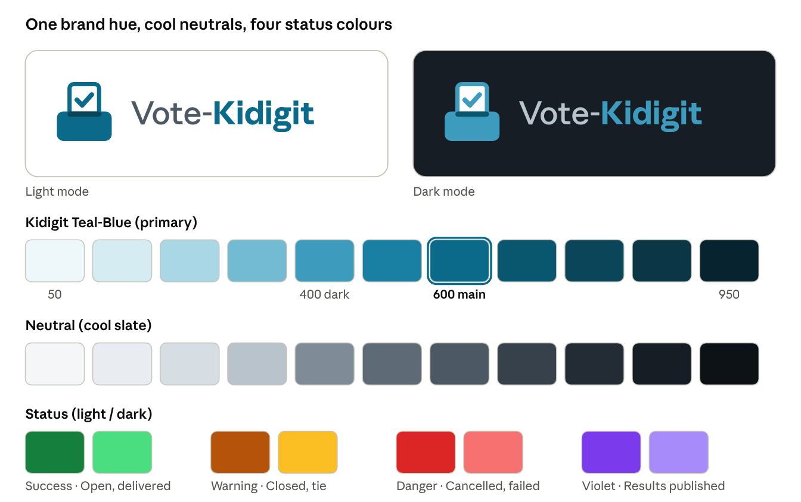

# Vote-Kidigit — Content & Design Guidelines (V1)

Nov 3, 2026 · @Smartone

## 1. How Claude Code must use this document

This document is the design system for every screen in Vote-Kidigit V1: the staff portal, the voter app, the public website and the kiosk. It fixes every colour, size, spacing value, icon, component state and piece of wording, so no design decision is left to the person or tool writing the code. Place it in the repository as docs/DESIGN_SYSTEM.md and reference it from CLAUDE.md, next to docs/TECH_STACK.md.

### 1.1 Hard rules

1. **Use tokens, never raw values.** Colours, font sizes, spacing, radius, shadows and durations come only from the tokens in sections 3–5 (CSS variables --vk-*, the Ant Design theme in 12.2 and the Tailwind theme in 12.3). No hex codes, px numbers or Tailwind arbitrary values (text-[15px], bg-[#123456]) in components.
2. **Use only the components specified here.** Staff portal: Ant Design components configured as in sections 7–9. Voter app: the Tailwind components in sections 7–10. Do not invent new variants; if a screen seems to need one, stop and ask.
3. **Every component implements every state listed for it** (default, hover, active, focus, disabled, loading, error, empty, as applicable).
4. **Both themes, always.** Every screen works in light and dark mode through the semantic tokens; never style for one theme only.
5. **Words come from section 11** and the App Flow Document. All user-facing text goes through i18next keys; Swahili first.
6. **Accessibility rules in section 13 are requirements**, not suggestions.

### 1.2 Order of precedence

If two documents disagree: PRD (V1.1) for behaviour, App Flow Document (V1) for screens and wording of messages, this document for appearance and wording style, Tech Stack (V1) for libraries and versions. Report any conflict instead of choosing.

### 1.3 Where things apply

| Surface | Built with | Base font size | Default control height | Org colour applied? |
|---|---|---|---|---|
| Staff portal (/app) | Ant Design 6.6.8 + tokens | 14 px | 40 px | No (Vote-Kidigit brand) |
| Voter app (/vote) | Tailwind CSS 4.3.4 + tokens | 16 px | 48 px | Yes |
| Kiosk (/vote/kiosk) | Tailwind CSS 4.3.4 + tokens | 18 px | 56 px | Yes, light mode forced |
| Public website (/) | Tailwind CSS 4.3.4 + tokens | 16 px | 48 px | No |
| Public results (/results) | Tailwind CSS 4.3.4 + tokens | 16 px | 48 px | Yes |
| Results PDF | HTML template rendered by Puppeteer | 11 pt | — | Org logo only; colours from this document |

## 2. Brand

Vote-Kidigit looks trustworthy, simple and modern: a calm, neutral tool people trust with an election. The logo is a ballot paper with a tick dropping into a ballot box, next to the Kidigit name.

### 2.1 Design principles

1. **Clarity over decoration.** Every element helps someone vote or run an election. No decorative gradients, patterns or stock imagery.
2. **Neutral and fair.** No colour of any political party is used for decoration. All contesters get identical cards, the same size and weight, in random order; nothing highlights one contester over another.
3. **Calm confidence.** Quiet surfaces, strong hierarchy, one main action per screen. Irreversible actions are guarded (App Flow 6.11).
4. **Light enough for 3G and low-end phones.** System-light pages, few images, icons instead of illustrations.

### 2.2 Logo

The logo has two parts: the **mark** (ballot paper with a tick entering a ballot box) and the **wordmark** ("Vote-Kidigit", with "Kidigit" emphasized).

Mark, as an inline SVG component <LogoMark size={n} /> in each app. It takes its colours from tokens, so it adapts to light and dark:

```
<svg viewBox="0 0 32 32" width="32" height="32" role="img" aria-label="Vote-Kidigit" xmlns="http://www.w3.org/2000/svg">
  <rect x="9" y="2" width="14" height="16" rx="2" fill="var(--vk-logo-paper)" stroke="var(--vk-logo-ink)" stroke-width="2"/>
  <path d="M12.5 9.5l2.5 2.5 4.5-5" fill="none" stroke="var(--vk-logo-ink)" stroke-width="2.25" stroke-linecap="round" stroke-linejoin="round"/>
  <rect x="3" y="15" width="26" height="14" rx="3" fill="var(--vk-logo-ink)"/>
  <rect x="8" y="15" width="16" height="2.5" rx="1.25" fill="var(--vk-logo-slot)"/>
</svg>
```

| Token | Light | Dark |
|---|---|---|
| --vk-logo-ink | #0B6A8A (primary 600) | #3D9CBD (primary 400) |
| --vk-logo-paper | #FFFFFF | #FFFFFF |
| --vk-logo-slot | #0A4559 (primary 800) | #09566F (primary 700) |

Wordmark: Inter, letter-spacing −0.01em. "Vote-" in weight 500, colour --vk-text-secondary; "Kidigit" in weight 700, colour --vk-logo-ink. Always set as live text, never an image.

### 2.3 Logo lockups and sizes

| Lockup | Where | Mark size | Wordmark size | Gap |
|---|---|---|---|---|
| Horizontal, large | Staff sign-in (AUTH-01), public site header on desktop | 40 px | 24 px | 12 px |
| Horizontal, small | Staff sidebar (expanded), public site header on mobile | 28 px | 18 px | 8 px |
| Mark only | Collapsed sidebar, favicon (32 × 32 and 180 × 180 PNG), PDF footer | 28 px (favicon 32) | — | — |
| Stacked | Welcome screen (SYS-05), empty marketing hero | 64 px | 28 px, centred below | 12 px |

Rules:

- Clear space around the logo equals half the mark's height on every side.
- Minimum mark size: 20 px.
- Never stretch, rotate, recolour outside the tokens, add shadows or place on a photo.
- On voter, kiosk and public results screens, the **organization's logo** leads (left of the header). The Vote-Kidigit lockup appears only in the footer as "Inaendeshwa na Vote-Kidigit" (Powered by Vote-Kidigit), mark 16 px, caption text.

### 2.4 Brand sheet



brand sheet · logo in both themes, primary, neutral and status colours

Primary 600 is the main brand colour in light mode and primary 400 in dark mode; status colours always come in a light/dark pair.

## 3. Colour

The palette has one brand hue (Kidigit Teal-Blue), cool neutrals and four status colours (information messages reuse the brand hue). It is a deep blue-teal: it reads as trustworthy like blue, while staying apart from the royal blue, green, yellow and red used by Tanzanian political parties. Components never use these primitives directly; they use the semantic tokens in 3.2.

### 3.1 Primitive palettes

**Primary — Kidigit Teal-Blue**

| 50 | 100 | 200 | 300 | 400 | 500 | 600 | 700 | 800 | 900 | 950 |
|---|---|---|---|---|---|---|---|---|---|---|
| #EEF7FA | #D5ECF3 | #A9D7E6 | #72BBD3 | #3D9CBD | #1A80A3 | #0B6A8A | #09566F | #0A4559 | #0B3646 | #072330 |

**Neutral — cool slate**

| 0 | 50 | 100 | 200 | 300 | 400 | 500 | 600 | 700 | 800 | 900 | 950 |
|---|---|---|---|---|---|---|---|---|---|---|---|
| #FFFFFF | #F4F6F8 | #E9EDF1 | #D6DDE3 | #B8C3CC | #7F8C98 | #5E6B77 | #4C5864 | #36414B | #232C35 | #161D24 | #0D1217 |

**Status colours**

| Colour | 50 | 200 | 400 | 600 | 700 | 800 | 950 |
|---|---|---|---|---|---|---|---|
| Success (green) | #F0FDF4 | #BBF7D0 | #4ADE80 | #15803D | #166534 | #14532D | #052E16 |
| Warning (amber) | #FFFBEB | #FDE68A | #FBBF24 | #B45309 | #92400E | #78350F | #451A03 |
| Danger (red) | #FEF2F2 | #FECACA | #F87171 | #DC2626 | #B91C1C | #991B1B | #450A0A |
| Violet (results) | #F5F3FF | #DDD6FE | #A78BFA | #7C3AED | #6D28D9 | #5B21B6 | #2E1065 |

### 3.2 Semantic tokens

These are the only colour names components may use. Defined as CSS variables in tokens.css (section 12.1).

| Token | Use | Light | Dark |
|---|---|---|---|
| --vk-bg | Page background | neutral 50 | neutral 950 |
| --vk-surface | Cards, tables, sidebar, inputs | neutral 0 | neutral 900 |
| --vk-surface-raised | Dialogs, dropdowns, popovers, toasts | neutral 0 | neutral 800 |
| --vk-surface-muted | Table header, row hover, disabled input, code box | neutral 50 | neutral 800 |
| --vk-border | Dividers, card and table borders | neutral 200 | neutral 700 |
| --vk-border-strong | Input, checkbox, radio borders (3:1 to surface) | neutral 400 | neutral 400 |
| --vk-text | Main text, headings | neutral 900 | neutral 50 |
| --vk-text-secondary | Labels, descriptions, table secondary text | neutral 600 | neutral 300 |
| --vk-text-tertiary | Placeholders, helper text, timestamps (on --vk-surface only) | neutral 500 | neutral 400 |
| --vk-text-disabled | Disabled labels | neutral 400 | neutral 600 |
| --vk-text-inverse | Text on dark tooltips | neutral 0 | neutral 950 |
| --vk-primary | Primary buttons, links, active nav, selected states | primary 600 | primary 400 |
| --vk-primary-hover | Hover of the above | primary 700 | primary 300 |
| --vk-primary-active | Pressed state | primary 800 | primary 200 |
| --vk-on-primary | Text and icons on --vk-primary | neutral 0 | neutral 950 |
| --vk-primary-subtle | Selected row, active nav background, info banner | primary 50 | primary 950 |
| --vk-primary-subtle-text | Text on --vk-primary-subtle | primary 700 | primary 200 |
| --vk-focus | Focus ring | primary 500 | primary 300 |
| --vk-overlay | Behind dialogs and drawers | rgba(13,18,23,0.48) | rgba(0,0,0,0.64) |
| --vk-skeleton | Loading placeholders | neutral 100 | neutral 800 |
| --vk-tooltip-bg | Tooltip background | neutral 900 | neutral 100 |

Status tokens follow one pattern for each tone (success, warning, danger, info, violet, neutral):

| Token pattern | Use | Light | Dark |
|---|---|---|---|
| --vk-{tone}-fg | Icon and text on surface | 600 (info: primary 600; neutral: neutral 600) | 400 (info: primary 300; neutral: neutral 300) |
| --vk-{tone}-bg | Badge, banner, alert background | 50 (info: primary 50; neutral: neutral 100) | 950 (info: primary 950; neutral: neutral 800) |
| --vk-{tone}-border | Banner and alert border | 200 (info: primary 200; neutral: neutral 200) | 800 (info: primary 800; neutral: neutral 700) |
| --vk-{tone}-solid | Solid button (danger only), progress fill | 600 | 400 |
| --vk-{tone}-solid-hover | Hover of solid | 700 | 200 |
| --vk-on-{tone}-solid | Text on solid | neutral 0 | neutral 950 |

Contrast was checked for every pair used as text (minimum 4.5:1) and every control border (minimum 3:1). Examples: text on page 15.7:1 light / 17.4:1 dark; white on primary 6.1:1; primary on white 6.1:1; dark-mode primary 400 on surface 5.4:1; input border 3.4:1 light / 4.9:1 dark; danger 600 on white 4.8:1.

### 3.3 Status colours and icons

Status is always shown as **colour + icon + text** together, never colour alone. Badges use the StatusBadge component (section 9.1).

| Domain | Value | Tone | Icon (Ant Design) | Label (sw / en) |
|---|---|---|---|---|
| Event | Draft | neutral | EditOutlined | Rasimu / Draft |
| Event | Scheduled | info | ClockCircleOutlined | Imepangwa / Scheduled |
| Event | Open | success | PlayCircleOutlined | Wazi / Open |
| Event | Closed | warning | LockOutlined | Imefungwa / Closed |
| Event | Results Published | violet | FileDoneOutlined | Matokeo yametangazwa / Results published |
| Event | Cancelled | danger | StopOutlined | Imesitishwa / Cancelled |
| Event | Archived | neutral | InboxOutlined | Kumbukumbu / Archived |
| Category | Not open yet | neutral | ClockCircleOutlined | Itafunguliwa / Opens later |
| Category | Open | success | PlayCircleOutlined | Wazi / Open |
| Category | Closed | warning | LockOutlined | Imefungwa / Closed |
| Category | Inactive | neutral | MinusCircleOutlined | Haitumiki / Inactive |
| Code / SMS | Not sent | neutral | MinusCircleOutlined | Haijatumwa / Not sent |
| Code / SMS | Sent | info | SendOutlined | Imetumwa / Sent |
| Code / SMS | Delivered | success | CheckCircleOutlined | Imefika / Delivered |
| Code / SMS | Failed | danger | CloseCircleOutlined | Imeshindikana / Failed |
| Voter | Voted | success | CheckOutlined | Amepiga kura / Voted |
| Voter | Not voted | neutral | MinusOutlined | Bado / Not yet |
| Result | Winner | success | TrophyOutlined | Mshindi / Winner |
| Result | Tie | warning | WarningOutlined | Sare / Tie |
| Staff user | Invited | info | MailOutlined | Amealikwa / Invited |
| Staff user | Active | success | CheckCircleOutlined | Hai / Active |
| Staff user | Deactivated | neutral | StopOutlined | Amezimwa / Deactivated |

### 3.4 Organization colour (voter, kiosk, public results)

Each organization may set one primary colour (PRD ORG-04). It replaces --vk-primary and its family only on voter-facing surfaces, through these tokens: --vk-brand, --vk-brand-hover, --vk-on-brand, --vk-brand-subtle. If no colour is set, they equal the primary tokens.

**Where it is used:** primary buttons, links, the 4 px accent line under the voter header, the ballot progress bar, the selected contester card border and tick. **Never** for status colours, errors, success messages or text body.

**Contrast adjustment** (function deriveBrandTokens(hex) in packages/shared/src/design/brand.ts, also run in the settings preview):

1. Light theme: convert to HSL; lower lightness in steps of 2% until the colour has at least 4.5:1 contrast with #FFFFFF. Result = --vk-brand.
2. Dark theme: raise lightness in steps of 2% until at least 4.5:1 with neutral 900 (#161D24). Result = dark --vk-brand.
3. --vk-on-brand = #FFFFFF if it has at least 4.5:1 with --vk-brand, otherwise neutral 950.
4. --vk-brand-hover = lightness −6% (light) / +6% (dark).
5. --vk-brand-subtle = --vk-brand at 10% opacity over --vk-surface (light) / 18% (dark).
6. The settings screen (SYS-03) shows the original and the adjusted colour side by side with the note "Adjusted for readability" when they differ.

## 4. Typography

One typeface, Inter, is used everywhere, self-hosted so it loads from the app's own server. Two size scales share the same steps: a compact one for the staff portal (14 px body) and a larger one for voter-facing screens (16 px body).

### 4.1 Typeface

| Item | Value |
|---|---|
| Family | Inter, variable font (weights 400–700), from the official Inter 4.1 release (rsms/inter), SIL Open Font Licence |
| Files | InterVariable.woff2 and InterVariable-Italic.woff2, committed to apps/staff/public/fonts/ and apps/voter/public/fonts/ (no npm package, no Google Fonts) |
| Loading | @font-face with font-display: swap; <link rel="preload" as="font" type="font/woff2" crossorigin> for the upright file only |
| Fallback stack | Inter, system-ui, -apple-system, "Segoe UI", Roboto, "Helvetica Neue", Arial, sans-serif |
| Monospace (codes, IDs) | ui-monospace, SFMono-Regular, Menlo, Consolas, "Liberation Mono", monospace (system fonts, nothing downloaded) |
| Weights used | 400 regular, 500 medium, 600 semibold, 700 bold (logo and display only) |
| Numbers | font-variant-numeric: tabular-nums on tables, counters, turnout, countdowns, votes |

### 4.2 Type scale

Sizes in px; line height in px. Token names are used in CSS (--vk-font-{name}-size / --vk-font-{name}-line), Tailwind (text-{name}) and the Ant Design theme.

| Token | Staff portal size / line | Voter app size / line | Weight | Letter spacing | Use |
|---|---|---|---|---|---|
| display | — | 36 / 44 (28 / 36 below 768 px) | 700 | −0.02em | Public website hero only |
| h1 | 24 / 32 | 28 / 36 | 600 | −0.01em | Page title (one per page) |
| h2 | 20 / 28 | 24 / 32 | 600 | −0.01em | Section title, dialog title, ballot category name |
| h3 | 16 / 24 | 20 / 28 | 600 | 0 | Card title, side-panel section |
| h4 | 14 / 22 | 18 / 26 | 600 | 0 | Small group heading, contester name on ballot card |
| body-lg | 16 / 24 | 18 / 28 | 400 | 0 | Lead paragraph, kiosk body |
| body | 14 / 22 | 16 / 24 | 400 | 0 | Default text |
| body-sm | 12 / 20 | 14 / 20 | 400 | 0 | Table secondary text, helper text, footers |
| label | 14 / 22 | 16 / 24 | 500 | 0 | Form labels, buttons, tabs, menu items |
| caption | 12 / 16 | 13 / 18 | 500 | 0 | Badges, timestamps, chart-free meta text |
| overline | 12 / 16 | 12 / 16 | 600 | 0.06em, uppercase | Sidebar group names, table group headers |
| stat | 30 / 38 | 32 / 40 | 600 | −0.02em, tabular | Big numbers: turnout, counts in the control room |
| code | 14 / 22 mono | 20 / 28 mono | 500 | 0.08em | Voting codes (K7M4-Q9XR), membership IDs |

Kiosk uses the voter scale with every size multiplied by 1.125 (rounded to whole px).

### 4.3 Text rules

- One h1 per page. Headings never skip a level.
- Headings and labels use sentence case (section 11.3). text-wrap: balance on h1–h3; text-wrap: pretty on paragraphs.
- Maximum line length for paragraphs: 68 characters (max-width: 68ch).
- Body colour --vk-text; descriptions --vk-text-secondary; meta and helper text --vk-text-tertiary.
- Never use italics for emphasis; use weight 600. Never underline except links.
- Truncate long names with an ellipsis on one line in tables (full text in a tooltip); never truncate contester names on the ballot — wrap to a maximum of 3 lines.
- Numbers: thousands separated with commas (5,000), percentages without decimals (64%) except results (one decimal, 48.6%).

## 5. Spacing, layout, shape and motion

All spacing is a multiple of 4 px. Layouts use fixed widths for navigation and fluid content; corners are soft (8 px) and surfaces mostly flat.

### 5.1 Spacing scale

| Token | Value | Typical use |
|---|---|---|
| --vk-space-0 | 0 | — |
| --vk-space-0-5 | 2 px | Icon-to-badge text nudge |
| --vk-space-1 | 4 px | Icon and text inside a badge |
| --vk-space-2 | 8 px | Icon to label in buttons; gap between chips |
| --vk-space-3 | 12 px | Field label to input; table cell vertical padding (compact) |
| --vk-space-4 | 16 px | Card padding (mobile), gap between form fields, page side padding (mobile) |
| --vk-space-5 | 20 px | Gap between contester cards |
| --vk-space-6 | 24 px | Card padding (desktop), page side padding (desktop), gap between cards |
| --vk-space-8 | 32 px | Space between page sections |
| --vk-space-10 | 40 px | Space above page title block |
| --vk-space-12 | 48 px | Empty state top/bottom padding |
| --vk-space-16 | 64 px | Public website section spacing (mobile) |
| --vk-space-20 | 80 px | Public website section spacing (desktop) |

### 5.2 Breakpoints

| Name | Min width | Targets |
|---|---|---|
| xs | 0 | Small phones (design at 360 px) |
| sm | 480 px | Large phones |
| md | 768 px | Tablets, kiosk |
| lg | 1024 px | Small laptops; staff sidebar becomes permanent |
| xl | 1280 px | Laptops (staff design width) |
| 2xl | 1440 px | Desktops |

### 5.3 Staff portal layout

| Region | Size and behaviour |
|---|---|
| Sidebar | 248 px expanded, 72 px collapsed; permanent from lg; below lg it is a drawer opened from the top-bar menu button. Background --vk-surface, right border --vk-border. |
| Top bar | Height 56 px, sticky, background --vk-surface, bottom border --vk-border, padding 0 24 px (16 px below md) |
| Content area | Background --vk-bg; padding 24 px (16 px below md); max width 1440 px, left-aligned next to the sidebar |
| Page header block | Title row (h1 + status badge + main action right-aligned), then breadcrumbs above it; 24 px below the block before content; 16 px between header and tabs |
| Grid | 12 columns, 24 px gutter (16 px below md); dashboard cards span 4 columns at xl, 6 at md, 12 below |
| Side panel (drawer) | Width 480 px (forms) or 720 px (CSV preview, user detail with tables); full width below md |
| Dialog | Width 480 px (confirm), 640 px (forms); max 100% − 32 px on mobile |

### 5.4 Voter app layout

| Region | Size and behaviour |
|---|---|
| Container | Max width 480 px, centred; side padding 16 px; background --vk-bg |
| Voter header | Height 64 px: organization logo (max 40 px tall, max 160 px wide) left, event name (h4, one line, ellipsis) next to it; 4 px --vk-brand line along the bottom |
| Content | Top padding 24 px; stacks with 16 px gaps |
| Action bar | Sticky at the bottom: background --vk-surface, top border --vk-border, padding 12 px 16 px plus env(safe-area-inset-bottom); holds the screen's main button full width (and Rudi / Back as text button above or left) |
| Help footer | "Msaada: {phone}" in body-sm, centred, 16 px above the action bar |
| Kiosk | Container max width 720 px; all tap targets 56 px; header 80 px |
| Public website | Max width 1200 px, side padding 24 px (16 px mobile); sections separated by --vk-space-20 |

### 5.5 Radius

| Token | Value | Use |
|---|---|---|
| --vk-radius-xs | 4 px | Checkbox, small tags inside tables |
| --vk-radius-sm | 6 px | Tooltips, small buttons (32 px) |
| --vk-radius-md | 8 px | Buttons, inputs, selects, staff cards, tables, dropdowns |
| --vk-radius-lg | 12 px | Dialogs, drawers' inner cards, voter cards, contester cards, banners |
| --vk-radius-xl | 16 px | Voter identity card, kiosk panels |
| --vk-radius-full | 9999 px | Badges, avatars, switches, progress bars |

Contester and voter photos (5:7) use --vk-radius-md.

### 5.6 Elevation

Surfaces are flat with 1 px borders. Shadows are used only for things floating above the page.

| Token | Light | Dark | Use |
|---|---|---|---|
| --vk-shadow-none | none | none | Cards, tables, sidebar (borders only) |
| --vk-shadow-sm | 0 1px 2px rgba(13,18,23,0.06), 0 4px 12px rgba(13,18,23,0.08) | 0 1px 2px rgba(0,0,0,0.4), 0 4px 12px rgba(0,0,0,0.4) | Dropdowns, popovers, tooltips, sticky voter action bar |
| --vk-shadow-md | 0 4px 8px rgba(13,18,23,0.06), 0 12px 32px rgba(13,18,23,0.16) | 0 4px 8px rgba(0,0,0,0.5), 0 12px 32px rgba(0,0,0,0.6) | Dialogs, drawers, toasts |

In dark mode floating surfaces also keep a 1 px --vk-border so their edges stay visible.

### 5.7 Layers (z-index)

| Token | Value | Layer |
|---|---|---|
| --vk-z-base | 0 | Page |
| --vk-z-sticky | 100 | Top bar, voter action bar, table header |
| --vk-z-sidebar | 200 | Sidebar drawer on mobile |
| --vk-z-dropdown | 1000 | Dropdowns, popovers, date pickers |
| --vk-z-overlay | 1100 | Dialog and drawer overlay |
| --vk-z-modal | 1110 | Dialogs, drawers |
| --vk-z-toast | 1200 | Toasts |
| --vk-z-tooltip | 1300 | Tooltips |

### 5.8 Motion

| Token | Value | Use |
|---|---|---|
| --vk-duration-fast | 120 ms | Hover, colour changes, focus ring |
| --vk-duration-base | 200 ms | Dropdowns, tooltips, selection tick, tab underline |
| --vk-duration-slow | 300 ms | Dialogs, drawers, toasts, ballot screen change |
| --vk-ease-standard | cubic-bezier(0.2, 0, 0, 1) | All entering and moving elements |
| --vk-ease-exit | cubic-bezier(0.4, 0, 1, 1) | Leaving elements |

Allowed animations: fade, 8 px slide, scale from 0.96, progress fill, skeleton shimmer (1.5 s loop), the live dot pulse (2 s loop). No bounce, parallax or confetti — including on vote confirmation. With prefers-reduced-motion: reduce, all durations become 0 ms except the progress fill (kept, 0 ms easing) and the shimmer and pulse stop.

## 6. Iconography

All icons come from Ant Design Icons 6.3.4, in the Outlined style, in both apps. Each icon is imported individually (import { PlusOutlined } from '@ant-design/icons') so the voter app only ships the icons it uses.

### 6.1 Rules

| Rule | Value |
|---|---|
| Style | Outlined only. Filled style is allowed for exactly two cases: the selected-contester tick (CheckCircleFilled) and the success icon on the vote-received screen (CheckCircleFilled). |
| Sizes | 14 px inside badges and small buttons; 16 px in staff UI (menu, buttons, table actions); 20 px in voter buttons and alerts; 24 px kiosk; 32 px status screens (VTR-WEB not open / closed); 48 px vote received and empty states |
| Colour | Inherits text colour (currentColor). Status icons use --vk-{tone}-fg. Never a colour outside the tokens. |
| Spacing | 8 px between icon and label |
| With text | Icons support text; they never replace it, except icon-only buttons, which always have an aria-label and a tooltip |
| Decorative icons | aria-hidden="true" |
| Empty-state icon | 48 px icon in --vk-text-tertiary, centred in an 80 px circle filled with --vk-surface-muted |
| Emoji | Never used in the interface or messages |

### 6.2 Icon map

Use exactly these icons for these meanings, and never use one of them for an unrelated meaning. Status icons are listed in 3.3. Dropdown chevron: DownOutlined (12 px). Breadcrumb separator: RightOutlined (12 px). Expandable table row: RightOutlined, rotating 90° when open.

| Meaning | Icon |
|---|---|
| Dashboard | DashboardOutlined |
| Organizations (platform) | BankOutlined |
| Events | CalendarOutlined |
| Users | TeamOutlined |
| Roles and permissions | SafetyCertificateOutlined |
| Audit log / Activity tab | HistoryOutlined |
| Settings | SettingOutlined |
| Profile | UserOutlined |
| Sign out | LogoutOutlined |
| Language | GlobalOutlined |
| Light / dark mode toggle | SunOutlined (shown in dark mode) / MoonOutlined (shown in light mode) |
| Menu (open sidebar on mobile) | MenuOutlined |
| Collapse / expand sidebar | MenuFoldOutlined / MenuUnfoldOutlined |
| Search | SearchOutlined |
| Overview tab | AppstoreOutlined |
| Categories tab | UnorderedListOutlined |
| Voters tab | IdcardOutlined |
| Messages tab | MessageOutlined |
| Results tab | BarChartOutlined |
| Live tab | No icon; a pulsing 8 px dot in --vk-success-fg before the label |
| Create / add | PlusOutlined |
| Edit | EditOutlined |
| Delete / remove | DeleteOutlined |
| More actions | MoreOutlined |
| Drag handle | HolderOutlined |
| Upload | UploadOutlined |
| Download | DownloadOutlined |
| PDF file | FilePdfOutlined |
| Excel / CSV file | FileExcelOutlined |
| Send SMS / resend code | SendOutlined |
| Regenerate code | SyncOutlined |
| Refresh / retry | ReloadOutlined |
| Copy | CopyOutlined |
| Public link | LinkOutlined |
| QR code | QrcodeOutlined |
| Locked (read-only) | LockOutlined |
| Open voting (Open now) | PlayCircleOutlined |
| Close voting (Close now) | PoweroffOutlined |
| Publish | CloudUploadOutlined |
| Kiosk | TabletOutlined |
| Help line / phone | PhoneOutlined |
| Back | ArrowLeftOutlined |
| Next | ArrowRightOutlined |
| Close dialog / clear | CloseOutlined |
| Show / hide password | EyeOutlined / EyeInvisibleOutlined |
| Info | InfoCircleOutlined |
| Success | CheckCircleOutlined |
| Warning | WarningOutlined |
| Error | CloseCircleOutlined |
| Question / help tooltip | QuestionCircleOutlined |
| Time / countdown | ClockCircleOutlined |
| Photo placeholder | PictureOutlined (missing category picture; people show initials instead) |
| Winner | TrophyOutlined |
| Empty list | InboxOutlined |
| No search results | SearchOutlined |
| Offline | DisconnectOutlined |
| Not found | FileSearchOutlined |

## 7. Components: actions and form inputs

Each component lists its variants, sizes and every state. Staff portal: implemented with the named Ant Design component and props, themed by section 12.2. Voter app: implemented as a React + Tailwind component in apps/voter/src/components/ with the same values.

### 7.1 Buttons

| Variant | Use | Background | Text / icon | Border | Hover | Pressed | Ant Design props |
|---|---|---|---|---|---|---|---|
| Primary | The one main action of a screen or dialog | --vk-primary (voter: --vk-brand) | --vk-on-primary | none | bg --vk-primary-hover | bg --vk-primary-active | color="primary" variant="solid" |
| Secondary | Other actions next to a primary | --vk-surface | --vk-text | 1 px --vk-border-strong | border and text --vk-primary, bg --vk-surface | bg --vk-surface-muted | color="default" variant="outlined" |
| Tertiary | Low-emphasis actions in toolbars, cards, "Rudi" / Back | transparent | --vk-primary | none | bg --vk-primary-subtle | bg --vk-primary-subtle, text --vk-primary-active | color="primary" variant="text" |
| Link | Inline navigation inside text | transparent | --vk-primary, underline on hover | none | text --vk-primary-hover, underline | — | color="primary" variant="link" |
| Danger | Confirm a destructive action (Cancel event, Delete) inside a dialog | --vk-danger-solid | --vk-on-danger-solid | none | bg --vk-danger-solid-hover | bg --vk-danger-solid-hover | color="danger" variant="solid" |
| Danger secondary | Start a destructive flow (opens a dialog) | --vk-surface | --vk-danger-fg | 1 px --vk-danger-fg | bg --vk-danger-bg | bg --vk-danger-bg | color="danger" variant="outlined" |
| Icon button | Single-icon actions (More, Copy, Close, theme toggle) | transparent | --vk-text-secondary | none | bg --vk-surface-muted, icon --vk-text | bg --vk-border | color="default" variant="text" icon={...} + aria-label + Tooltip |

| Size | Height | Horizontal padding | Font | Icon | Radius | Used in |
|---|---|---|---|---|---|---|
| S | 32 px | 12 px | label 14 px | 14 px | --vk-radius-sm | Table row actions, compact toolbars |
| M | 40 px | 16 px | label 14 px | 16 px | --vk-radius-md | Staff portal default |
| L | 48 px | 20 px | label 16 px | 20 px | --vk-radius-md | Voter app default, public site |
| XL | 56 px | 24 px | 18 px, 600 | 24 px | --vk-radius-lg | Kiosk |

Icon buttons are square: 32, 40, 48 or 56 px.

**All states:**

| State | Rule |
|---|---|
| Focus (keyboard) | 2 px solid --vk-focus outline, 2 px offset; shown on :focus-visible only |
| Disabled | bg --vk-surface-muted, text --vk-text-disabled, border --vk-border (secondary) or none, cursor not-allowed, no hover change. A disabled button that blocks a task has a tooltip or adjacent text explaining why (e.g. "Resolve 2 ties first"). |
| Loading | 16 px spinner replaces the leading icon (or appears before the label), label stays, width does not change, clicks ignored, aria-busy="true". Use for any action that calls the server. |
| Pressed | Colours as in the variant table; no scale effect |

**Rules:** one primary button per screen region (page header, dialog, voter action bar). In dialogs and forms: primary on the right, secondary to its left (staff); on voter screens the primary is full width at the bottom and Back is a tertiary button above it. Icon before label, except "Next" (ArrowRightOutlined after label). Labels start with a verb (section 11.3).

### 7.2 Form field anatomy

Every input is wrapped in a Field: label → 8 px → control → 4 px → helper or error text. Fields are separated by 16 px (staff) or 20 px (voter).

| Part | Style |
|---|---|
| Label | label token, --vk-text; optional fields add " (si lazima)" / " (optional)" in --vk-text-tertiary. No asterisks. |
| Helper text | body-sm, --vk-text-tertiary |
| Error text | body-sm, --vk-danger-fg, preceded by CloseCircleOutlined 14 px; replaces the helper text; linked by aria-describedby; field gets aria-invalid="true" |
| Character counter | Right-aligned under textarea, caption, --vk-text-tertiary; --vk-warning-fg when over the SMS limit |

Validation runs on blur and on submit; an error clears as soon as the value becomes valid. On submit with errors, focus moves to the first invalid field.

### 7.3 Text inputs

| Property | Value |
|---|---|
| Height | 40 px staff, 48 px voter, 56 px kiosk |
| Padding | 0 12 px (voter 0 16 px) |
| Text | body token, --vk-text; placeholder --vk-text-tertiary |
| Background / border / radius | --vk-surface, 1 px --vk-border-strong, --vk-radius-md |
| Hover | border --vk-text-secondary |
| Focus | border --vk-primary + box-shadow: 0 0 0 3px var(--vk-focus-soft) |
| Error | border --vk-danger-fg; on focus box-shadow: 0 0 0 3px var(--vk-danger-soft) |
| Disabled | bg --vk-surface-muted, border --vk-border, text --vk-text-disabled |
| Read-only | bg --vk-surface-muted, border --vk-border, text --vk-text |
| Prefix / suffix icon | 16 px (voter 20 px), --vk-text-tertiary, 8 px from text |

--vk-focus-soft = primary 500 at 24% opacity (light) / primary 300 at 32% (dark). --vk-danger-soft = danger 600 at 20% (light) / danger 400 at 32% (dark).

| Input type | Ant Design | Specifics |
|---|---|---|
| Text | Input | — |
| Password | Input.Password | Eye toggle (EyeOutlined / EyeInvisibleOutlined); live rule checklist below on set-password screens (each rule with CheckOutlined in success-fg when met, MinusOutlined in text-tertiary when not) |
| Search | Input with SearchOutlined prefix and clear button | Debounce 300 ms; global search in top bar is 320 px wide at xl, icon button below md |
| Phone | Input with addon "+255" | Formats as 7XX XXX XXX while typing |
| Number | InputNumber | Used for seats, thresholds (suffix "%"), reminder offsets (suffix "saa" / "hours") |
| Textarea | Input.TextArea | Min 3 rows, auto-grows to 8; SMS templates show counter "142 / 160" and "2 SMS" when over 160 |
| Date and time | DatePicker with showTime, format D MMM YYYY, HH:mm | 24-hour clock; the organization time zone is shown after the field as caption, e.g. "EAT (UTC+3)" |

### 7.4 Select and dropdowns

| Property | Value |
|---|---|
| Trigger | Same box as text input; DownOutlined 12 px in --vk-text-tertiary on the right, rotates 180° when open |
| Menu panel | --vk-surface-raised, 1 px --vk-border, --vk-radius-md, --vk-shadow-sm, padding 4 px, max height 320 px with scroll, 4 px below the trigger |
| Option | Height 36 px staff / 48 px voter, padding 0 12 px, radius --vk-radius-sm; hover bg --vk-surface-muted; selected bg --vk-primary-subtle, text --vk-primary-subtle-text, weight 500, CheckOutlined on the right |
| Disabled option | Text --vk-text-disabled, no hover |
| Search | Built-in search field when more than 7 options |
| Empty | "Hakuna matokeo" / "No matches", body-sm, --vk-text-tertiary, centred, 12 px padding |
| Multi-select | Selected values as removable tags (neutral tone, --vk-radius-xs, 24 px tall); "+3" overflow tag after 3 |

| Type | Ant Design | Use |
|---|---|---|
| Single select | Select | Role, gender, results visibility, winner rule |
| Multi-select | Select mode="multiple" | Events mapped to a user |
| Action menu | Dropdown with menu items, opened by a "More" icon button | Row and page actions; items 36 px with 16 px icon; destructive items in --vk-danger-fg after a divider |
| Filter chips | Segmented or a row of Tag.CheckableTag | Event list status filter: chips 32 px, radius full; selected = --vk-primary-subtle bg + --vk-primary-subtle-text |

### 7.5 Checkbox, radio and switch

| Control | Size staff / voter | Unchecked | Checked | Disabled | Label |
|---|---|---|---|---|---|
| Checkbox (Checkbox) | 18 px / 24 px box, radius --vk-radius-xs | border 1.5 px --vk-border-strong, bg --vk-surface | bg --vk-primary, white check (--vk-on-primary); indeterminate shows a 10 px bar | bg --vk-surface-muted, border --vk-border | 8 px right of the box, body; whole row is clickable, min height 40 / 48 px |
| Radio (Radio) | 18 px / 24 px circle | border 1.5 px --vk-border-strong | border --vk-primary, 8 px / 10 px inner dot --vk-primary | as checkbox | as checkbox |
| Switch (Switch) | 44 × 24 px | track --vk-border-strong | track --vk-primary, thumb white | track --vk-surface-muted | Label to the left, switch right-aligned in settings rows; state also written ("Imewashwa" / "On") for screen readers via aria-checked |

On voter screens, multi-choice ballot selection uses contester cards (10.3), not checkboxes.

### 7.6 File upload and photo crop

| Element | Spec |
|---|---|
| Dropzone (Upload.Dragger) | 1 px dashed --vk-border-strong, --vk-radius-lg, bg --vk-surface, padding 24 px, centred UploadOutlined 32 px in --vk-text-tertiary, title label "Buruta faili hapa au bofya kuchagua" / "Drag a file here or click to choose", helper body-sm with accepted types and size |
| Drag-over | border --vk-primary solid, bg --vk-primary-subtle |
| Uploading | Progress bar (9.6) inside the dropzone with file name and percentage |
| Error | border --vk-danger-fg, error text under it |
| Photo field | 70 × 98 px preview (5:7) with --vk-radius-md; buttons "Pakia picha" / "Upload photo" (secondary S) and "Ondoa" / "Remove" (tertiary S) |
| Crop dialog | Dialog 640 px; crop area fixed at 5:7 with zoom slider (1–3×); actions "Hifadhi" / "Save" (primary) and "Ghairi" / "Cancel" (secondary) |

### 7.7 Voter credential inputs

| Input | Spec |
|---|---|
| Membership ID | Text input 48 px (kiosk 56 px), autocomplete="off", autocapitalize="characters", body-lg |
| Verification code | Single input, 56 px tall, code token (mono, 20 px, 0.08em spacing), centred text, auto upper-case, inserts the dash after 4 characters, max 9 characters including dash, inputmode="text", autocomplete="one-time-code", placeholder XXXX-XXXX |
| Kiosk keypad | On-screen grid, 4 columns, keys 64 × 56 px, --vk-radius-md, bg --vk-surface, border --vk-border, text 20 px 600; keys A–Z and 0–9 (without O, I, L for codes), backspace (ArrowLeftOutlined) and clear; pressed bg --vk-primary-subtle |

## 8. Components: navigation and structure

These components build the staff portal frame (App Flow 3.2) and the containers inside every page.

### 8.1 Sidebar (Layout.Sider + Menu)

| Part | Spec |
|---|---|
| Header | 64 px tall: logo lockup (horizontal small) on the left, padding 0 20 px; collapsed: mark only, centred |
| Group label | overline, --vk-text-tertiary, padding 16 px 20 px 4 px (groups: "Kazi" / "Work": Dashboard, Organizations, Events; "Usimamizi" / "Admin": Users, Roles, Audit log, Settings) |
| Item | Height 40 px, margin 2 px 8 px, padding 0 12 px, radius --vk-radius-md, icon 16 px + 12 px gap + label |
| Item states | Default: text --vk-text-secondary. Hover: bg --vk-surface-muted, text --vk-text. Active (current section): bg --vk-primary-subtle, text --vk-primary-subtle-text, weight 600, 3 px bar in --vk-primary on the left edge of the item. Focus: focus ring. |
| Collapsed | 72 px wide; items show icon only, centred, with a tooltip on the right |
| Footer | Collapse button (MenuFoldOutlined / MenuUnfoldOutlined) as icon button M, bottom left, 16 px padding, top border --vk-border |
| Mobile (below lg) | Opens as a left drawer 280 px with overlay; closes on item click or overlay tap |

### 8.2 Top bar

Left to right: menu button (below lg only) → breadcrumbs → flexible space → global search (320 px at xl, 240 px at lg, icon button below lg) → theme toggle (icon button M) → language switch (Dropdown: "Kiswahili", "English") → profile avatar (32 px) opening a dropdown with name, email (body-sm, tertiary), Profile, Sign out. 16 px gap between items.

### 8.3 Breadcrumbs (Breadcrumb)

body-sm; links --vk-text-secondary, hover --vk-primary with underline; current page --vk-text, not a link; separator RightOutlined 12 px in --vk-text-tertiary with 8 px on each side. More than 4 levels: middle levels collapse into "…" with a dropdown. Hidden below md (replaced by a "← Back" tertiary button S to the parent).

### 8.4 Page header

| Part | Spec |
|---|---|
| Title row | h1 + status badge (8 px gap) on the left; actions on the right: tertiary/secondary first, primary last; "More" icon button for overflow actions |
| Meta line | Under the title, 4 px gap, body-sm, --vk-text-secondary, items separated by " · " (e.g. voting window, organization) |
| Mobile | Actions move below the title, primary full width |

### 8.5 Tabs (Tabs)

| Property | Spec |
|---|---|
| Style | Line tabs; bottom border 1 px --vk-border across the full width |
| Tab | Height 44 px, padding 0 4 px, 24 px gap between tabs, icon 16 px + 8 px + label |
| States | Default text --vk-text-secondary; hover --vk-text; active --vk-primary, weight 600, 2 px underline in --vk-primary; disabled --vk-text-disabled; focus ring inside |
| Overflow | Horizontal scroll with fade edges below lg; never wraps to two lines |
| Locked tab content | Tab still opens; content shows the locked banner (9.2) and read-only fields |

### 8.6 Cards (Card)

| Variant | Spec |
|---|---|
| Default card | bg --vk-surface, 1 px --vk-border, --vk-radius-md (voter --vk-radius-lg), padding 24 px (16 px below md), no shadow. Header: h3 title + optional actions right, 16 px below header. |
| Stat card | Default card; label body-sm --vk-text-secondary on top; value stat token; optional sub-line caption (e.g. "of 5,000 registered"); optional 8 px progress bar at the bottom |
| Checklist card (setup) | Default card; title h3 + "4 of 6 complete" body-sm; progress bar 8 px; items 32 px tall: done = CheckCircleOutlined in --vk-success-fg + text --vk-text-secondary; pending = 16 px empty circle in --vk-border-strong + text --vk-text weight 500 + "Fix" link right-aligned |
| Category card (staff, EVT-04) | Default card; header row: drag handle (HolderOutlined, --vk-text-tertiary), 40 × 56 picture, name h3, status badge, "More" icon button; rule summary body-sm; contester row: 48 × 67 photos with name body-sm below, 16 px gaps, "+ Add contester" tertiary button |
| Clickable card | Adds hover border --vk-primary and cursor pointer; whole card is one link |

### 8.7 Tables (Table)

| Property | Spec |
|---|---|
| Container | bg --vk-surface, 1 px --vk-border, --vk-radius-md, overflow hidden |
| Header row | Height 44 px, bg --vk-surface-muted, caption 12 px weight 600 --vk-text-secondary (not uppercase), sticky on scroll |
| Body row | Height 52 px (comfortable) or 40 px (compact toggle, Voters tab only); padding 0 16 px; 1 px bottom border --vk-border; text body |
| Row hover | bg --vk-surface-muted |
| Selected row | bg --vk-primary-subtle; checkbox column 48 px wide |
| Numbers | Right-aligned, tabular-nums |
| Actions column | Right-aligned, 1–2 icon buttons S + "More"; visible always (not only on hover) |
| Sorting | Clickable header with sort arrows in --vk-text-tertiary; active sort --vk-primary |
| Bulk action bar | Appears above the table when rows are selected: bg --vk-primary-subtle, height 48 px, "{n} selected" + bulk buttons (secondary S) + "Clear" tertiary |
| Empty | Empty state (9.7) inside the table body, 48 px padding |
| Loading | 5 skeleton rows |
| Mobile (below md) | Each row becomes a stacked card: primary column as title, other columns as label/value pairs, actions at the bottom |

### 8.8 Pagination (Pagination)

Below tables, right-aligned, 16 px top margin: "1–50 of 4,812" body-sm on the left; page buttons 32 px, radius --vk-radius-sm; current page bg --vk-primary, text --vk-on-primary; page size select (25 / 50 / 100, default 50). Mobile: "Previous" / "Next" buttons only.

### 8.9 Drawer / side panel (Drawer)

| Property | Spec |
|---|---|
| Placement | Right; width 480 px or 720 px (5.3); full screen below md |
| Surface | bg --vk-surface-raised, --vk-shadow-md, overlay --vk-overlay |
| Header | 64 px: title h2 left, close icon button right, bottom border --vk-border |
| Body | Padding 24 px, scrolls |
| Footer | Sticky, 72 px, top border, buttons right-aligned (Cancel secondary, Save primary) |
| Unsaved changes | Closing asks for confirmation (App Flow 13.2) |
| Motion | Slides from the right, --vk-duration-slow |

### 8.10 Dialogs (Modal)

| Type | Spec |
|---|---|
| Base | Width 480 / 640 px; bg --vk-surface-raised, --vk-radius-lg, --vk-shadow-md, padding 24 px; title h2; body body --vk-text-secondary; footer buttons right-aligned, 12 px gap; closes on Esc and close icon; overlay click closes only non-destructive dialogs |
| Confirm | Icon 24 px left of the title in the tone colour (WarningOutlined warning, InfoCircleOutlined info); buttons: secondary "Ghairi" / "Cancel" + primary action named by verb ("Fungua sasa" / "Open now") |
| Destructive | Danger button; title states the consequence ("Close voting for AGM 2027?") |
| Type-to-confirm | Adds a text input labelled "Andika jina la uchaguzi kuthibitisha" / "Type the event name to confirm"; the danger button stays disabled until the text matches exactly (case-sensitive, trimmed) |
| Reason required | Adds a textarea "Sababu" / "Reason", required, min 10 characters |
| Motion | Fade + scale from 0.96, --vk-duration-slow; focus moves to the first input or the safest button (Cancel) and is trapped inside |

### 8.11 Avatar

Circle, sizes 24 / 32 / 40 / 64 px. With a photo: the photo, cover-cropped. Without: initials (first letters of the first two names, upper case, label weight 600) on one of six tinted backgrounds picked by a stable hash of the user ID: info, success, warning, violet, danger, neutral — bg --vk-{tone}-bg, text --vk-{tone}-fg.

### 8.12 Dividers and description lists

Divider: 1 px --vk-border, 16 px vertical margin (24 px between page sections). Description lists (label/value pairs in panels): label body-sm --vk-text-secondary 160 px wide on desktop, value body --vk-text; stacked below md, 12 px between pairs.

## 9. Components: feedback and status

These components tell people what state something is in and what just happened. Each uses the tone tokens from 3.2.

### 9.1 Status badge (StatusBadge, built on Tag)

| Property | Spec |
|---|---|
| Shape | Height 24 px (voter 28 px), padding 0 10 px, --vk-radius-full, 1 px border --vk-{tone}-border |
| Content | 14 px icon from 3.3 + 4 px + label in caption (voter 13 px, 500) |
| Colours | bg --vk-{tone}-bg, text and icon --vk-{tone}-fg |
| API | <StatusBadge domain="event" value="open" /> — the component looks up tone, icon and label from 3.3; no free-form badges |
| Open status extra | The Open event badge shows the 8 px pulsing live dot instead of the icon |

Count badge (number on a tab, e.g. "Ties 2"): 20 px tall, min width 20 px, caption 600, bg --vk-danger-solid for problems or --vk-surface-muted with --vk-text-secondary for neutral counts.

### 9.2 Banners (page-level, Alert banner)

Full-width message under the page header (App Flow 3.2 banner area).

| Property | Spec |
|---|---|
| Layout | Padding 12 px 16 px, --vk-radius-lg, 1 px --vk-{tone}-border, bg --vk-{tone}-bg; icon 20 px --vk-{tone}-fg + 12 px + text; optional action (tertiary button S or link) right-aligned; optional close icon button |
| Text | Title label 600 --vk-text (optional) + message body --vk-text-secondary |
| Tones and icons | info InfoCircleOutlined; success CheckCircleOutlined; warning WarningOutlined; danger CloseCircleOutlined; locked uses neutral tone with LockOutlined ("This event is published. Setup can no longer be changed.") |
| Stacking | Max 2 banners; 8 px apart; danger first |
| Persistence | Banners stay until the cause is resolved; only info banners can be dismissed |

Inline alert: the same component inside a card or form, without the close button.

### 9.3 Toasts (message / notification)

| Property | Spec |
|---|---|
| Position | Staff: top-right, 24 px from edges; voter: top-centre, 16 px from top |
| Surface | bg --vk-surface-raised, 1 px --vk-border, --vk-radius-md, --vk-shadow-md, padding 12 px 16 px, max width 400 px |
| Content | Tone icon 20 px + message body; optional "Undo" / action link |
| Duration | Success and info 4 s; warning 6 s; errors stay until closed. Pause on hover. |
| Use | Confirm completed actions ("Imehifadhiwa" / "Saved", "Codes sent to 4,812 voters"). Never for errors that need action (use a banner or field error) and never on voter ballot screens. |
| Accessibility | role="status" (success, info) or role="alert" (errors) |

### 9.4 Tooltip and popover

Tooltip (Tooltip): bg --vk-tooltip-bg, text --vk-text-inverse body-sm, padding 6 px 10 px, --vk-radius-sm, max width 280 px, arrow on; appears after 300 ms hover or on focus; never holds essential information on voter screens. Popover (Popover): --vk-surface-raised, --vk-radius-md, --vk-shadow-sm, padding 16 px, used for help text (QuestionCircleOutlined triggers).

### 9.5 Loading

| Component | Spec | Use |
|---|---|---|
| Skeleton (Skeleton) | Blocks in --vk-skeleton, radius --vk-radius-sm, shimmer 1.5 s; text lines 12 px tall with 8 px gaps, last line 60% width | First load of any page, card or table (never a blank page) |
| Spinner (Spin) | 16 px in buttons, 24 px inline, 32 px for a section; colour --vk-primary | Button loading, short waits |
| Page progress | 2 px bar at the very top of the content area in --vk-primary | Route changes over 300 ms |
| Calculating results | Spinner 32 px + "Inahesabu…" / "Calculating…" body centred in the Results tab | RES-01 after close |

### 9.6 Progress bar (Progress)

Track --vk-surface-muted, fill --vk-primary (voter --vk-brand; turnout and setup use primary; a completed setup bar turns --vk-success-solid), --vk-radius-full. Heights: 6 px (voter ballot), 8 px (cards), 12 px (control room turnout). Label above or to the right in body-sm with tabular-nums ("64%", "3,214 of 5,000"). Animate width changes with --vk-duration-slow.

### 9.7 Empty state

Centred block, padding 48 px 24 px: empty-state icon (6.1) → 16 px → title h3 --vk-text → 8 px → description body --vk-text-secondary, max 400 px wide → 24 px → one primary button (M), only if the user has permission. Messages and actions come from App Flow section 12. Icons: InboxOutlined for empty lists, SearchOutlined for no matches (with a "Clear filters" tertiary button), CalendarOutlined for no events, TeamOutlined for no users.

### 9.8 Error pages

Same layout as the empty state, icon 48 px in --vk-{tone}-fg: offline DisconnectOutlined (warning), not found FileSearchOutlined (neutral), server error CloseCircleOutlined (danger), expired link ClockCircleOutlined (warning), maintenance SettingOutlined (info). Button: Retry (primary) or Back to dashboard / Home (secondary). Voter versions add the help line.

### 9.9 Countdown and live indicators

| Component | Spec |
|---|---|
| Countdown | ClockCircleOutlined + "Inafungwa baada ya" / "Closes in" + HH:MM:SS in tabular-nums weight 600; turns --vk-warning-fg under 15 minutes and --vk-danger-fg under 5 minutes; above 24 h shows "2 siku 4 saa" / "2 days 4 h" |
| Live dot | 8 px circle --vk-success-fg with a 2 s pulse ring (opacity 0.4 → 0, scale 1 → 2.2); static when reduced motion |
| Last updated | caption --vk-text-tertiary: "Imesasishwa sekunde 12 zilizopita" / "Updated 12 s ago" |

### 9.10 Result row (staff results and public results)

One row per contester: rank number (caption, tertiary, 24 px column) → photo 40 × 56 → name h4 (party body-sm below if enabled) → votes (tabular-nums, right) → percentage (one decimal) → full-width share bar 8 px under the row (fill --vk-primary; winner fill --vk-success-solid). Winner rows add a Winner status badge. Ties add a Tie badge to each tied row and a warning banner above the category. The skipped count appears as a muted row at the bottom ("Waliruka: 41" / "Skipped: 41"). In "winners only" mode, votes, percentages and bars are hidden.

## 10. Voter, kiosk and public-site components

Voter screens follow one rule: one job per screen, the main button at the bottom within thumb reach, nothing that could favour a contester. All voter text is Swahili; the screen IDs refer to the App Flow Document.

### 10.1 Voter frame

| Part | Spec |
|---|---|
| VoterHeader | 64 px, bg --vk-surface, 4 px bottom line --vk-brand; org logo (max 40 × 160 px, contain) + event name h4 one line with ellipsis; no menu, no links |
| VoterActionBar | Sticky bottom bar (5.4); primary button L full width; optional tertiary "Rudi" button L full width above it (8 px gap) |
| HelpLine | PhoneOutlined 16 px + "Msaada: 0700 000 000" body-sm --vk-text-secondary, centred; number is selectable text |
| PoweredBy | Logo mark 16 px + "Inaendeshwa na Vote-Kidigit" caption --vk-text-tertiary, centred, 24 px below content on non-ballot screens only |

### 10.2 Ballot progress (BallotProgress)

"Nafasi 2 kati ya 3" (body-sm, --vk-text-secondary, left) above a 6 px progress bar in --vk-brand; sits at the top of the content, 16 px below the header. Changes animate with --vk-duration-base.

### 10.3 Contester card (ContesterCard)

The most important component. Every card in a category is identical in size and style; order is randomized per voter (PRD CAT-05).

| Property | Spec |
|---|---|
| Grid | 2 columns, 12 px gap, on all phone widths; 3 columns on kiosk (md+) |
| Card | bg --vk-surface, 1.5 px border --vk-border-strong, --vk-radius-lg, padding 12 px; whole card is the tap target (role="checkbox" for multi-select, role="radio" in a radiogroup for single-select) |
| Photo | 5:7, width 100% of card inner width, --vk-radius-md, object-fit: cover; no photo: initials avatar filling the same 5:7 box, bg --vk-neutral-bg, initials 32 px 600 --vk-neutral-fg (neutral for everyone, so no contester gets a colour) |
| Name | h4 (18 px), centred, up to 3 lines, 8 px below photo |
| Party | body-sm --vk-text-secondary, centred, 2 px below name (only when the event shows party) |
| Hover / press | border --vk-text-secondary / bg --vk-surface-muted |
| Selected | 2.5 px border --vk-brand, bg --vk-brand-subtle, CheckCircleFilled 24 px in --vk-brand at the top-right corner of the photo (8 px inset) on a white 28 px circle; name weight 700 |
| Focus | Focus ring outside the border |
| Disabled (limit reached in multi-select) | Unselected cards get opacity 0.48 and are not selectable; the rule line explains "Umechagua 3 kati ya 3" / "You chose 3 of 3" |
| Motion | Border and tick fade in over --vk-duration-base |

Above the grid: category name h2, then the rule line body --vk-text-secondary ("Chagua mgombea 1" / "Chagua kati ya 1 na 3"), then a live counter for multi-select ("Umechagua 1 kati ya 3") in label --vk-brand.

### 10.4 Yes / No choice (YesNoChoice)

For single-contester categories: the contester's photo (120 × 168, centred) and name h3, then two buttons side by side, each 50% width, height 64 px, --vk-radius-lg, 1.5 px --vk-border-strong: "Ndiyo" (CheckOutlined) and "Hapana" (CloseOutlined), 20 px 600. Selected: border 2.5 px --vk-brand, bg --vk-brand-subtle. Both buttons use the brand colour when selected — never green for Yes or red for No, to avoid steering the vote.

### 10.5 Skip link

When skipping is allowed: tertiary button L, full width, under the grid: "Ruka nafasi hii" / "Skip this position". When chosen, the review shows "Umeruka".

### 10.6 Ballot overview row (VTR-WEB-03, VTR-WEB-07)

List inside a card, rows 64 px, 1 px dividers: category name h4 left; status on the right as StatusBadge (category domain) or "Umeshapiga kura" (success). Open rows show a RightOutlined chevron and are tappable only on VTR-WEB-07.

### 10.7 Review row (ReviewRow, VTR-WEB-05)

Card with one row per category, 16 px padding, dividers between: category name body-sm --vk-text-secondary; choices under it as 32 × 45 photo + name label 600 (one line per choice); "Badilisha" tertiary button S on the right. Skipped categories show "Umeruka" in --vk-text-tertiary. Below the card: warning inline alert "Ukishatuma, huwezi kubadilisha kura." then the action bar with "Tuma kura" (primary L, no icon).

### 10.8 Identity card (VTR-WEB-02, KSK-04)

Centred card, --vk-radius-xl, padding 24 px: photo 120 × 168 (kiosk 160 × 224) or initials, name h2, membership ID in code style, small caption "Hakikisha taarifa hizi ni zako" / "Check these details are yours". Buttons: "Huyu ni mimi" (primary L) and "Si mimi" (secondary L).

### 10.9 Status screens

For sign-in results that stop the flow (not open, closed, cancelled, already voted, locked): centred, icon 48 px in the tone colour inside an 80 px circle of --vk-{tone}-bg, title h2, message body --vk-text-secondary, optional countdown (9.9), help line.

| Screen | Tone | Icon |
|---|---|---|
| Voting not yet open | info | ClockCircleOutlined |
| Voting closed / results pending | warning | LockOutlined |
| Already voted | success | CheckCircleOutlined |
| Event cancelled | neutral | StopOutlined |
| Locked after failed attempts | danger | LockOutlined |
| Vote received (VTR-WEB-06) | success | CheckCircleFilled 48 px, title "Kura yako imepokelewa", time in tabular-nums |

### 10.10 Kiosk

Light mode always (theme toggle hidden). Voter scale × 1.125, controls XL (56 px), contester grid 3 columns, identity photo 160 × 224. Welcome screen (KSK-01): org logo 80 px tall centred, event name h1, "Gusa kuanza" in body-lg with a slow 2 s fade pulse (static with reduced motion), help line at the bottom. Return countdown (KSK-06): a 10-second circular progress 64 px in --vk-brand around the number.

### 10.11 Public website (PUB screens)

| Component | Spec |
|---|---|
| Site header | 72 px, bg --vk-surface, bottom border; logo horizontal large left; nav links label --vk-text-secondary (hover --vk-text); "Vote" secondary M and "Request a demo" primary M right; mobile: menu icon opening a full-width panel |
| Hero | Left-aligned text block max 640 px: overline ("Uchaguzi wa kidijitali" / "Digital elections"), display heading, body-lg lead, two buttons (primary L "Request a demo", secondary L "How it works"); right side on lg+: a static screenshot of the voter ballot in a phone frame. No gradients, no stock photos. |
| Steps | 3 columns (1 on mobile): step number in a 32 px circle (--vk-primary-subtle, --vk-primary-subtle-text, label 600), title h3, text body |
| Feature grid | 3 columns at lg, 2 at md, 1 below; each: 40 px icon tile (--vk-primary-subtle bg, --vk-radius-md, icon 20 px --vk-primary), title h4, text body-sm |
| Trust strip | Row of 4 short facts with icons: secret ballot (LockOutlined), audit log (HistoryOutlined), results PDF (FilePdfOutlined), works on any phone (PhoneOutlined) |
| CTA band | bg --vk-primary, text --vk-on-primary, padding 64 px, h2 + button (secondary style on dark: bg --vk-surface, text --vk-primary) |
| Footer | bg --vk-surface, top border; logo, contact (phone, email as selectable text), links; body-sm --vk-text-secondary; © line caption |

## 11. Content and writing guidelines

Words are part of the design. Vote-Kidigit speaks politely and clearly, in short sentences, Swahili first. These rules apply to every label, message, SMS and PDF.

### 11.1 Voice and tone

| Principle | Do | Don't |
|---|---|---|
| Clear | "Chagua mgombea 1" | "Tafadhali fanya uteuzi wako wa mgombea mmoja kwa nafasi hii" |
| Polite, not formal-stiff | Use "Tafadhali" once per message at most, for requests | Repeating "tafadhali" or using legal language |
| Neutral | Same wording for every contester and position | Words that praise, rank or favour a contester |
| Calm | "Upigaji kura umefungwa saa 16:00." | Exclamation marks, capitals, "Oops!", "Hongera!" on ballots |
| Honest | Say exactly what happened and what to do next | Vague errors ("Kuna tatizo") or blaming the user |
| Short | Body messages under 25 words; buttons 1–3 words | Paragraphs on voter screens |

The only exclamation mark allowed is in the thank-you on the vote-received screen: "Asante!".

### 11.2 Language

- Voter-facing text (voter app, kiosk, USSD, SMS, public results): **Swahili only**.
- Staff portal: English and Kiswahili, switchable; every string exists in both.
- Public website: English and Kiswahili.
- Standard Swahili (Kiswahili sanifu); no Sheng or slang. Use the glossary (11.6) so the same thing always has the same name.
- Keys are in English (ballot.submit), values in the language files sw.json and en.json in packages/shared/src/i18n/.

### 11.3 Capitalization and punctuation

- **Sentence case** everywhere: buttons, titles, menu items, tabs, table headers ("Create event", "Registered voters", "Tuma kura"). Only proper nouns and product names are capitalized.
- No full stop at the end of buttons, titles, labels, badges or menu items. Full stops at the end of sentences in messages and helper text.
- Use "…" (single character) only for in-progress states ("Inahesabu…", "Sending…").
- Never all capitals, except the voting code and the overline style (applied by CSS, text written in sentence case).

### 11.4 Labels and messages

| Element | Rule | Examples |
|---|---|---|
| Buttons | Verb first, says exactly what happens | "Tuma kura", "Publish", "Send codes", "Download PDF" — never "OK", "Yes", "Submit" alone |
| Confirmation dialog title | A question naming the action and the object | "Close voting for AGM 2027?" |
| Confirmation body | The consequence, in one or two sentences | "Voters will not be able to vote again. This cannot be undone." |
| Confirm button | Repeats the verb | "Close voting" (not "Yes") |
| Success toast | Past tense, what happened | "Codes sent to 4,812 voters" |
| Error message | What happened + what to do, no apology | "This file is larger than 10 MB. Choose a smaller file." |
| Field error | Specific to the field | "Enter a phone number like 0712 345 678" |
| Empty state | What belongs here + how to add it | "No voters yet. Upload a CSV or add voters one by one." |
| Placeholder | An example value, never the label repeated | "M-1029", "0712 345 678" |
| Helper text | Constraints the user needs before typing | "JPG or PNG, up to 2 MB" |

Never use "Click here", "Please note", "Kindly", "Invalid input", "Error 500" or system terms (token, payload, null) in the interface.

### 11.5 Formats

| Item | Swahili format | English format |
|---|---|---|
| Date | 3 Nov 2026 (short months: Jan, Feb, Mac, Apr, Mei, Jun, Jul, Ago, Sep, Okt, Nov, Des) | 3 Nov 2026 |
| Date with weekday (voter screens) | Jumanne, 3 Novemba 2026 | Tuesday, 3 November 2026 |
| Time | 24-hour, "saa 14:00" | 14:00 |
| Date and time | 3 Nov 2026, saa 14:00 | 3 Nov 2026, 14:00 |
| Time range | 08:00 – 16:00 (en dash with spaces) | same |
| Relative time | "sekunde 12 zilizopita", "dakika 5 zilizopita" | "12 s ago", "5 min ago" |
| Time zone label | EAT (UTC+3), or the organization's zone | same |
| Numbers | 5,000 (comma thousands) | same |
| Percentages | 64% (results: 48.6%) | same |
| Phone (display) | +255 712 345 678; masked: +255 7XX XXX 678 | same |
| Voting code | K7M4-Q9XR (mono, letter-spaced) | same |
| Membership ID | As entered by the organization, never reformatted | same |
| Currency (not used in V1) | TSh 10,000 | same |

### 11.6 Glossary (use these exact terms)

| English (staff UI) | Swahili | Notes |
|---|---|---|
| Election / voting event | Uchaguzi | Plural: chaguzi |
| Position / category | Nafasi | e.g. "Nafasi ya Mwenyekiti" |
| Contester / candidate | Mgombea (pl. wagombea) |  |
| Voter | Mpiga kura (pl. wapiga kura) |  |
| Vote (noun) | Kura |  |
| To vote | Kupiga kura | "Piga kura" on buttons |
| Ballot | Kura yako | "Hakiki kura yako" for review |
| Membership ID | Namba ya uanachama |  |
| Verification code / voting code | Msimbo wa uthibitisho | Short: "msimbo" |
| Submit vote | Tuma kura |  |
| Review | Hakiki |  |
| Change | Badilisha |  |
| Skip | Ruka | "Umeruka" = skipped |
| Back | Rudi |  |
| Next | Inayofuata |  |
| Continue | Endelea |  |
| Finish | Maliza |  |
| Results | Matokeo |  |
| Winner | Mshindi |  |
| Tie | Sare |  |
| Turnout | Idadi ya waliopiga kura | Short label: "Waliopiga kura" |
| Open (status) | Wazi |  |
| Closed (status) | Imefungwa |  |
| Opens at | Itafunguliwa saa |  |
| Help | Msaada |  |
| Election officer | Msimamizi wa uchaguzi |  |
| Organization | Shirika / Taasisi | Use "Shirika" consistently |
| Yes / No | Ndiyo / Hapana |  |
| This is me / Not me | Huyu ni mimi / Si mimi |  |

### 11.7 SMS writing rules

- Keep code-delivery SMS within 160 characters after placeholders are filled with typical values.
- Order: name → what the message is → code (if any) → when → how. Never include ballot choices or results details beyond the public link.
- No links other than the official voting or results link; no shortened links from third parties.
- Sender ID is the organization's registered NextSMS sender.

## 12. Implementation

All values live in one place, packages/shared/src/design/, and both apps consume them. Copy the code below as written.

| File | Content |
|---|---|
| tokens.css | All CSS variables (12.1). Imported first by both apps. |
| tokens.ts | The same values as a typed object, used by the Ant Design theme (12.2) and the PDF templates |
| brand.ts | deriveBrandTokens(hex) for organization colours (3.4) |
| theme.ts | Theme preference read/write and effective-theme hook (12.4) |
| fonts/ | Inter variable woff2 files (copied into each app's public/fonts/ at build) |

### 12.1 tokens.css

```
@font-face { font-family: "Inter"; src: url("/fonts/InterVariable.woff2") format("woff2");
  font-weight: 100 900; font-style: normal; font-display: swap; }
@font-face { font-family: "Inter"; src: url("/fonts/InterVariable-Italic.woff2") format("woff2");
  font-weight: 100 900; font-style: italic; font-display: swap; }

:root {
  color-scheme: light;
  /* primitives */
  --vk-primary-50:#EEF7FA; --vk-primary-100:#D5ECF3; --vk-primary-200:#A9D7E6; --vk-primary-300:#72BBD3;
  --vk-primary-400:#3D9CBD; --vk-primary-500:#1A80A3; --vk-primary-600:#0B6A8A; --vk-primary-700:#09566F;
  --vk-primary-800:#0A4559; --vk-primary-900:#0B3646; --vk-primary-950:#072330;
  --vk-neutral-0:#FFFFFF; --vk-neutral-50:#F4F6F8; --vk-neutral-100:#E9EDF1; --vk-neutral-200:#D6DDE3;
  --vk-neutral-300:#B8C3CC; --vk-neutral-400:#7F8C98; --vk-neutral-500:#5E6B77; --vk-neutral-600:#4C5864;
  --vk-neutral-700:#36414B; --vk-neutral-800:#232C35; --vk-neutral-900:#161D24; --vk-neutral-950:#0D1217;

  /* semantic: surfaces and text (light) */
  --vk-bg:var(--vk-neutral-50); --vk-surface:var(--vk-neutral-0); --vk-surface-raised:var(--vk-neutral-0);
  --vk-surface-muted:var(--vk-neutral-50); --vk-border:var(--vk-neutral-200); --vk-border-strong:var(--vk-neutral-400);
  --vk-text:var(--vk-neutral-900); --vk-text-secondary:var(--vk-neutral-600); --vk-text-tertiary:var(--vk-neutral-500);
  --vk-text-disabled:var(--vk-neutral-400); --vk-text-inverse:var(--vk-neutral-0);
  --vk-primary:var(--vk-primary-600); --vk-primary-hover:var(--vk-primary-700); --vk-primary-active:var(--vk-primary-800);
  --vk-on-primary:var(--vk-neutral-0); --vk-primary-subtle:var(--vk-primary-50); --vk-primary-subtle-text:var(--vk-primary-700);
  --vk-focus:var(--vk-primary-500); --vk-focus-soft:rgba(26,128,163,0.24); --vk-danger-soft:rgba(220,38,38,0.20);
  --vk-overlay:rgba(13,18,23,0.48); --vk-skeleton:var(--vk-neutral-100); --vk-tooltip-bg:var(--vk-neutral-900);
  --vk-logo-ink:var(--vk-primary-600); --vk-logo-paper:#FFFFFF; --vk-logo-slot:var(--vk-primary-800);

  /* semantic: tones (light) */
  --vk-success-fg:#15803D; --vk-success-bg:#F0FDF4; --vk-success-border:#BBF7D0; --vk-success-solid:#15803D; --vk-success-solid-hover:#166534; --vk-on-success-solid:#FFFFFF;
  --vk-warning-fg:#B45309; --vk-warning-bg:#FFFBEB; --vk-warning-border:#FDE68A; --vk-warning-solid:#B45309; --vk-warning-solid-hover:#92400E; --vk-on-warning-solid:#FFFFFF;
  --vk-danger-fg:#DC2626;  --vk-danger-bg:#FEF2F2;  --vk-danger-border:#FECACA;  --vk-danger-solid:#DC2626;  --vk-danger-solid-hover:#B91C1C;  --vk-on-danger-solid:#FFFFFF;
  --vk-violet-fg:#7C3AED;  --vk-violet-bg:#F5F3FF;  --vk-violet-border:#DDD6FE;  --vk-violet-solid:#7C3AED;  --vk-violet-solid-hover:#6D28D9;  --vk-on-violet-solid:#FFFFFF;
  --vk-info-fg:var(--vk-primary-600); --vk-info-bg:var(--vk-primary-50); --vk-info-border:var(--vk-primary-200);
  --vk-neutral-fg:var(--vk-neutral-600); --vk-neutral-bg:var(--vk-neutral-100); --vk-neutral-border:var(--vk-neutral-200);

  /* organization brand (voter surfaces); overwritten at runtime by deriveBrandTokens */
  --vk-brand:var(--vk-primary); --vk-brand-hover:var(--vk-primary-hover); --vk-on-brand:var(--vk-on-primary);
  --vk-brand-subtle:var(--vk-primary-subtle);

  /* type */
  --vk-font-family:Inter, system-ui, -apple-system, "Segoe UI", Roboto, "Helvetica Neue", Arial, sans-serif;
  --vk-font-mono:ui-monospace, SFMono-Regular, Menlo, Consolas, "Liberation Mono", monospace;
  /* staff scale (default); the voter app adds class vk-voter on <html>, the kiosk vk-kiosk */
  --vk-font-h1-size:24px; --vk-font-h1-line:32px; --vk-font-h2-size:20px; --vk-font-h2-line:28px;
  --vk-font-h3-size:16px; --vk-font-h3-line:24px; --vk-font-h4-size:14px; --vk-font-h4-line:22px;
  --vk-font-body-lg-size:16px; --vk-font-body-lg-line:24px; --vk-font-body-size:14px; --vk-font-body-line:22px;
  --vk-font-body-sm-size:12px; --vk-font-body-sm-line:20px; --vk-font-label-size:14px; --vk-font-label-line:22px;
  --vk-font-caption-size:12px; --vk-font-caption-line:16px; --vk-font-overline-size:12px; --vk-font-overline-line:16px;
  --vk-font-stat-size:30px; --vk-font-stat-line:38px; --vk-font-code-size:14px; --vk-font-code-line:22px;
  --vk-font-display-size:36px; --vk-font-display-line:44px;

  /* space, radius, shadow, layers, motion */
  --vk-space-0:0; --vk-space-0-5:2px; --vk-space-1:4px; --vk-space-2:8px; --vk-space-3:12px; --vk-space-4:16px;
  --vk-space-5:20px; --vk-space-6:24px; --vk-space-8:32px; --vk-space-10:40px; --vk-space-12:48px; --vk-space-16:64px; --vk-space-20:80px;
  --vk-radius-xs:4px; --vk-radius-sm:6px; --vk-radius-md:8px; --vk-radius-lg:12px; --vk-radius-xl:16px; --vk-radius-full:9999px;
  --vk-shadow-sm:0 1px 2px rgba(13,18,23,0.06), 0 4px 12px rgba(13,18,23,0.08);
  --vk-shadow-md:0 4px 8px rgba(13,18,23,0.06), 0 12px 32px rgba(13,18,23,0.16);
  --vk-z-sticky:100; --vk-z-sidebar:200; --vk-z-dropdown:1000; --vk-z-overlay:1100; --vk-z-modal:1110; --vk-z-toast:1200; --vk-z-tooltip:1300;
  --vk-duration-fast:120ms; --vk-duration-base:200ms; --vk-duration-slow:300ms;
  --vk-ease-standard:cubic-bezier(0.2,0,0,1); --vk-ease-exit:cubic-bezier(0.4,0,1,1);
}

.vk-voter {
  --vk-font-h1-size:28px; --vk-font-h1-line:36px; --vk-font-h2-size:24px; --vk-font-h2-line:32px;
  --vk-font-h3-size:20px; --vk-font-h3-line:28px; --vk-font-h4-size:18px; --vk-font-h4-line:26px;
  --vk-font-body-lg-size:18px; --vk-font-body-lg-line:28px; --vk-font-body-size:16px; --vk-font-body-line:24px;
  --vk-font-body-sm-size:14px; --vk-font-body-sm-line:20px; --vk-font-label-size:16px; --vk-font-label-line:24px;
  --vk-font-caption-size:13px; --vk-font-caption-line:18px; --vk-font-stat-size:32px; --vk-font-stat-line:40px;
  --vk-font-code-size:20px; --vk-font-code-line:28px;
}
.vk-kiosk { /* voter scale x 1.125 */
  --vk-font-h1-size:32px; --vk-font-h1-line:40px; --vk-font-h2-size:27px; --vk-font-h2-line:36px;
  --vk-font-h3-size:23px; --vk-font-h3-line:32px; --vk-font-h4-size:20px; --vk-font-h4-line:29px;
  --vk-font-body-lg-size:20px; --vk-font-body-lg-line:32px; --vk-font-body-size:18px; --vk-font-body-line:27px;
  --vk-font-body-sm-size:16px; --vk-font-body-sm-line:23px; --vk-font-label-size:18px; --vk-font-label-line:27px;
  --vk-font-caption-size:15px; --vk-font-caption-line:20px; --vk-font-code-size:23px; --vk-font-code-line:32px;
}
@media (max-width: 767px) { :root { --vk-font-display-size:28px; --vk-font-display-line:36px; } }

/* dark: identical declarations in both blocks */
@media (prefers-color-scheme: dark) { :root:not([data-theme="light"]) { DARK } }
:root[data-theme="dark"] { DARK }
/* where DARK = */
  color-scheme: dark;
  --vk-bg:var(--vk-neutral-950); --vk-surface:var(--vk-neutral-900); --vk-surface-raised:var(--vk-neutral-800);
  --vk-surface-muted:var(--vk-neutral-800); --vk-border:var(--vk-neutral-700); --vk-border-strong:var(--vk-neutral-400);
  --vk-text:var(--vk-neutral-50); --vk-text-secondary:var(--vk-neutral-300); --vk-text-tertiary:var(--vk-neutral-400);
  --vk-text-disabled:var(--vk-neutral-600); --vk-text-inverse:var(--vk-neutral-950);
  --vk-primary:var(--vk-primary-400); --vk-primary-hover:var(--vk-primary-300); --vk-primary-active:var(--vk-primary-200);
  --vk-on-primary:var(--vk-neutral-950); --vk-primary-subtle:var(--vk-primary-950); --vk-primary-subtle-text:var(--vk-primary-200);
  --vk-focus:var(--vk-primary-300); --vk-focus-soft:rgba(114,187,211,0.32); --vk-danger-soft:rgba(248,113,113,0.32);
  --vk-overlay:rgba(0,0,0,0.64); --vk-skeleton:var(--vk-neutral-800); --vk-tooltip-bg:var(--vk-neutral-100);
  --vk-logo-ink:var(--vk-primary-400); --vk-logo-slot:var(--vk-primary-700);
  --vk-success-fg:#4ADE80; --vk-success-bg:#052E16; --vk-success-border:#14532D; --vk-success-solid:#4ADE80; --vk-success-solid-hover:#BBF7D0; --vk-on-success-solid:#0D1217;
  --vk-warning-fg:#FBBF24; --vk-warning-bg:#451A03; --vk-warning-border:#78350F; --vk-warning-solid:#FBBF24; --vk-warning-solid-hover:#FDE68A; --vk-on-warning-solid:#0D1217;
  --vk-danger-fg:#F87171;  --vk-danger-bg:#450A0A;  --vk-danger-border:#991B1B;  --vk-danger-solid:#F87171;  --vk-danger-solid-hover:#FECACA;  --vk-on-danger-solid:#0D1217;
  --vk-violet-fg:#A78BFA;  --vk-violet-bg:#2E1065;  --vk-violet-border:#5B21B6;  --vk-violet-solid:#A78BFA;  --vk-violet-solid-hover:#DDD6FE;  --vk-on-violet-solid:#0D1217;
  --vk-info-fg:var(--vk-primary-300); --vk-info-bg:var(--vk-primary-950); --vk-info-border:var(--vk-primary-800);
  --vk-neutral-fg:var(--vk-neutral-300); --vk-neutral-bg:var(--vk-neutral-800); --vk-neutral-border:var(--vk-neutral-700);
  --vk-shadow-sm:0 1px 2px rgba(0,0,0,0.4), 0 4px 12px rgba(0,0,0,0.4);
  --vk-shadow-md:0 4px 8px rgba(0,0,0,0.5), 0 12px 32px rgba(0,0,0,0.6);

html { background: var(--vk-bg); color: var(--vk-text); font-family: var(--vk-font-family);
  font-size: var(--vk-font-body-size); line-height: var(--vk-font-body-line); -webkit-font-smoothing: antialiased; }
:focus-visible { outline: 2px solid var(--vk-focus); outline-offset: 2px; }
@media (prefers-reduced-motion: reduce) { *, *::before, *::after {
  animation-duration: 0ms !important; animation-iteration-count: 1 !important; transition-duration: 0ms !important; } }
```

### 12.2 Ant Design theme (staff portal, apps/staff/src/theme.ts)

```
import { theme, type ThemeConfig } from 'antd';
const shared = {
  fontFamily: 'Inter, system-ui, -apple-system, "Segoe UI", Roboto, "Helvetica Neue", Arial, sans-serif',
  fontSize: 14, fontSizeSM: 12, fontSizeLG: 16, lineHeight: 22 / 14,
  fontSizeHeading1: 24, fontSizeHeading2: 20, fontSizeHeading3: 16, fontSizeHeading4: 14, fontSizeHeading5: 14,
  borderRadius: 8, borderRadiusSM: 6, borderRadiusXS: 4, borderRadiusLG: 12,
  controlHeight: 40, controlHeightSM: 32, controlHeightLG: 48,
  motionDurationFast: '0.12s', motionDurationMid: '0.2s', motionDurationSlow: '0.3s',
  wireframe: false, zIndexPopupBase: 1000,
};
export const lightTheme: ThemeConfig = {
  algorithm: theme.defaultAlgorithm,
  token: { ...shared,
    colorPrimary: '#0B6A8A', colorInfo: '#0B6A8A', colorLink: '#0B6A8A', colorSuccess: '#15803D',
    colorWarning: '#B45309', colorError: '#DC2626', colorTextBase: '#161D24', colorText: '#161D24',
    colorTextSecondary: '#4C5864', colorTextTertiary: '#5E6B77', colorTextQuaternary: '#7F8C98',
    colorBgLayout: '#F4F6F8', colorBgContainer: '#FFFFFF', colorBgElevated: '#FFFFFF', colorFillAlter: '#F4F6F8',
    colorBorder: '#7F8C98', colorBorderSecondary: '#D6DDE3', colorSplit: '#D6DDE3',
    colorBgSpotlight: '#161D24', controlOutline: 'rgba(26,128,163,0.24)', controlOutlineWidth: 3,
    boxShadow: '0 4px 8px rgba(13,18,23,0.06), 0 12px 32px rgba(13,18,23,0.16)',
    boxShadowSecondary: '0 1px 2px rgba(13,18,23,0.06), 0 4px 12px rgba(13,18,23,0.08)' },
  components: componentTokens('light'),
};
export const darkTheme: ThemeConfig = {
  algorithm: theme.darkAlgorithm,
  token: { ...shared,
    colorPrimary: '#3D9CBD', colorInfo: '#72BBD3', colorLink: '#3D9CBD', colorSuccess: '#4ADE80',
    colorWarning: '#FBBF24', colorError: '#F87171', colorTextBase: '#F4F6F8', colorText: '#F4F6F8',
    colorTextSecondary: '#B8C3CC', colorTextTertiary: '#7F8C98', colorTextQuaternary: '#4C5864',
    colorTextLightSolid: '#0D1217', colorBgLayout: '#0D1217', colorBgContainer: '#161D24', colorBgElevated: '#232C35',
    colorFillAlter: '#232C35', colorBorder: '#7F8C98', colorBorderSecondary: '#36414B', colorSplit: '#36414B',
    colorBgSpotlight: '#E9EDF1', controlOutline: 'rgba(114,187,211,0.32)', controlOutlineWidth: 3,
    boxShadow: '0 4px 8px rgba(0,0,0,0.5), 0 12px 32px rgba(0,0,0,0.6)',
    boxShadowSecondary: '0 1px 2px rgba(0,0,0,0.4), 0 4px 12px rgba(0,0,0,0.4)' },
  components: componentTokens('dark'),
};
function componentTokens(mode: 'light' | 'dark'): ThemeConfig['components'] {
  const d = mode === 'dark';
  return {
    Layout: { headerHeight: 56, headerBg: d ? '#161D24' : '#FFFFFF', siderBg: d ? '#161D24' : '#FFFFFF',
      bodyBg: d ? '#0D1217' : '#F4F6F8', headerPadding: '0 24px' },
    Menu: { itemHeight: 40, itemBorderRadius: 8, itemMarginInline: 8, itemBg: 'transparent',
      itemColor: d ? '#B8C3CC' : '#4C5864', itemHoverBg: d ? '#232C35' : '#F4F6F8',
      itemSelectedBg: d ? '#072330' : '#EEF7FA', itemSelectedColor: d ? '#A9D7E6' : '#09566F' },
    Button: { fontWeight: 500, primaryShadow: 'none', defaultShadow: 'none', dangerShadow: 'none',
      paddingInline: 16, paddingInlineSM: 12, paddingInlineLG: 20 },
    Input: { paddingInline: 12, activeShadow: d ? '0 0 0 3px rgba(114,187,211,0.32)' : '0 0 0 3px rgba(26,128,163,0.24)',
      errorActiveShadow: d ? '0 0 0 3px rgba(248,113,113,0.32)' : '0 0 0 3px rgba(220,38,38,0.20)' },
    Table: { headerBg: d ? '#232C35' : '#F4F6F8', headerColor: d ? '#B8C3CC' : '#4C5864', headerSplitColor: 'transparent',
      rowHoverBg: d ? '#232C35' : '#F4F6F8', rowSelectedBg: d ? '#072330' : '#EEF7FA',
      borderColor: d ? '#36414B' : '#D6DDE3', cellPaddingBlock: 15, cellPaddingInline: 16 },
    Tabs: { horizontalItemGutter: 24, horizontalItemPadding: '11px 4px', inkBarColor: d ? '#3D9CBD' : '#0B6A8A',
      itemColor: d ? '#B8C3CC' : '#4C5864', itemHoverColor: d ? '#F4F6F8' : '#161D24', itemSelectedColor: d ? '#3D9CBD' : '#0B6A8A' },
    Card: { paddingLG: 24, headerFontSize: 16, boxShadow: 'none' },
    Modal: { titleFontSize: 20, borderRadiusLG: 12 },
    Drawer: { footerPaddingBlock: 16, footerPaddingInline: 24 },
    Tooltip: { borderRadius: 6 },
    Switch: { trackHeight: 24, trackMinWidth: 44, handleSize: 20 },
    Checkbox: { controlInteractiveSize: 18, borderRadiusSM: 4 },
    Radio: { radioSize: 18 },
  };
}
```

Wrap the app in <ConfigProvider theme={effectiveTheme === 'dark' ? darkTheme : lightTheme} locale={...}> and use App from antd for message and notification so they pick up the theme.

### 12.3 Tailwind theme (voter app, apps/voter/src/index.css)

```
@import "tailwindcss";
@import "@vote-kidigit/shared/design/tokens.css";

@theme inline {
  --color-*: initial; /* remove Tailwind's default palette: only tokens can be used */
  --color-bg: var(--vk-bg); --color-surface: var(--vk-surface); --color-surface-raised: var(--vk-surface-raised);
  --color-surface-muted: var(--vk-surface-muted); --color-border: var(--vk-border); --color-border-strong: var(--vk-border-strong);
  --color-text: var(--vk-text); --color-text-secondary: var(--vk-text-secondary); --color-text-tertiary: var(--vk-text-tertiary);
  --color-text-disabled: var(--vk-text-disabled); --color-primary: var(--vk-primary); --color-on-primary: var(--vk-on-primary);
  --color-brand: var(--vk-brand); --color-brand-hover: var(--vk-brand-hover); --color-on-brand: var(--vk-on-brand);
  --color-brand-subtle: var(--vk-brand-subtle); --color-focus: var(--vk-focus);
  --color-success-fg: var(--vk-success-fg); --color-success-bg: var(--vk-success-bg); --color-success-border: var(--vk-success-border);
  --color-warning-fg: var(--vk-warning-fg); --color-warning-bg: var(--vk-warning-bg); --color-warning-border: var(--vk-warning-border);
  --color-danger-fg: var(--vk-danger-fg); --color-danger-bg: var(--vk-danger-bg); --color-danger-border: var(--vk-danger-border);
  --color-danger-solid: var(--vk-danger-solid); --color-on-danger-solid: var(--vk-on-danger-solid);
  --color-info-fg: var(--vk-info-fg); --color-info-bg: var(--vk-info-bg); --color-info-border: var(--vk-info-border);
  --color-neutral-fg: var(--vk-neutral-fg); --color-neutral-bg: var(--vk-neutral-bg); --color-neutral-border: var(--vk-neutral-border);
  --color-white: #FFFFFF;
  --font-sans: var(--vk-font-family); --font-mono: var(--vk-font-mono);
  --text-h1: var(--vk-font-h1-size); --text-h1--line-height: var(--vk-font-h1-line);
  --text-h2: var(--vk-font-h2-size); --text-h2--line-height: var(--vk-font-h2-line);
  --text-h3: var(--vk-font-h3-size); --text-h3--line-height: var(--vk-font-h3-line);
  --text-h4: var(--vk-font-h4-size); --text-h4--line-height: var(--vk-font-h4-line);
  --text-body-lg: var(--vk-font-body-lg-size); --text-body-lg--line-height: var(--vk-font-body-lg-line);
  --text-body: var(--vk-font-body-size); --text-body--line-height: var(--vk-font-body-line);
  --text-body-sm: var(--vk-font-body-sm-size); --text-body-sm--line-height: var(--vk-font-body-sm-line);
  --text-label: var(--vk-font-label-size); --text-label--line-height: var(--vk-font-label-line);
  --text-caption: var(--vk-font-caption-size); --text-caption--line-height: var(--vk-font-caption-line);
  --text-stat: var(--vk-font-stat-size); --text-stat--line-height: var(--vk-font-stat-line);
  --text-code: var(--vk-font-code-size); --text-code--line-height: var(--vk-font-code-line);
  --text-display: var(--vk-font-display-size); --text-display--line-height: var(--vk-font-display-line);
  --radius-xs: var(--vk-radius-xs); --radius-sm: var(--vk-radius-sm); --radius-md: var(--vk-radius-md);
  --radius-lg: var(--vk-radius-lg); --radius-xl: var(--vk-radius-xl);
  --shadow-sm: var(--vk-shadow-sm); --shadow-md: var(--vk-shadow-md);
  --breakpoint-sm: 480px; --breakpoint-md: 768px; --breakpoint-lg: 1024px; --breakpoint-xl: 1280px; --breakpoint-2xl: 1440px;
  --ease-standard: var(--vk-ease-standard);
}
```

Tailwind's default 4 px spacing unit matches the spacing scale (p-4 = 16 px). Arbitrary values ([...]) are forbidden by lint review. Components are written with these utilities only: e.g. a primary button is h-12 px-5 rounded-md bg-brand text-on-brand text-label font-medium hover:bg-brand-hover disabled:bg-surface-muted disabled:text-text-disabled.

### 12.4 Light / dark toggle

| Item | Rule |
|---|---|
| Preference values | system (default), light, dark; stored in localStorage key vk-theme (wrapped in try/catch) |
| Before first paint | Inline script in each app's index.html reads the key and sets document.documentElement.dataset.theme to light or dark; for system it leaves the attribute off so the CSS media query applies |
| Toggle control | Icon button in the staff top bar and in the voter header (right side, 40 px): shows MoonOutlined in light mode and SunOutlined in dark mode; aria-label "Badili mwonekano" / "Switch theme"; clicking sets the opposite explicit theme |
| Back to device setting | Staff Profile (SYS-04) has a 3-option radio: "Fuata kifaa" / "Use device setting", "Mwanga" / "Light", "Giza" / "Dark" |
| Effective theme for Ant Design | useEffectiveTheme() hook: explicit value, else matchMedia('(prefers-color-scheme: dark)'), listening for changes |
| Kiosk | Sets data-theme="light" and hides the toggle |
| Transition | No animated cross-fade between themes |

### 12.5 Organization colour at runtime

When the voter app loads an event, it calls deriveBrandTokens(org.primaryColor) and injects one <style id="vk-brand"> with :root{--vk-brand:…;--vk-brand-hover:…;--vk-on-brand:…;--vk-brand-subtle:…} plus the same four variables inside both dark blocks (same selectors as 12.1). Nothing else changes.

## 13. Accessibility checklist and assumptions

The target is WCAG 2.2 level AA on every screen. Each item below is a pass/fail check for code review and for the Playwright suite (with axe-core run in the end-to-end tests if it is later added to the Tech Stack).

### 13.1 Accessibility checklist

- ☐ Text contrast at least 4.5:1 (large text 3:1); control borders and icons that carry meaning at least 3:1 — guaranteed by using only the tokens in section 3.
- ☐ Status is never shown by colour alone (colour + icon + text, 3.3).
- ☐ Tap targets at least 44 × 44 px in the staff portal and 48 × 48 px on voter screens (56 × 56 px kiosk).
- ☐ Every interactive element is reachable by keyboard in a logical order and shows the focus ring on :focus-visible.
- ☐ Dialogs and drawers trap focus, close with Esc, and return focus to the element that opened them.
- ☐ Every input has a visible label; errors are linked with aria-describedby and announced.
- ☐ Icon-only buttons have an aria-label and a tooltip.
- ☐ Images: contester and voter photos have alt set to the person's name; decorative icons aria-hidden.
- ☐ Contester cards use role="radio" / role="checkbox" with aria-checked, grouped with the category name as label.
- ☐ Live regions: countdowns are not announced every second (only at 15 min, 5 min, 1 min); turnout updates use aria-live="polite".
- ☐ Pages have one h1, a correct heading order and lang="sw" (voter) or the selected language (staff).
- ☐ Layout works at 200% zoom and at 320 px width without horizontal scrolling (tables excepted, which scroll inside their container).
- ☐ Reduced motion respected (5.8).
- ☐ Both themes checked for every screen before release.

### 13.2 Assumptions

| Topic | Decision made in this document |
|---|---|
| Logo | A ballot paper with a tick entering a ballot box, with the wordmark "Vote-Kidigit" where "Kidigit" is emphasized (your answer 1). A designer can refine it later; the token and size rules stay. |
| Brand colour | Kidigit Teal-Blue #0B6A8A, chosen to read as trustworthy while staying apart from Tanzanian party colours |
| Personality | Trustworthy, simple, modern |
| Organization colour | Voter, kiosk and public results only; auto-adjusted for contrast |
| Dark mode | Both apps; follows the device by default; kiosk always light |
| Font | Inter 4.1 variable, self-hosted; system monospace for codes |
| Icons | Ant Design Icons (Outlined) in both apps; no illustrations |
| Shape | 8 px radius (12 px voter cards), flat surfaces, shadows only on floating layers |
| Density | Comfortable by default; compact rows on the Voters table only |
| Writing | Polite, clear Swahili first; sentence case; glossary in 11.6 |

### 13.3 Change to the Tech Stack

None required. Inter is committed as font files (no package), icons use the already-listed @ant-design/icons 6.3.4, and the Tailwind and Ant Design theming use only listed packages.
