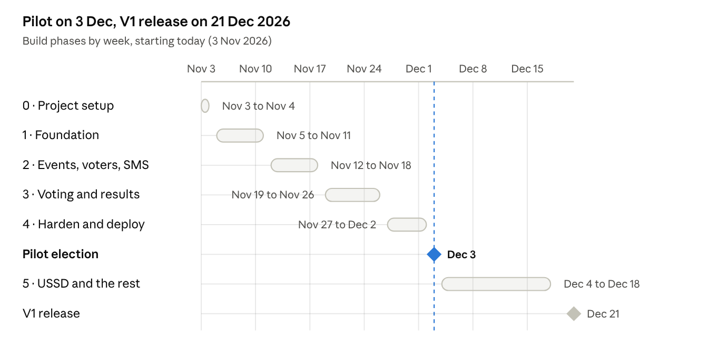

# Vote-Kidigit — Implementation Plan (V1)

Nov 3, 2026 · @Smartone

## 1. How Claude Code follows this plan

This plan builds Vote-Kidigit V1 in 40 numbered steps, from an empty repository to a production release, with a pilot election after step 35. Each step is small enough for one Claude Code session (a few hours of work), ends with passing tests, and produces one pull request. Place this file in the repository as docs/IMPLEMENTATION_PLAN.md.

### 1.1 Source documents

| File in docs/ | Use it for |
|---|---|
| PRD.md (V1.1) | What the product must do; requirement IDs (EVT-03, VOT-04…) |
| APP_FLOW.md (V1) | Every screen, route, state, message (screen IDs VTR-WEB-04…) |
| TECH_STACK.md (V1) | Exact package versions, server setup, conventions |
| DESIGN_SYSTEM.md (V1) | Tokens, components, wording |
| BACKEND_SCHEMA.md (V1) | Tables, RLS, functions, triggers, endpoints |
| IMPLEMENTATION_PLAN.md (this) | Order of work |

If documents disagree, follow the precedence in Design System 1.2 and record the conflict in the pull request description instead of guessing.

### 1.2 Session routine (every step)

1. Read CLAUDE.md, this step's **Read** list, and the progress checklist (section 10) to confirm earlier steps are done.
2. Create a branch step-NN-short-name from main.
3. Build only what the step lists. Anything else that seems needed goes in the PR description under "Follow-ups", not into the code.
4. Write the tests listed under **Done when** alongside the code.
5. Run pnpm lint && pnpm typecheck && pnpm test (and pnpm e2e from step 30 on). All must pass.
6. Update the step's checkbox in section 10 and commit with Conventional Commits (feat(events): …).
7. Open a pull request titled Step NN: <name> listing what was built, how it was tested, and any follow-ups. The owner reviews and merges before the next step starts.

Suggested prompt to start each session:

```
Read CLAUDE.md and docs/IMPLEMENTATION_PLAN.md. Implement Step NN exactly as written,
using only the versions in docs/TECH_STACK.md and the specs referenced in the step.
Follow the session routine in section 1.2. Stop and ask if anything is ambiguous.
```

### 1.3 Definition of done (applies to every step)

- ☐ Everything in the step's **Build** list exists and matches the referenced document sections.
- ☐ Every item in **Done when** is verified by an automated test or, where stated, a manual check written in the PR.
- ☐ Lint, type check and all tests pass in CI.
- ☐ No new dependency unless the Tech Stack lists it; no version changes.
- ☐ New tables have RLS policies, grants and an RLS test (Backend Schema 1.3).
- ☐ New screens implement loading, empty, populated, locked and error states, in light and dark mode, with Swahili and English strings where the screen is bilingual.
- ☐ Every state-changing endpoint writes an audit entry and has a permission decorator.
- ☐ No secrets, codes or ballot choices in logs, fixtures committed to the repo, or audit data.

### 1.4 Rules

- Steps are done **in order**. A step may start only when the previous one is merged, except where section 2 marks parallel work.
- Never edit an applied migration; add a new one.
- main is always deployable after step 34.
- Nothing is deployed to production while any event is Open.

## 2. Timeline

The pilot runs on web and kiosk from 3 Dec 2026, a month from today; USSD, the public website and the remaining should-have features follow, with V1 released on 21 Dec 2026. The plan assumes you plus Claude Code full-time, at about one step per working day.



timeline · 6 phases, pilot and V1 release

| Phase | Steps | Dates | Outcome |
|---|---|---|---|
| 0 · Project setup | 1–5 | 3–4 Nov | Monorepo, CI, design tokens |
| 1 · Foundation | 6–14 | 5–11 Nov | Database with RLS, staff sign-in, permissions, staff portal shell |
| 2 · Events, voters, SMS | 15–21 | 12–18 Nov | Event setup, voters, codes, publishing, SMS |
| 3 · Voting and results | 22–29 | 19–26 Nov | Web and kiosk voting, control room, results, PDF |
| 4 · Harden and deploy | 30–35 | 27 Nov – 2 Dec | Tests, load, security, server, deployment, rehearsal |
| Pilot election | 35 | From 3 Dec | First real election |
| 5 · USSD and the rest | 36–39 | 4–18 Dec | Pilot fixes, USSD, public site, remaining features |
| V1 release | 40 | 21 Dec | Penetration test, final load test, v1.0.0 |

Parallel work allowed: step 33 (server provisioning) can run alongside Phase 3 because it is done mostly by you on the VPS; prerequisites (section 3) run alongside everything.

## 3. Prerequisites

These are things only you can arrange. Each is needed by a specific step; start the slow ones (USSD short code, sender ID, domain) today.

| Item | Needed by step | Lead time | Notes |
|---|---|---|---|
| Development PC with Node.js 24.22.2, pnpm 11.28.10, Git, PostgreSQL 18.6, Redis 7.2, Chrome | 1 | Same day | Or Docker for PostgreSQL and Redis only, using the same image tags as CI |
| GitHub repository (private) and Claude Code connected to it | 1 | Same day | Branch protection on main: PR + passing CI required |
| The six documents exported as Markdown into docs/ | 1 | Same day | PRD.md, APP_FLOW.md, TECH_STACK.md, DESIGN_SYSTEM.md, BACKEND_SCHEMA.md, IMPLEMENTATION_PLAN.md |
| Inter 4.1 font files (InterVariable.woff2, italic) from the official Inter release | 5 | Same day | Download from the Inter project's GitHub releases |
| SMTP mailbox no-reply@ on the DirectAdmin server | 10 | 1 day | For invitations and password resets |
| NextSMS account, API credentials and an approved sender ID | 21 | Days to weeks | Sender ID approval is the slow part; start now |
| Sentry project (free tier) and DSNs for API, staff and voter apps | 8 | Same day | Optional until step 33 |
| VPS root SSH access, DirectAdmin admin login | 33 | Ready | Rocky Linux 9, 8 GB RAM |
| Domain DNS pointed to the VPS and Let's Encrypt in DirectAdmin | 33 | 1–2 days | Final domain name still to confirm |
| Off-site backup storage (another server or storage service reachable by rsync) | 33 | 1–3 days | Tech Stack 9.8 |
| Pilot organization details: name, logo, colour, time zone, help phone, staff emails, voter CSV, categories and contesters with photos | 34 | 1 week | Collect early; photos take time |
| USSD aggregator chosen, contract signed, short code applied for | 37 | 2–6 weeks | Start now; USSD is after the pilot |
| Penetration tester booked | 40 | 1–2 weeks | Before the first public event |

## 4. Phase 0 — Project setup (steps 1–5)

Goal: an empty but complete monorepo where every app builds, tests run in CI and the design tokens are in place. Dates: 3–4 Nov 2026.

### Step 1 — Initialize the monorepo

**Read:** Tech Stack 1, 2, 5, 11.

**Build:**

- Root files exactly as Tech Stack 5.2–5.4: package.json (with packageManager and engines), pnpm-workspace.yaml, .nvmrc, tsconfig.base.json, eslint.config.mjs, .prettierrc.json, .gitignore, .editorconfig.
- docs/ with the six Markdown documents.
- CLAUDE.md containing: project summary (3 lines), links to the six docs, Design System 1.1 and Tech Stack 1.1 rules, the coding conventions from Tech Stack 11, and the session routine from this plan's 1.2.
- pnpm approve-builds for exactly: argon2, puppeteer, prisma, @prisma/engines, sharp.

**Done when:** pnpm install --frozen-lockfile succeeds on a clean clone; pnpm lint passes; every version in every package.json is exact.

### Step 2 — Scaffold the apps and shared package

**Read:** Tech Stack 5.1, 6, 7.

**Build:**

- apps/api: NestJS 11.2.8 app with two entry points, src/main.ts (HTTP on PORT) and src/worker.ts (no HTTP), sharing one AppModule split into ApiModule / WorkerModule; Jest configured with ts-jest.
- apps/staff: Vite 8 + React 19 + Ant Design 6, base: '/app/', React Router 7 data router with one placeholder route.
- apps/voter: Vite 8 + React 19 + Tailwind 4, base: '/', routes /, /vote, /results/:token as placeholders.
- packages/shared: TypeScript library exporting from src/index.ts; folders api/, design/, i18n/, constants/.
- e2e: Playwright 1.64.1 config pointing at local URLs, one smoke test that loads each app.
- Dev scripts so pnpm dev runs API, worker and both apps; Vite proxies /api to localhost:3000.

**Done when:** pnpm build builds all four packages; pnpm test runs one passing test per app; pnpm dev serves the staff app at localhost:5173/app/ and the voter app at localhost:5174/.

### Step 3 — Local database and Redis

**Read:** Tech Stack 4, 9.2, 9.3, 10; Backend Schema 2, 10.1.

**Build:**

- deploy/sql/000_roles.sql creating vk_owner, vk_api, vk_readonly (Backend Schema 10.1) and a matching scripts/dev-db-setup.sh for the development PC.
- apps/api/.env.example with every variable from Tech Stack 10 (including the Backend Schema additions); .env git-ignored.
- Config module: loads and validates all environment variables with Zod at startup; refuses to start on a missing value.
- prisma.config.ts and an empty schema.prisma with schemas = ["public", "ballot", "audit"], generator prisma-client with moduleFormat = "cjs".
- Optional docker-compose.dev.yml with postgres:18.6 and redis:7.2 for developers who prefer containers.

**Done when:** the API starts locally, connects to PostgreSQL as vk_api and to Redis, and GET /api/health returns 200; it fails fast with a clear message if DATABASE_URL is wrong.

### Step 4 — Continuous integration

**Read:** Tech Stack 8.2.

**Build:** .github/workflows/ci.yml exactly as Tech Stack 8.2, plus a step that runs deploy/sql/000_roles.sql against the service database before migrations.

**Done when:** CI passes on the pull request; branch protection requires it.

### Step 5 — Design tokens and component gallery

**Read:** Design System 2–6, 12.

**Build:**

- packages/shared/src/design/: tokens.css (exactly 12.1), tokens.ts, brand.ts (deriveBrandTokens with unit tests for contrast rules in 3.4), theme.ts (preference storage and useEffectiveTheme).
- Inter font files in fonts/, copied to both apps' public/fonts/ at build.
- Staff: theme.ts exactly as 12.2, ConfigProvider and antd App wrapper; voter: index.css exactly as 12.3.
- Pre-paint theme script in both index.html files (12.4); theme toggle icon button.
- LogoMark component (2.2) in both apps.
- A development-only route /app/dev/components (staff) and /dev/components (voter) showing every token and every component variant as they are built, in both themes. It is excluded from production builds.

**Done when:** both apps render the gallery in light and dark mode with no hard-coded colours (a lint rule bans hex values and Tailwind arbitrary values in apps/*/src); deriveBrandTokens tests pass for light yellow, dark navy and the default colour.

## 5. Phase 1 — Foundation (steps 6–14)

Goal: tenants, staff accounts, sign-in, permissions and the staff portal shell, all protected by RLS. Dates: 5–11 Nov 2026.

### Step 6 — Database foundations

**Read:** Backend Schema 1.2, 2, 3, 10.1, 11.1, 13.2.

**Build:** migrations 000_roles_and_schemas (as deploy script), 001_helpers (app.current_org_id, current_user_id, is_platform_admin, set_updated_at, forbid_change), 002_enums (all enums in section 3, mirrored as Prisma enums and Zod enums in packages/shared). PrismaService with withContext(ctx, fn) that opens a transaction and runs the four set_config calls (2.3) before fn; a NestJS request-scoped RequestContext populated by middleware.

**Done when:** a test proves withContext sets and isolates settings per transaction (two concurrent transactions see their own app.org_id).

### Step 7 — Tenancy and identity tables with RLS

**Read:** Backend Schema 4, 10.2–10.5, 11.3, 11.6.

**Build:** migration 003_tenancy_identity (organizations, users, password_history, user_tokens, permissions, roles, role_permissions, user_roles) with RLS, grants and triggers; app.create_default_roles; rls.spec.ts test harness that creates two organizations and runs the isolation assertions for any table passed to it.

**Done when:** the RLS suite passes for every table in this migration; LAST_SUPER_ADMIN is raised when the last Org Super Admin is deactivated.

### Step 8 — API infrastructure

**Read:** Tech Stack 6.3, 11.2; Backend Schema 12.1; PRD AUD-01–04.

**Build:** global ZodValidationPipe; error filter producing {code, message, details} with the error codes in 12.1 (maps PostgreSQL P0001 messages to codes); structured JSON logging with request IDs and redaction (no bodies on /vote/*, /ussd/*); Helmet; trust proxy; throttler with Redis storage; AuditService.record(action, entity, before, after, reason) writing audit.audit_log in the caller's transaction; Sentry SDK; /health and /health/live-events.

**Done when:** tests cover the error format, redaction (a request body containing a code never appears in logs), rate limiting returning 429, and audit rows being written in the same transaction (rolled back together).

### Step 9 — Staff authentication

**Read:** Backend Schema 8.1; PRD USR-05–USR-09; App Flow 4.3.

**Build:** app.find_user_for_login; POST /auth/login, /auth/logout, GET/PATCH /me, POST /me/password; express-session with connect-redis (TTL = organization timeout, rolling); X-Session-Expires header; CSRF token check on state-changing requests; Argon2id hashing; lockout after 5 failures; session guard re-reading user status and permissions (30 s cache, invalidated on change).

**Done when:** tests cover successful login, wrong password, lockout and unlock time, deactivated user, suspended organization, CSRF rejection, idle expiry, and a deactivated user being rejected on the next request.

### Step 10 — Invitations, password reset and email

**Read:** Backend Schema 8.2; PRD USR-01–USR-02, USR-06, USR-08.

**Build:** user_tokens flows and endpoints (/auth/forgot, /auth/tokens/:token, /auth/invite/accept, /auth/reset); shared password-policy Zod schema; Nodemailer transport (DirectAdmin SMTP; in development a log transport that prints emails); email templates (invite, reset) in Swahili and English; email BullMQ queue (worker sends); CLI create-platform-admin.

**Done when:** tests cover expired, used and valid tokens, password policy, last-5 reuse, all sessions destroyed after reset, and the forgot endpoint returning 202 for unknown emails.

### Step 11 — Permissions and guards

**Read:** Backend Schema 9; PRD 3.

**Build:** migration seeding the permission catalogue (9.1); @RequirePermission decorator; PermissionGuard exactly as 9.3 (404 for unmapped or other-organization targets); GET /permissions; role and permission cache.

**Done when:** a table-driven test checks every default role against every permission (9.2) and the event-mapping rule for moderators and observers.

### Step 12 — Platform Super Admin

**Read:** App Flow 5.3; Backend Schema 12.3.

**Build:** platform endpoints (organizations list, create with first Org Super Admin invite and default roles, detail, edit, suspend/reactivate, resend invite, settings, platform audit, dashboard counts); platform context handling (app.is_platform_admin).

**Done when:** tests show a platform admin can create and suspend organizations, cannot read voters, and an Org Admin gets 404 on platform routes.

### Step 13 — Staff portal shell and sign-in screens

**Read:** App Flow 3.2–3.9, 4.3, 13.3; Design System 8.1–8.5, 9.3–9.8, 11.

**Build:** i18next setup (sw/en files in packages/shared/src/i18n, language switch); TanStack Query client with the error format; layout (sidebar by role, top bar with theme toggle, language, profile menu, breadcrumbs, search box placeholder); route guards; AUTH-01 to AUTH-05 screens; session expiry dialog; ERR-01/03/04/05 pages; shared EmptyState, StatusBadge, Banner, PageHeader, ConfirmDialog (with type-to-confirm and reason variants) components.

**Done when:** component tests for every shared component (all variants and states); a manual check in both themes and both languages is recorded in the PR with screenshots.

### Step 14 — Users, roles, settings, profile, audit and onboarding

**Read:** App Flow 7; Backend Schema 12.4; Design System 8.7–8.11.

**Build:** API: users, roles, organization, audit endpoints; UI: USR-01 to USR-05, SYS-01 audit log, SYS-03 organization settings (with logo upload placeholder until step 17 and brand colour preview using deriveBrandTokens), SYS-04 profile (theme radio), SYS-05 welcome, onboarding checklist card.

**Done when:** API tests for invite, role edits, deactivation rules (only moderator of an open event is checked later in step 26), and audit entries; UI tests for the role editor and user drawer.

## 6. Phase 2 — Events, setup, voters and messaging (steps 15–21)

Goal: a moderator can create an event, set up categories, contesters and voters, publish it and send codes by SMS. Dates: 12–18 Nov 2026.

### Step 15 — Event data model and lifecycle (part 1)

**Read:** Backend Schema 5, 9.4, 11.2, 11.5; PRD 4.

**Build:** migration 004_events (voting_events, event_assignments, categories, contesters, voters, category_voters) with RLS, setup-lock triggers, category window check, app.category_is_votable, app.voter_is_eligible, app.publish_checklist, and app.transition_event covering draft ↔ scheduled, → open, → cancelled, → archived. (Close, reopen and results publication are added in step 27.)

**Done when:** RLS suite passes for all new tables; trigger tests prove setup is locked after publish with only the allowed columns changeable (11.2 table); every invalid transition raises INVALID_TRANSITION; the checklist returns the six items correctly for a sample event.

### Step 16 — Events API and event workspace shell

**Read:** App Flow 3.4, 6.1–6.3, 6.9; Backend Schema 12.5; Design System 8.4–8.6.

**Build:** events endpoints (list, create, detail, edit, delete, checklist, assignments, activate/deactivate); EVT-01 event list with status filter chips; EVT-02 create dialog; event workspace with header (status badge, main action by status), tabs and "More" menu; EVT-03 Overview (Draft state with checklist card); EVT-09 Settings tab; Activity tab (filtered audit).

**Done when:** API tests for each endpoint and permission; UI tests for the list filters, create validation, and header button changing with status.

### Step 17 — Files and photos

**Read:** Backend Schema 7.6; Design System 7.6; PRD CAT-07.

**Build:** files table (in a new migration), upload service with type and size checks, Sharp processing (cover-crop to 5:7, 350 × 490 px, strip metadata, JPEG quality 82), storage under STORAGE_DIR, GET /files/:id with permission check; staff PhotoField component with the crop dialog (react-easy-crop); organization logo upload completed in SYS-03.

**Done when:** tests reject wrong types and files over 2 MB, store a 350 × 490 image, and refuse to serve another organization's file.

### Step 18 — Categories and contesters

**Read:** App Flow 6.4; Backend Schema 12.6; Design System 8.6 (category card); PRD CAT-01–CAT-08, RUL-01–RUL-07.

**Build:** category and contester endpoints, reorder, eligibility, bulk photo ZIP; EVT-04 with category cards, drag-and-drop ordering (dnd-kit), side panels for category, contester, rules (live rule sentence), eligibility; Yes/No badge for single-contester categories; withdraw action.

**Done when:** API tests for rule validation (exact, range, threshold, quorum), ordering, eligibility modes, and locks after publish; UI tests for the rules panel sentence and drag ordering (keyboard arrows).

### Step 19 — Voters, codes and CSV import

**Read:** App Flow 6.5, 6.6; Backend Schema 5.4, 5.5, 7.7, 12.7; PRD VTR-01–VTR-11, COD-01–COD-08.

**Build:** code service (8-character alphabet, crypto.randomInt, HMAC-SHA256 with CODE_HMAC_KEY, AES-256-GCM with CODE_ENCRYPTION_KEY, retry on unique conflict); voter endpoints (list with filters, add, edit, delete, bulk assign/unassign, regenerate); CSV template; import pipeline (upload → imports BullMQ job validates with Papa Parse and the shared Zod voter schema → preview → confirm → insert in batches of 500 inside withContext); EVT-05 voters tab with side panel and bulk bar; EVT-06 import page.

**Done when:** tests for code uniqueness, HMAC lookup, encrypt/decrypt round trip, no plain code in the database or logs, every CSV validation rule (duplicate membership ID, invalid phone, duplicate phone warning, bad gender), a 10,000-row import validated under 30 seconds, and locks after publish.

### Step 20 — Worker, scheduler and publishing

**Read:** Tech Stack 3.1, 6.1; Backend Schema 2.4, 11.9; App Flow 6.8, 6.11.

**Build:** worker.ts with BullMQ processors registered for sms, email, reports, imports, schedule; repeatable 1-minute schedule job calling app.due_transitions and processing each item in its organization's context; publish endpoints (publish with schedule / open now, unpublish, cancel, archive) with type-to-confirm checks; EVT-08 publish flow (checklist dialog with Fix links, schedule vs open now, optional send codes); Overview states for Scheduled and Cancelled.

**Done when:** tests prove a scheduled event opens within 60 s of start_at with the worker running, unpublish is refused after first_code_sent_at, and the checklist blocks publishing with the right items.

### Step 21 — SMS and email messaging

**Read:** App Flow 6.7; Backend Schema 7.1–7.3, 12.8, 12.12; PRD SMS-01–SMS-09; Design System 11.7.

**Build:** migration for sms_templates, sms_batches, sms_messages; template rendering with the placeholder whitelist and SMS segment count; NextSmsAdapter (global fetch, AbortSignal.timeout(10000), credentials from config; a FakeSmsAdapter in development and tests that records messages); batch creation and sending (decrypt code only in the worker, store redacted body, 3 retries with backoff, pause at > 20% failures); delivery-report webhook updating messages, voters.code_status and batch counters; first_code_sent_at; scheduled reminders; email channel through the email queue; EVT-07 Messages tab (templates editor with preview and counter, schedule settings, send dialog, batch table with drill-down, resend failed).

**Done when:** tests with the fake adapter cover sending to 5,000 voters, redaction, retries, auto-pause, resume, DLR updates, resend of the same code and regenerate; a manual test sends one real SMS to your phone through NextSMS in development (recorded in the PR).

## 7. Phase 3 — Voting, kiosk, control room, results and reports (steps 22–29)

Goal: voters can vote on the web and at a kiosk, staff can watch turnout, close voting, resolve ties, publish results and download the PDF. Dates: 19–26 Nov 2026.

### Step 22 — Secret ballot in the database

**Read:** Backend Schema 1.3, 6.1–6.3, 10.3, 11.1, 11.4.

**Build:** migration 005_ballot (ballot schema, ballots, ballot_selections, voter_participation, immutability triggers, grants, app.cast_ballot).

**Done when:** database tests prove: vk_api gets permission denied reading ballot.*; one vote per voter per category even with 20 concurrent cast_ballot calls for the same voter; votes rejected after end_at and after status leaves open; closed and ineligible categories rejected while others in the same submission are recorded; every rule mode (exact, range, skip, Yes/No) accepted and rejected correctly; ballots carry only event_id and received_hour; no UPDATE or DELETE possible on ballots or participation.

### Step 23 — Voter API

**Read:** Backend Schema 2.4, 8.3, 8.4, 12.11; App Flow 8.2, 8.3, 13.1.

**Build:** bootstrap functions (resolve_event, find_voter_by_credentials, resolve_results_token); /vote/* endpoints; ballot token in Redis (10-minute idle); attempt counting and 15-minute lock; per-voter shuffled contester order (seed in token); status computation (VTR-WEB-07, 8.3 table); vote-confirmation SMS queued after submit; turnout counter in Redis.

**Done when:** tests cover sign-in success, wrong code with attempts left, lock and unlock, several events matching (CHOOSE_EVENT), "Si mimi", each status screen state, stable shuffle within a session, submission with a category closed meanwhile, and that no log line contains a code or selection.

### Step 24 — Voter web app

**Read:** App Flow 3.8, 8; Design System 5.4, 10.1–10.9, 11; wireframes in App Flow 14.1.

**Build:** VoterHeader, VoterActionBar, HelpLine, PoweredBy; organization brand injection (12.5); screens VTR-WEB-01 to VTR-WEB-08 with BallotProgress, ContesterCard (single and multi-select), YesNoChoice, skip link, ReviewRow, identity card and all status screens; Swahili strings; route-level code splitting; 10-minute idle handling; browser back after submit returns to the confirmation.

**Done when:** component tests for contester selection rules (Next disabled until met, limit reached disables others), review change links, status screens; Playwright test of the full web vote; vite build shows first-load JavaScript under 200 KB gzip for /vote.

### Step 25 — Kiosk

**Read:** App Flow 10; Backend Schema 7.4, 7.5, 8.3, 11.8, 12.9; Design System 10.10.

**Build:** migration for kiosk tables and the other-phone limit trigger; kiosk session endpoints (launch with PIN, list, end, heartbeat, exit with PIN and 3-try lock); /vote/kiosk/send-code including the staff-approved other phone; KSK-00 to KSK-06 screens in the voter app (light mode forced, keypad, 60-second idle reset, 10-second return countdown); "Launch kiosk on this device" in the staff portal.

**Done when:** tests cover PIN checks, re-sending the existing code, the 3-voters-per-number limit, already-voted short-circuit, and kiosk channel recorded on participation; Playwright test of a kiosk vote.

### Step 26 — Control room and live turnout

**Read:** App Flow 6.10; Design System 9.9, wireframes in App Flow 14.2; Backend Schema 11.10, 12.5.

**Build:** GET /events/:id/live (turnout total, per category, per channel, countdowns, alerts for lockouts, SMS failures, categories closing in 5 minutes); category manual open/close endpoints; CTL-01 Live tab with 30-second refresh and "Updated n s ago"; Open-state Overview; send-reminder-to-non-voters action; block deactivating the only moderator of an open event.

**Done when:** tests show turnout matches participation counts, no contester-level numbers are returned before close, and manual category close is permanent.

### Step 27 — Closing, results and publication

**Read:** Backend Schema 6.4–6.7, 11.5, 11.7, 12.10; App Flow 11; PRD RES-01–RES-07.

**Build:** migration 006_results (snapshots, stats, rows, tie resolutions, tally_event, freeze_results, resolve_tie, and transition_event extended with close, reopen and results publication); close, reopen and results endpoints; RES-01 Results tab (before close, calculating, summary, category detail RES-02), tie dialog RES-03, publish with type-to-confirm, public link copy/disable; RES-04 public results page and VTR-WEB-08 voter results; results-published SMS.

**Done when:** tests compute correct winners for plurality, multiple seats, threshold, quorum and Yes/No; detect a tie at the last seat; block publication until ties are resolved; produce the same content_hash for the same data; forbid changes after publication; reopen keeps existing ballots and still blocks double votes; the public page respects "winners only".

### Step 28 — Reports

**Read:** PRD REP-01, REP-02; Backend Schema 7.7, 12.10; Design System 1.3 (PDF).

**Build:** report jobs; results PDF from an HTML template rendered by one shared Puppeteer browser in the worker (organization logo, event details, per-category results, winners, tie notes, turnout, timestamps, signature lines, QR code to the public page, content hash); registered-voters report as PDF and XLSX (ExcelJS) with voted / not voted and masked phones; audit export XLSX; instant download up to 5,000 voters, background job above; recent downloads list.

**Done when:** snapshot tests of the PDF HTML; a 5,000-voter results PDF generates in under 10 seconds; the voters report never contains choices or codes.

### Step 29 — Dashboards, search and state sweep

**Read:** App Flow 5, 12, 13; Backend Schema 12.4.

**Build:** dashboard endpoint and DSH-01 to DSH-04 cards with independent loading and errors; landing rules after sign-in (5.1); global search; a sweep of every screen against the empty-state catalogue (App Flow 12) and error catalogue (App Flow 13), fixing gaps.

**Done when:** each dashboard role shows the right cards; search respects permissions; a checklist of every App Flow 12 and 13 row is ticked in the PR.

## 8. Phase 4 — Hardening, deployment and pilot (steps 30–35)

Goal: prove the system is correct, secure and fast enough, put it on the VPS and run the pilot election. Dates: 27 Nov – 2 Dec 2026; pilot from 3 Dec 2026.

### Step 30 — End-to-end tests and accessibility

**Read:** Tech Stack 8.1; Design System 13.1; App Flow 6.12, 8.4.

**Build:** Playwright suites run against a locally started full stack with the fake SMS adapter: (1) moderator: create → categories → contesters → CSV import → publish → send codes → open; (2) voter: sign in → identity → ballot → review → submit → already voted; (3) kiosk vote with other phone; (4) close → tie → resolve → publish → public page → PDF; (5) permission checks for observer and unmapped moderator. Keyboard-only run of the voter flow; both themes.

**Done when:** all suites pass in CI; the Design System 13.1 checklist is ticked in the PR with notes.

### Step 31 — Load test

**Read:** PRD NFR-01–NFR-06; Tech Stack 8.1.

**Build:** scripts/load/ Node script using global fetch and Promise.all: seeds an event with 5,000 voters and known codes, then runs sign-in + ballot + submit for all 5,000 over 30 minutes, with a burst of 30 per second in the first 2 minutes; reports p50/p95/p99 and errors. Run it against a production-like build on your PC, then again on the VPS after step 34 (on a test organization, before the pilot data is loaded).

**Done when:** p95 submit under 2 s, zero failed ballots, turnout equals 5,000, and results compute in under 60 s at close. Any fix gets its own commit with before/after numbers.

### Step 32 — Security review

**Read:** PRD 8.3, 8.4; Backend Schema 10.5; Tech Stack 6.3, 11.2.

**Build:** complete RLS suite for every tenant table; tests for IDOR (every :id route with another organization's ID returns 404); session fixation, CSRF and cookie flags; rate limits on all public endpoints; upload checks; headers (Helmet, CSP for both apps); log redaction review; pnpm audit with no high or critical issues in used code; secrets only in .env on the server; a written threat-model summary in docs/SECURITY.md.

**Done when:** all security tests pass; docs/SECURITY.md merged; outstanding items listed for the penetration test in step 40.

### Step 33 — Server provisioning

**Read:** Tech Stack 3, 4, 9.

**Build (with you on the server):** follow Tech Stack 9.1–9.5 and 9.8 exactly: base setup and firewall, Node 24.22.2 via nvm for user vk, PM2 6.0.14 with startup, PostgreSQL 18.6 from PGDG with tuning and dnf versionlock, the three database roles and pg_trgm, Redis 7.2 with noeviction, Chromium libraries, storage folders, DirectAdmin proxy and SPA routing, Let's Encrypt, backup scripts (pg_dump daily, hourly during open events, WAL archive, off-site rsync) with a test restore. Record exact installed versions in docs/server-versions.md.

**Done when:** deploy/verify-server.sh (written in this step) checks every version, service and port and passes; a backup was restored to a scratch database successfully.

### Step 34 — Deployment pipeline and first release

**Read:** Tech Stack 9.6, 9.7; Backend Schema 13.2, 13.3.

**Build:** deploy/ecosystem.config.cjs; .github/workflows/deploy.yml (build in CI → live-events safety check → rsync release → pnpm install --prod --frozen-lockfile → prisma migrate deploy as vk_owner → copy frontends → switch symlink → pm2 reload), keeping 5 releases; rollback script; production .env on the server; Sentry DSNs; first deploy; create the Platform Super Admin with the CLI; create the pilot organization and its Org Super Admin.

**Done when:** a tagged release deploys with zero downtime; rollback to the previous release works; smoke test on production passes (sign in, create a test event, vote with a test voter, close, PDF), then the test event is cancelled and archived.

### Step 35 — Pilot rehearsal and pilot election

**Read:** PRD 10.2; App Flow 6, 10.

**Build:**

- docs/RUNBOOK.md: before the event (checklist, SMS balance, sender ID, kiosk devices charged, help phone staffed), during (control room, what to watch, how to resend codes, how to handle "I didn't get my code", outage steps, who can extend), after (close, ties, publish, PDF, backups).
- Rehearsal: a full dress rehearsal with the pilot's staff on production using a rehearsal event of 20 real phones, real SMS, web and kiosk; collect issues.
- Pilot day: you and Claude Code on standby; no deployments while the event is open.

**Done when:** rehearsal issues are fixed or accepted in writing; the pilot election closes, results are published and the PDF is handed to the organization; a pilot report (turnout, SMS delivery rate, incidents, feedback) is added to docs/PILOT_REPORT.md.

## 9. Phase 5 — USSD, public site, remaining features and V1 release (steps 36–40)

Goal: add everything the pilot did not need and release V1. Dates: 4–21 Dec 2026.

### Step 36 — Pilot fixes

**Read:** docs/PILOT_REPORT.md.

**Build:** fixes for every pilot issue rated must-fix, each as its own small PR referencing the issue; update the documents where behaviour changed.

**Done when:** all must-fix items closed; regression tests added for each bug.

### Step 37 — USSD voting

**Read:** App Flow 9; Backend Schema 8.5, 12.12; PRD VOT-04, VOT-05.

**Build:** UssdAdapter interface (parseRequest, formatResponse) with the chosen aggregator's adapter and a GenericTestAdapter; USSD menu engine as a state machine (states VTR-USSD-01 to 10) with Redis session state; paging (6 per screen, continuous numbering), multi-select parsing (1 4, 1,4), skip (0), review and confirm; results menu; callback endpoint with secret and IP allow-list; 182-character guard on every screen; aggregator sandbox test.

**Done when:** unit tests walk every state and error path; a test asserts no screen exceeds 182 characters for the longest seeded names; a sandbox session with the aggregator votes successfully; load test re-run including 30% USSD traffic.

### Step 38 — Public website

**Read:** App Flow 4.1; Design System 10.11.

**Build:** PUB-01 to PUB-05 in the voter app at /, /features, /pricing, /contact, /demo, in English and Swahili; contact and demo forms posting to POST /api/v1/public/contact (rate-limited, emails the Vote-Kidigit team, no account created); static phone-frame screenshot of the ballot.

**Done when:** pages pass the accessibility checklist; forms validate and send in both languages; home page first load under 200 KB gzip.

### Step 39 — Remaining V1 features

**Read:** PRD 2.2 and every S-priority requirement; App Flow 15.1.

**Build:** any S-priority item not yet done, verified one by one against the PRD: email delivery of codes, staff portal Swahili completeness, compact table density toggle, bulk photo ZIP for voters, automatic archiving after archive_after_days, audit export, organization suspension edge cases, observer screens polish, quorum display on PDF. Update the PRD change log for anything deferred.

**Done when:** a PRD traceability table (docs/TRACEABILITY.md: requirement ID → code location → test) shows every M and S requirement implemented and tested, or explicitly deferred with your approval.

### Step 40 — V1 release

**Read:** docs/SECURITY.md, docs/RUNBOOK.md.

**Build:** penetration test on production with a test organization; fix findings; final load test on the VPS (web, kiosk and USSD mix); update all six documents to match what was built; tag v1.0.0; release notes.

**Done when:** no open high or critical findings; load test meets PRD NFR-01; documents updated; v1.0.0 deployed.

## 10. Progress checklist, risks and change control

Tick a step only when its pull request is merged. Claude Code updates this list in the repository copy at the end of each step.

### 10.1 Progress checklist

**Phase 0 — Project setup**

- ☑ 1. Initialize the monorepo
- ☑ 2. Scaffold the apps and shared package
- ☑ 3. Local database and Redis
- ☑ 4. Continuous integration
- ☑ 5. Design tokens and component gallery

**Phase 1 — Foundation**

- ☑ 6. Database foundations
- ☑ 7. Tenancy and identity tables with RLS
- ☑ 8. API infrastructure
- ☑ 9. Staff authentication
- ☐ 10. Invitations, password reset and email
- ☐ 11. Permissions and guards
- ☐ 12. Platform Super Admin
- ☐ 13. Staff portal shell and sign-in screens
- ☐ 14. Users, roles, settings, profile, audit and onboarding

**Phase 2 — Events, setup, voters and messaging**

- ☐ 15. Event data model and lifecycle (part 1)
- ☐ 16. Events API and event workspace shell
- ☐ 17. Files and photos
- ☐ 18. Categories and contesters
- ☐ 19. Voters, codes and CSV import
- ☐ 20. Worker, scheduler and publishing
- ☐ 21. SMS and email messaging

**Phase 3 — Voting and results**

- ☐ 22. Secret ballot in the database
- ☐ 23. Voter API
- ☐ 24. Voter web app
- ☐ 25. Kiosk
- ☐ 26. Control room and live turnout
- ☐ 27. Closing, results and publication
- ☐ 28. Reports
- ☐ 29. Dashboards, search and state sweep

**Phase 4 — Hardening, deployment and pilot**

- ☐ 30. End-to-end tests and accessibility
- ☐ 31. Load test
- ☐ 32. Security review
- ☐ 33. Server provisioning
- ☐ 34. Deployment pipeline and first release
- ☐ 35. Pilot rehearsal and pilot election

**Phase 5 — V1 completion**

- ☐ 36. Pilot fixes
- ☐ 37. USSD voting
- ☐ 38. Public website
- ☐ 39. Remaining V1 features
- ☐ 40. V1 release

### 10.2 Risks to the schedule

| Risk | Effect | Response |
|---|---|---|
| NextSMS sender ID not approved in time | Codes can't be sent in the pilot | Apply now; fallback: NextSMS default sender for the pilot, agreed with the organization |
| Steps take longer than a day | Pilot date slips | Phase 5 items never move earlier; if Phase 3 runs late, drop step 29's search (keep dashboards) and the bulk ZIP from step 18 to after the pilot |
| USSD aggregator delays | USSD missing in V1 | USSD is already after the pilot; V1 can ship web + kiosk with USSD as V1.1 |
| Load test fails on the VPS | Pilot capacity risk | Pilot has under 1,000 voters; fixes continue before V1 |
| Pilot data arrives late or messy | Rehearsal slips | Send the CSV template to the organization now; import validation catches errors |
| A document is unclear during a step | Claude Code guesses | Rule: stop and ask; the answer is written back into the document |

### 10.3 Change control

- A change to scope, behaviour or design is first written into the relevant document (with a change-log line), then implemented.
- New dependencies or version changes: update the Tech Stack first (Tech Stack 12.3 policy).
- Database changes: a new migration plus an update to the Backend Schema in the same pull request.
- Dates in this plan replace the release-plan dates in PRD 10.1.
