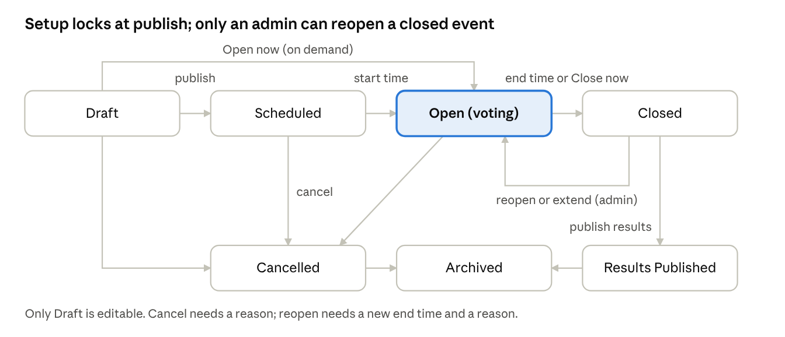
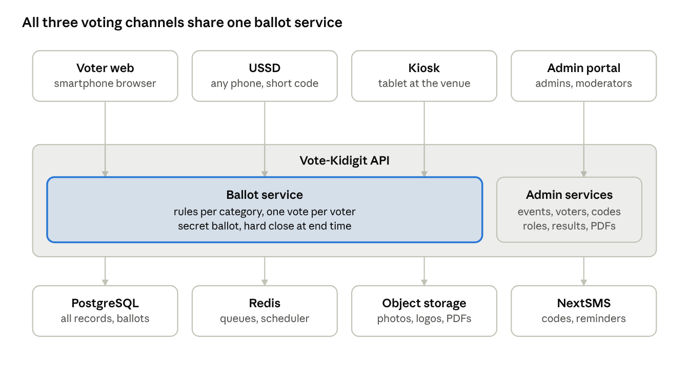

# Vote-Kidigit — Product Requirements Document (V1)

Nov 2, 2026 · @Smartone

## 1. Overview

Vote-Kidigit is a multi-tenant electronic voting platform. Organizations use it to run secret-ballot elections end to end: set up events and positions, register voters, send each voter a unique code by SMS, run voting on web, USSD and kiosk, and publish results with a downloadable PDF. V1 targets a pilot election within two weeks of this document.

| Item | Value |
|---|---|
| Product name | Vote-Kidigit |
| Document | Product Requirements Document, Version 1.1 (Draft, updated 3 Nov 2026) |
| Release covered | V1 (MVP), all three roles included |
| Audience | Development team, client organizations, investors |
| Primary language | Swahili (voter-facing); English and Swahili (admin portal) |

**Change log**

| Version | Date | Changes |
|---|---|---|
| 1.1 | 3 Nov 2026 | Review screen before submit on web, USSD and kiosk; membership ID entered before the code; staggered category windows confirmed; Unpublish to Draft until codes are sent; kiosk identity by membership ID and SMS code, with someone else's phone allowed under staff approval; no staff notification bell or email alerts in V1. Aligned with the App Flow Document (V1). |
| 1.0 | 2 Nov 2026 | First draft |

### 1.1 Problem

Organizations run elections on paper today. Paper voting is slow to count, hard to audit, and easy to dispute. Counting delays results by hours or days, and a single miscount can trigger a re-run.

### 1.2 Vision

Any organization can run a trusted election in which every eligible voter votes once, in secret, from any phone, and results are ready the moment voting closes.

### 1.3 Target customers

Any organization that holds elections: associations, SACCOs, cooperatives, schools and universities, religious bodies, companies, professional bodies and community groups. Government or national elections are out of scope.

### 1.4 Glossary

| Term | Meaning |
|---|---|
| Organization (tenant) | A customer account. Its users, events, voters and results are isolated from every other organization. |
| Voting event | One election, e.g. "2027 AGM Elections". Has a start and end date-time. |
| Category / position | A seat being contested inside an event, e.g. "Chairperson". |
| Contester | A candidate standing in a category. |
| Voter | A person registered to vote in one event. |
| Membership ID | The voter's identifier in their organization (the "voter's ID" field). |
| Voting code | A system-generated, alphanumeric code sent by SMS, unique per voter per event. |
| Ballot | The set of choices one voter submits for all their assigned categories. |
| Turnout | Share of registered voters who have submitted a ballot. |

## 2. Goals, success metrics and scope

V1 succeeds if it runs 5 elections a month with zero disputed results and publishes results the moment voting closes.

### 2.1 Success metrics

| Metric | Target | How measured |
|---|---|---|
| Events run per month | 5 | Events reaching Closed status |
| Turnout | 100% of registered voters (aspirational; report actual) | Ballots submitted ÷ voters registered, per event |
| Time to results | Results available at close time, under 1 minute | Close timestamp vs. results-ready timestamp |
| Disputed results | 0 | Disputes logged by moderators |
| SMS delivery | ≥ 98% delivered on first send | NextSMS delivery reports |
| Peak load | 5,000 voters within 30 minutes, no failed ballots | Load test before each large event |

### 2.2 In scope for V1

- Multi-tenant organizations with fully configurable roles and permissions
- Roles: Super Admin, Admin, Moderator, Observer, Voter
- Voting events with full lifecycle, scheduling and on-demand open/close
- Categories with contesters (name, photo, optional party), display order and per-category rules
- Voter registration by manual entry and CSV upload; mapping voters to categories
- Voting codes delivered by SMS (NextSMS) and email; resend and regenerate
- Voting on mobile web, USSD and kiosk (in-person)
- Secret ballot
- Live turnout during voting; results after close; publish results via public link
- Results PDF and registered-voters report (PDF and Excel)
- Audit log of all admin and moderator actions

### 2.3 Out of scope for V1

- "None of the above" (None Contester) option — deferred
- Ranked or preferential voting
- Billing, subscriptions and payments
- AI features (the name is branding only for V1)
- Native Android/iOS apps
- Voter groups (branch, region, department)
- Vote receipts or individual vote verification
- Integrations with membership systems or national ID (NIDA)
- Cloning or duplicating events
- Charts and dashboards beyond turnout and result tables
- Changing a vote after submission
- Government or national elections

Staff notifications: V1 has no notification bell and no email alerts for staff. Alerts such as SMS failures or ties appear as banners on the relevant page.

## 3. Users, roles and permissions

Access is role- and permission-based: a role is a named bundle of permissions, and each organization's Admins can create custom roles. Two Admins can therefore hold different permissions. The roles below ship as defaults.

### 3.1 Roles

| Role | Scope | Who | Summary |
|---|---|---|---|
| Platform Super Admin | All organizations | Vote-Kidigit operations staff | Creates organizations and their first Org Super Admin; manages platform settings. Cannot see ballot contents. |
| Org Super Admin | One organization | Customer's account owner | All Admin permissions; manages roles and permissions; cannot be restricted or deleted by other Admins. At least one must exist per organization. |
| Admin | One organization | Customer staff | Manages moderators, events and categories; maps moderators to events; has every Moderator capability on all events. |
| Moderator | Events mapped to them only | Election officers | Runs the events they are mapped to: setup, voters, SMS, open/close, results. |
| Observer | Events mapped to them only | Candidate agents, election committee | Read-only: event setup, live turnout, results after close, audit log for that event. |
| Voter | One event (per code) | Registered members | Authenticates with voting code + membership ID, votes once, views published results. |

A person may hold a staff role and also be a voter in the same event (answer 16). Their staff account and voter record are separate; holding a staff role never reveals how they or anyone else voted.

### 3.2 Permission model

- Permissions are fine-grained actions (e.g. event.create, event.publish, voters.upload, results.publish).
- An Org Super Admin creates roles, ticks permissions per role, and assigns roles to users.
- Moderator and Observer permissions apply only to events they are mapped to. An event can have many moderators and observers.
- No action requires a second approver (no maker-checker) in V1.
- Every permission change is written to the audit log.

### 3.3 Default permission matrix

Custom roles can change any cell except those marked "fixed".

| Permission | Org Super Admin | Admin | Moderator (mapped events) | Observer (mapped events) |
|---|---|---|---|---|
| Manage roles and permissions | Yes (fixed) | No | No | No |
| Create / edit / delete admins | Yes | No | No | No |
| Create / edit / deactivate moderators and observers | Yes | Yes | No | No |
| Map moderators and observers to events | Yes | Yes | No | No |
| Organization settings (time zone, branding, SMS templates) | Yes | Yes | No | No |
| Create event | Yes | Yes | Yes | No |
| Edit event (draft only) | Yes | Yes | Yes | No |
| Activate / deactivate event | Yes | Yes | No | No |
| Publish, open, close, cancel event | Yes | Yes | Yes | No |
| Reopen or extend a closed event | Yes | Yes | No | No |
| Create / edit / activate / deactivate categories | Yes | Yes | Yes | No |
| Manage contesters | Yes | Yes | Yes | No |
| Add / upload / edit voters (before voting starts) | Yes | Yes | Yes | No |
| Map voters to categories | Yes | Yes | Yes | No |
| Send bulk SMS / email, resend or regenerate codes | Yes | Yes | Yes | No |
| Operate kiosk mode | Yes | Yes | Yes | No |
| View live turnout | Yes | Yes | Yes | Yes |
| View results (after close) | Yes | Yes | Yes | Yes |
| Resolve ties | Yes | Yes | Yes | No |
| Publish results to voters / public link | Yes | Yes | Yes | No |
| Download results PDF and voter reports | Yes | Yes | Yes | Yes |
| View audit log | Yes | Yes | Own events | Own events |
| Vote | Only with a voter code | Only with a voter code | Only with a voter code | Only with a voter code |

Assumption: Moderators can create events (answer 14). An event a moderator creates is automatically mapped to them.

## 4. Event lifecycle and status rules

An event moves through seven statuses. Only a Draft can be edited; once published, its setup is locked.

event lifecycle · 7 statuses

Voting happens only in Open; every path ends in Archived, and Cancelled events never produce results.

### 4.1 Statuses

| Status | Meaning | Editable? | Voters can |
|---|---|---|---|
| Draft | Being set up | Yes, everything | Nothing |
| Scheduled | Published; waiting for its start date-time | No | Receive code; see "voting opens at…" |
| Open | Voting in progress | No | Vote once |
| Closed | Voting ended; results calculated | No | See "results pending" |
| Results Published | Results visible to voters and on the public link | No | View results |
| Cancelled | Stopped by staff; no results produced | No | See "event cancelled" |
| Archived | Read-only history | No | View results if previously published |

### 4.2 Transitions

| From | To | Trigger | Who |
|---|---|---|---|
| Draft | Scheduled | "Publish" with a future start time | Admin, Moderator |
| Draft or Scheduled | Open | "Open now" (on demand); ignores the configured start time | Admin, Moderator |
| Scheduled | Open | Start date-time reached | System |
| Open | Closed | End date-time reached, or "Close now" (no reason required) | System, Admin, Moderator |
| Closed | Open | "Reopen / extend" with a new end time and a mandatory reason | Admin |
| Closed | Results Published | "Publish results" (blocked while any tie is unresolved) | Admin, Moderator |
| Draft, Scheduled or Open | Cancelled | "Cancel event" with a reason | Admin, Moderator |
| Results Published or Cancelled | Archived | Manual, or automatically after a configurable period | Admin |

### 4.3 Rules

1. **Publish validation.** An event can be published only if it has a name, start and end date-time (end after start), at least one active category, at least one contester per category, voters mapped to every category, and valid rules per category.
2. **Locked after publish.** Event, categories, contesters, rules and voters cannot be edited after publish (answer 20). A Scheduled event can return to Draft ("Unpublish to Draft") until the first code SMS is sent; after that, staff must cancel and recreate the event to change anything. (Updated 3 Nov 2026.)
3. **Activate / deactivate** is separate from status. A deactivated event is hidden from moderators, observers and voters and cannot change status. An Open event cannot be deactivated; staff must close or cancel it first. This prevents votes being silently lost mid-election.
4. **Hard close.** When an event is Closed, the server rejects every ballot, including one already on screen. A ballot whose submission reaches the server before the end time is counted, even if processing finishes after.
5. **Reopen / extend.** Ballots already cast are kept. Voters who already voted still cannot vote again. Voters are notified by SMS of the new end time.
6. **Time zone.** All times are entered and shown in the organization's time zone (default Africa/Dar_es_Salaam) and stored in UTC.

### 4.4 Category status

Each category has an active/inactive flag and its own open and close times, which must sit inside the event window. Staff can also open or close a category manually. A category is votable only when the event is Open, the category is active, and the current time is within its window (or it was opened manually).

A voter votes in all of their currently open assigned categories in one session (answer 41). If categories open at different times, a voter keeps the right to vote later in any assigned category that was not yet open when they first voted. Confirmed 3 Nov 2026. A closed category never accepts votes, and a voter can never vote twice in the same category.

## 5. Functional requirements

Requirements are numbered by module. Priority: **M** = must have for V1 pilot, **S** = should have in V1, **C** = could have if time allows.

### 5.1 Organizations (multi-tenancy)

| ID | Requirement | Priority |
|---|---|---|
| ORG-01 | Platform Super Admin creates an organization with name, logo, time zone, contact email and phone. | M |
| ORG-02 | Creating an organization creates its first Org Super Admin and emails them a set-password link. | M |
| ORG-03 | All data (users, events, voters, ballots, files, SMS logs) is isolated per organization; no screen, API, report or export can return another organization's data. | M |
| ORG-04 | Organization settings: time zone (default Africa/Dar_es_Salaam), logo, primary colour, SMS sender ID, default SMS templates, archive period. | M |
| ORG-05 | Platform Super Admin can suspend an organization; suspended organizations cannot log in or run events. | S |

### 5.2 Users, roles and authentication (staff)

| ID | Requirement | Priority |
|---|---|---|
| USR-01 | Admins create, view, edit, deactivate and delete moderators and observers (name, email, phone, role, status). | M |
| USR-02 | New staff receive an email invitation with a one-time set-password link, valid 48 hours. | M |
| USR-03 | Org Super Admin creates custom roles and ticks permissions from the full permission list (section 3.3). | M |
| USR-04 | Admins map one or more moderators and observers to an event, and remove them. | M |
| USR-05 | Staff log in with email and password. | M |
| USR-06 | Password policy: minimum 10 characters with upper case, lower case and a number; last 5 passwords cannot be reused; account locks for 15 minutes after 5 failed attempts. | M |
| USR-07 | Sessions expire after 15 minutes of inactivity (configurable per organization, 5–60 minutes). | M |
| USR-08 | Forgot-password flow by email link. | M |
| USR-09 | A user deactivated mid-session is logged out on their next request. | M |

### 5.3 Voting events

| ID | Requirement | Priority |
|---|---|---|
| EVT-01 | Create an event with name, start date-time and end date-time. Status starts as Draft. | M |
| EVT-02 | Edit any field while the event is Draft; all setup is locked after publish (section 4.3). | M |
| EVT-03 | Publish on schedule (opens automatically at start time) or open on demand ("Open now"). | M |
| EVT-04 | Close on schedule (end time) or on demand ("Close now"). | M |
| EVT-05 | Cancel an event with a reason; voters are notified by SMS. | M |
| EVT-06 | Admin reopens or extends a Closed event with a new end time and a reason. | M |
| EVT-07 | Admin activates and deactivates an event (rules in section 4.3). | M |
| EVT-08 | Event list filtered by status, with search by name; moderators see only mapped events. | M |
| EVT-09 | Event setting: show contester "party/group" field on or off. | S |
| EVT-10 | Event setting: results visibility — full counts and percentages, or winners only. | M |
| EVT-11 | Publish validation checklist shown before publishing, listing every blocking issue. | M |

### 5.4 Categories and contesters

| ID | Requirement | Priority |
|---|---|---|
| CAT-01 | Create, edit, activate and deactivate categories in a Draft event: name, optional picture, display order. | M |
| CAT-02 | Each category has optional open and close times inside the event window, plus a manual open/close toggle. | M |
| CAT-03 | Add, edit and remove contesters: name (required), photo (optional), party/group (optional, shown only if enabled for the event). | M |
| CAT-04 | Contesters can be withdrawn only before voting starts. | M |
| CAT-05 | Categories appear on the ballot in display order; contesters appear in random order, shuffled separately for each voter. | M |
| CAT-06 | A category with exactly one contester becomes a Yes/No vote automatically. | M |
| CAT-07 | Photos (contesters and voters) follow passport format 25 × 35 mm (5:7 ratio): JPG or PNG up to 2 MB, cropped in the browser to 5:7 and stored at 350 × 490 px. | M |
| CAT-08 | Bulk upload of contester photos as a ZIP, matched by file name. | S |

### 5.5 Voting rules (per category)

| ID | Rule | Options | Priority |
|---|---|---|---|
| RUL-01 | Selection mode | "Exactly N" or "Between min and max" | M |
| RUL-02 | Seats | Number of winners (default 1) | M |
| RUL-03 | Allow skipping | On: voter may leave the category blank. Off: a selection is required. | M |
| RUL-04 | Winner rule | Plurality (top N by votes) or Threshold (must reach a set % of valid votes, e.g. 50% + 1) | M |
| RUL-05 | Quorum | Optional minimum turnout % for the category result to be valid | S |
| RUL-06 | Ties | Flagged for manual resolution. The moderator records the outcome and a reason; results cannot be published until all ties are resolved. | M |
| RUL-07 | Eligible voters | All event voters, or a selected subset (section 5.6) | M |

For Yes/No categories, the contester wins when Yes votes exceed No votes (or meet the threshold, if set). If a threshold or quorum is not met, the result shows "No winner — threshold not met" and staff decide next steps outside the system.

### 5.6 Voter registration and mapping

| ID | Requirement | Priority |
|---|---|---|
| VTR-01 | Add a voter manually: full name, membership ID, phone number, gender (required); email and photo (optional). | M |
| VTR-02 | Upload voters from CSV using a downloadable template with columns full_name, membership_id, phone, gender, email, photo_file. | M |
| VTR-03 | Before import, show a preview: valid rows, rows with errors (and why), and warnings. Staff confirm before anything is saved. | M |
| VTR-04 | Validation: membership ID unique within the event (duplicate = error); phone normalized to +255 format (invalid = error); same phone on several voters = warning, allowed; gender must be Male or Female. | M |
| VTR-05 | Download an error file of rejected rows, fix and re-upload. | M |
| VTR-06 | Bulk upload voter photos as a ZIP, matched by photo_file name or membership ID. | S |
| VTR-07 | Voters can be added, edited or removed only before voting starts (answer 47). | M |
| VTR-08 | Map voters to each category: "All event voters" or a selection, with search, filter and select-all. | M |
| VTR-09 | Optional CSV column categories (names separated by \|) maps voters in bulk at upload. | S |
| VTR-10 | No limit on voters per event; tested to at least 50,000. | M |
| VTR-11 | The system generates each voter's voting code on save (section 5.7). | M |

### 5.7 Voting codes and voter authentication

| ID | Requirement | Priority |
|---|---|---|
| COD-01 | Code format: 8 upper-case characters from an unambiguous set (no 0, O, 1, I, L), shown in SMS as two groups, e.g. K7M4-Q9XR. Unique within the event. | M |
| COD-02 | Codes are stored hashed; staff can never view a code after it is sent. | M |
| COD-03 | A voter authenticates with membership ID **plus** voting code, entered in that order on one screen. Both must match the same voter record. | M |
| COD-04 | After submitting a ballot, the code cannot vote again but still works to view the voter's status and published results. | M |
| COD-05 | Resend: staff resend the same code by SMS/email. | M |
| COD-06 | Regenerate: staff issue a new code; the old code is permanently deleted and stops working immediately. Logged in the audit log. | M |
| COD-07 | Brute-force protection: 5 failed attempts from one device, phone session or code locks attempts for 15 minutes; repeated lockouts alert moderators. | M |
| COD-08 | Codes expire when the event is archived. | S |

### 5.8 SMS and email notifications

| ID | Requirement | Priority |
|---|---|---|
| SMS-01 | Send SMS through NextSMS using the organization's registered sender ID. | M |
| SMS-02 | Message types: code delivery, reminder before opening, voting now open, closing reminder, vote confirmation, results published, event cancelled, event extended. | M |
| SMS-03 | Templates editable per event, in Swahili by default, with placeholders {voter_name}, {org_name}, {event_name}, {voting_code}, {voting_link}, {ussd_code}, {start_time}, {end_time}, {results_link}. | M |
| SMS-04 | Live character counter warns when a message exceeds 160 characters (billed as several SMS). | M |
| SMS-05 | Bulk send to all voters, voters not yet sent, failed only, or voters who have not voted. | M |
| SMS-06 | Reminders scheduled by offset: before opening (default 24 h) and before closing (default 1 h); sent only to voters who have not voted. | M |
| SMS-07 | Delivery reports per message (queued, sent, delivered, failed) and automatic retry of failed messages up to 3 times. | M |
| SMS-08 | The vote confirmation never mentions choices: it confirms only that a ballot was received and when. | M |
| SMS-09 | Same messages also sent by email when the voter has an email address. | S |

Example code-delivery SMS (Swahili): "{voter_name}, msimbo wako wa kupiga kura kwa {event_name} ni {voting_code}. Upigaji kura: {start_time} hadi {end_time}. Piga {ussd_code} au tembelea {voting_link}."

### 5.9 Voting channels

Voters can vote on three channels. All three call the same ballot service, so rules, locking and counting are identical.

| ID | Requirement | Priority |
|---|---|---|
| VOT-01 | **Mobile web:** voter opens the link, enters membership ID and code, sees their own name and photo to confirm identity, then the ballot. | M |
| VOT-02 | Web ballot shows all open assigned categories on one flow, contester photos and names in random order, and enforces each category's rules before submit is enabled. | M |
| VOT-03 | Before submitting, the voter sees a review screen listing every choice, with a Change link per category. One final "Submit" then records the whole ballot, which cannot be changed. Applies to web, USSD and kiosk (updated 3 Nov 2026). | M |
| VOT-04 | **USSD:** voter dials the short code, enters membership ID, then code, confirms their name, picks contesters per category by number, then confirms on a review screen (1. Thibitisha / 2. Rudi mwanzo). Long lists page with "99. Zaidi" (more). | M |
| VOT-05 | USSD multi-select: voter enters numbers separated by commas or spaces (e.g. 1 3). Invalid entries re-prompt with the rule. | M |
| VOT-06 | A ballot is stored only on final submit. If a USSD or web session drops before submit, nothing is recorded and the voter can start again. | M |
| VOT-07 | **Kiosk:** staff sign in and launch kiosk mode for one event on a tablet or PC; the screen is locked to the voter flow and returns to the start after each ballot or after 60 seconds idle. Voters identify themselves with their membership ID and the system sends their code by SMS. A voter without a phone may have the code sent once to someone else's phone, approved by the staff PIN; that number is not saved on the voter record, the action is logged, and one number can serve at most 3 voters per event. | M |
| VOT-08 | All voter screens and USSD menus in Swahili, large touch targets, readable on low-end phones. | M |
| VOT-09 | Outside the voting window the voter sees the right status message (not yet open, closed, cancelled, results pending). | M |
| VOT-10 | A voter who already voted sees "You have already voted" with the time, and a results link once published. | M |

### 5.10 Turnout, counting and results

| ID | Requirement | Priority |
|---|---|---|
| RES-01 | During voting, staff and observers see live turnout: total and per category, number and percent, auto-refreshing every 30 seconds. No counts per contester are visible until close. | M |
| RES-02 | At close, the system tallies all ballots and results are ready within 1 minute. | M |
| RES-03 | Results panel per event and category: votes per contester, percent of valid votes, skipped count, turnout, winner(s), and quorum/threshold status. | M |
| RES-04 | Ties are highlighted; resolving one records the chosen outcome, reason, user and time (RUL-06). | M |
| RES-05 | "Publish results" makes results visible to voters (via their code) and on a public link, at the visibility level set for the event (EVT-10). | M |
| RES-06 | Public link: an unguessable URL that needs no login; staff can copy it and disable it. | M |
| RES-07 | Published results cannot be edited or annulled (answer 77). | M |

### 5.11 Reports and exports

| ID | Report | Contents | Format | Priority |
|---|---|---|---|---|
| REP-01 | Results report | Organization logo and name; event name, dates, status; for every category: contesters, votes, percent, skipped, winners, tie resolutions; overall turnout; voting opened/closed timestamps; generated-at time and by whom; signature lines for returning officer and witnesses; QR code linking to the public results page plus a document hash for verification | PDF | M |
| REP-02 | Registered voters report | Name, membership ID, gender, phone (masked), categories assigned, voted / not voted, SMS delivery status. Never shows choices. | PDF and Excel | M |

### 5.12 Audit log

| ID | Requirement | Priority |
|---|---|---|
| AUD-01 | Record every staff action: who, what, which record, before/after values, time, IP address. | M |
| AUD-02 | Record system actions: auto-open, auto-close, SMS batches, code regeneration, failed voter logins, lockouts. | M |
| AUD-03 | The log is append-only; no user, including Super Admins, can edit or delete entries. | M |
| AUD-04 | The log never contains ballot choices or voting codes. | M |
| AUD-05 | Filter by event, user, action and date; export to Excel. | S |

### 5.13 Branding and language

| ID | Requirement | Priority |
|---|---|---|
| BRD-01 | The organization's logo and primary colour appear on voter pages, kiosk screens, the public results page and PDFs. | M |
| BRD-02 | Voter-facing screens, USSD and SMS default to Swahili. | M |
| BRD-03 | Admin portal available in English and Swahili, switchable per user. | S |

## 6. User flows and key user stories

### 6.1 Moderator: set up and run an event

1. Create event (name, start, end) — status Draft.
2. Add categories in display order; set each category's window and rules.
3. Add contesters with photos (and party, if enabled).
4. Upload voters by CSV or add manually; fix errors from the preview.
5. Map voters to categories.
6. Review SMS templates and reminder timings.
7. Run the publish checklist, then Publish (scheduled) or Open now.
8. Send code SMS in bulk; watch delivery reports; resend or regenerate where needed.
9. Monitor live turnout; send "not yet voted" reminders.
10. Event closes on time or by "Close now".
11. Review results; resolve any ties.
12. Publish results; download the results PDF and voter report.

### 6.2 Voter: web or kiosk

1. Opens link from SMS (or approaches kiosk).
2. Enters membership ID and voting code (at a kiosk: membership ID, then the code arrives by SMS).
3. Sees own name and photo; confirms "Huyu ni mimi" (this is me).
4. Votes in each open assigned category; rules enforced on screen.
5. Reviews all choices (can change any category), taps Submit; sees confirmation; receives confirmation SMS.
6. Later, re-enters code to view published results.

### 6.3 Voter: USSD

1. Dials short code; selects "Piga kura" (vote).
2. Enters membership ID, then voting code.
3. Sees own name to confirm identity (no photo on USSD).
4. For each category, sees a numbered contester list and enters choice(s); Yes/No categories show "1. Ndiyo 2. Hapana".
5. Review screen lists all choices: 1. Thibitisha (confirm) submits the ballot and shows confirmation; 2. Rudi mwanzo (start again) returns to the first category. SMS follows.

### 6.4 Key user stories and acceptance criteria

**US-01 — Vote once.** As a voter, I want to vote with my code so that my choice counts exactly once.

- Given a valid code and membership ID during the voting window, when I submit a valid ballot, then it is stored and my status becomes "voted".
- Given I have already voted, when I enter my code on any channel, then I cannot vote again and I see the time I voted.
- Given two devices submit with the same code at the same moment, then exactly one ballot is stored.

**US-02 — Hard close.** As a moderator, I want voting to stop exactly at close so that results are not disputed.

- Given the end time has passed or Close now was pressed, when any ballot reaches the server, then it is rejected with "Voting has closed".
- Given a ballot reached the server before the end time, then it is counted.

**US-03 — Secret ballot.** As a voter, I want nobody to know how I voted.

- Given any staff role or database access, when inspecting stored ballots, then no field links a ballot to a voter, code, phone, device or exact submission time.

**US-04 — Upload voters.** As a moderator, I want to upload 5,000 voters from CSV in one step.

- Given a CSV with some invalid rows, when I upload, then I see a preview of valid and invalid rows with reasons, and nothing is saved until I confirm.
- Given duplicate membership IDs, then those rows are rejected.

**US-05 — Send codes.** As a moderator, I want to send every voter their code by SMS and see who did not receive it.

- Given I press Send to all, then each voter receives one SMS and the delivery status appears per voter within 5 minutes.
- Given some messages fail, when I press Resend failed, then only those voters are messaged.

**US-06 — Category rules.** As a voter, I want the ballot to stop me making an invalid choice.

- Given a category set to "exactly 3", when I have selected 2, then I cannot proceed and I see "Chagua wagombea 3".
- Given skipping is allowed, when I select nobody, then the category is recorded as skipped.

**US-07 — Results at close.** As a moderator, I want results the moment voting closes.

- Given the event closes, then the results panel is complete within 1 minute and the PDF can be downloaded.
- Given a tie for the last seat, then Publish results is blocked until I resolve it with a reason.

**US-08 — Lost code.** As a moderator, I want to replace a voter's lost code.

- Given I regenerate a code, then the old code fails immediately, the voter receives the new code by SMS, and the action is in the audit log.

**US-09 — Scoped moderators.** As an admin, I want moderators to see only their events.

- Given a moderator not mapped to event X, when they request event X by screen or API, then access is denied and logged.

## 7. Data model

The core design choice: the record that a voter **has voted** and the **ballot itself** are stored in separate tables with no link between them. That separation is what makes the ballot secret.

| Entity | Key fields | Notes |
|---|---|---|
| Organization | id, name, logo, primary_colour, time_zone, sms_sender_id, status | Tenant root; every other record carries organization_id |
| User (staff) | id, organization_id, name, email, phone, password_hash, status, language | Platform Super Admins have no organization |
| Role | id, organization_id, name, is_system | Default roles plus custom roles |
| Permission | id, key, description | Fixed list defined by the platform |
| RolePermission | role_id, permission_id |  |
| UserRole | user_id, role_id |  |
| EventAssignment | event_id, user_id, type (moderator / observer) | Maps staff to events |
| Event | id, organization_id, name, start_at, end_at, status, is_active, show_party, results_visibility, public_results_token, opened_at, closed_at, created_by |  |
| Category | id, event_id, name, picture, display_order, opens_at, closes_at, manual_state, is_active, selection_mode, exact_n, min_n, max_n, seats, allow_skip, winner_rule, threshold_pct, quorum_pct, eligibility (all / selected) | Yes/No mode derived when it has one contester |
| Contester | id, category_id, name, photo, party, status (active / withdrawn) |  |
| Voter | id, event_id, full_name, membership_id, phone, email, gender, photo, code_hash, code_status | Unique (event_id, membership_id) |
| VoterCategory | voter_id, category_id | Used when eligibility = selected |
| VoterParticipation | voter_id, category_id, has_voted | Records only that a voter voted in a category. No ballot reference, no exact time stored. |
| Ballot | id (random UUID), event_id, received_window | No voter, code, phone, IP or device. Time stored only as the hour bucket. |
| BallotSelection | ballot_id, category_id, contester_id or choice (yes / no / skipped) | One row per choice |
| TieResolution | category_id, outcome, reason, resolved_by, resolved_at |  |
| ResultSnapshot | event_id, category_id, contester_id, votes, percent, is_winner, generated_at, hash | Frozen at close; source for PDF and public page |
| SmsTemplate | id, organization_id, event_id, type, body, language |  |
| SmsMessage | id, voter_id, type, provider_message_id, status, attempts, sent_at, delivered_at | Message body with the code is not stored after sending |
| AuditLog | id, organization_id, actor_id, action, entity, entity_id, before, after, ip, created_at | Append-only |
| KioskSession | id, event_id, launched_by, device_label, started_at, ended_at |  |

**Writing a ballot.** In one database transaction the system (1) checks the voter has not voted in those categories, (2) sets has_voted in VoterParticipation, and (3) inserts the Ballot and BallotSelections. If any step fails, nothing is saved. Ballots are inserted in a shuffled order so row order cannot reveal who voted when.

## 8. Non-functional requirements

### 8.1 Performance and scale

| ID | Requirement |
|---|---|
| NFR-01 | Handle 5,000 voters submitting within 30 minutes (≈ 3 ballots per second sustained, 30 per second peak) with p95 ballot submit time under 2 seconds. |
| NFR-02 | Voter web pages load in under 3 seconds on a 3G connection; first page under 200 KB. |
| NFR-03 | USSD each menu response under 2 seconds (operators typically end sessions that respond slowly). |
| NFR-04 | Results ready within 1 minute of close for events up to 50,000 voters. |
| NFR-05 | CSV import of 10,000 voters validates and previews in under 30 seconds. |
| NFR-06 | Bulk SMS of 5,000 messages queued in under 1 minute, sent at the rate NextSMS allows. |

### 8.2 Availability and reliability

| ID | Requirement |
|---|---|
| NFR-07 | 99.9% availability during any event's voting window. |
| NFR-08 | A submitted ballot is never lost: it is written to the database in one transaction before the voter sees confirmation (answer 81). |
| NFR-09 | If the system goes down mid-vote, every ballot confirmed before the outage is kept; voters who had not submitted can vote when service returns. Admins can extend the event (section 4.2). |
| NFR-10 | Scheduled open, close and reminders run from a job scheduler with retry; if a scheduled close is missed, the server still rejects ballots after end_at. |
| NFR-11 | Database backups every hour during open events, daily otherwise; point-in-time recovery for 7 days; restore tested monthly. |

### 8.3 Security

| ID | Requirement |
|---|---|
| NFR-12 | HTTPS (TLS 1.2+) everywhere; HSTS on all domains. |
| NFR-13 | Passwords hashed with Argon2id or bcrypt; voting codes hashed. |
| NFR-14 | Password policy and session timeout per USR-06 and USR-07. |
| NFR-15 | Rate limiting on login, code entry and public endpoints; lockout per COD-07. |
| NFR-16 | Tenant isolation enforced in the data-access layer and covered by automated tests on every endpoint. |
| NFR-17 | Protection against OWASP Top 10 (injection, XSS, CSRF, broken access control); uploads checked for type and size and stored outside the web root. |
| NFR-18 | Penetration test before the first public event. |

### 8.4 Secret ballot

| ID | Requirement |
|---|---|
| NFR-19 | No table, log, analytics event or backup links a ballot to a voter, code, phone, IP, device or exact time (section 7). |
| NFR-20 | Application and web-server logs exclude ballot contents and request bodies on voting endpoints. |
| NFR-21 | Contester-level counts are not computable by staff screens or APIs before the event closes. |
| NFR-22 | Turnout and results with fewer than 5 voters in a category show a warning, since small groups can reveal individual choices. |
| NFR-23 | Database-level correlation risk (transaction timing) is documented and reviewed; database access during an open event is limited to named operators and logged. |

### 8.5 Usability and accessibility

| ID | Requirement |
|---|---|
| NFR-24 | Voter web works on Android 8+ browsers and screens from 320 px wide. |
| NFR-25 | USSD works on any GSM phone on all major Tanzanian networks. |
| NFR-26 | A first-time voter completes a 3-category ballot in under 2 minutes on web and under 3 minutes on USSD. |

### 8.6 Data retention

Data is kept indefinitely in V1 (answer 76). Archived events stay read-only. No personal data compliance regime was specified (answer 75); see Open issues.

## 9. Recommended tech stack and architecture

The recommendation favours a stack a small team can ship in two weeks, with built-in queues, scheduling, PDF and Excel support. It is a recommendation, not a constraint; swap any layer your team knows better.

| Layer | Recommendation | Why |
|---|---|---|
| Backend API | Laravel 11 (PHP 8.3) | Mature auth, roles, queues, scheduler, validation; large developer pool in Tanzania |
| Admin portal | React + TypeScript (Vite), served as a single-page app | Rich tables, uploads, live turnout |
| Voter web and kiosk | Server-rendered pages (Laravel Blade) with minimal JavaScript | Fast on 3G and low-end phones |
| Database | PostgreSQL 16 | Transactions, row-level constraints, reliable backups |
| Cache and queues | Redis + Laravel Horizon | SMS batches, PDF jobs, rate limiting |
| Scheduler | Laravel scheduler (every minute) | Auto open/close, reminders |
| File storage | S3-compatible object storage | Photos, logos, generated PDFs |
| PDF | Headless Chromium (Browsershot) | Pixel-accurate branded PDFs with QR code |
| Excel | Laravel Excel | Voter report export, CSV import |
| SMS | NextSMS REST API | Already chosen; delivery-report callbacks |
| USSD | USSD aggregator with a short code on all networks (provider to be chosen) | Callback to the platform's USSD endpoint |
| Hosting | Managed cloud (e.g. AWS af-south-1, Cape Town) or a Tanzanian data centre; 2+ app servers behind a load balancer | Meets 99.9% during events |
| Monitoring | Sentry (errors), uptime checks, alerting to on-call phone | Visible failures during voting |

### 9.1 Architecture

All three voting channels call one ballot service, so rules and counting are identical everywhere. External services (NextSMS, USSD aggregator) talk to the platform through dedicated endpoints.

system architecture · 4 entry points, 1 API, 4 backing services

Web, USSD and kiosk ballots all pass through the same ballot service; the admin portal never writes ballots.

## 10. Release plan, risks, assumptions and open issues

### 10.1 Release plan

Shipping every V1 feature in two weeks is high-risk, mainly because a USSD short code usually takes longer to obtain than two weeks. The plan below delivers a pilot-ready core by 15 Nov 2026 and completes V1 after the pilot. Dates are proposals to adjust once the pilot date is fixed.

| Release | Dates (proposed) | Contents |
|---|---|---|
| Sprint 1 — Foundation | 2–8 Nov 2026 | Tenancy, staff auth, roles and permissions, events, categories, contesters, rules, voter CSV upload and mapping, codes |
| Sprint 2 — Voting and results | 9–15 Nov 2026 | Voter web and kiosk, NextSMS sending and delivery reports, live turnout, results, tie resolution, results PDF, voter report, audit log, load test at 5,000 voters |
| Pilot event | From 16 Nov 2026 | Real election on web + kiosk + SMS, with team on standby |
| V1 complete | By 13 Dec 2026 | USSD voting, observer role, email channel, admin Swahili toggle, remaining S-priority items, penetration test fixes |

### 10.2 Risks

| Risk | Impact | Mitigation |
|---|---|---|
| USSD short code not live in time | Voters without smartphones cannot vote remotely at pilot | Use kiosks at the venue for the pilot; apply for a short code (or a shared aggregator code) now |
| Two-week timeline | Quality gaps in a trust-critical product | Pilot on web + kiosk only; freeze scope; test the full flow end to end daily |
| SMS delays or failures | Voters miss codes | Send codes at least 24 h before opening; delivery reports; resend failed; kiosk staff can resend on site |
| Traffic spike at opening | Slow or failed ballots | Load test at 2× expected peak; autoscaling app servers; queue non-critical work |
| Shared codes (family phones) | Someone votes for another person | Code plus membership ID required; identity screen with photo on web and kiosk |
| USSD session drops mid-ballot | Frustrated voters | Ballot saved only on submit; short menus; voter can redial |
| Secret ballot doubt | Disputed results | Separate tables, no timestamps on ballots, documented design that can be shared with clients |
| Fully locked events after publish | A typo forces cancelling and recreating | Strong publish checklist; "Unpublish to Draft" until codes are sent (section 4.3) |

### 10.3 Assumptions

- A Moderator-created event is mapped to that moderator automatically.
- Admins (not moderators) reopen or extend closed events.
- Gender values are Male and Female.
- Each organization uses its own registered NextSMS sender ID; SMS costs are borne outside the platform.
- The admin portal is bilingual; everything a voter sees is Swahili.
- The "party" field is optional and switched on per event.
- The public results link is open to anyone who has it.

### 10.4 Open issues

- ☐ **1. Staggered category windows.** Resolved 3 Nov: confirmed; a closed category never accepts votes (section 4.4).
- ☐ **2. None of the above.** Deferred per answer 38. Confirm it is not needed for the pilot.
- ☐ **3. Confirmation step.** Resolved 3 Nov: review screen added on all channels (VOT-03).
- ☐ **4. Unpublish to Draft.** Resolved 3 Nov: allowed until the first code SMS is sent (section 4.3).
- ☐ **5. Voters without a phone.** Resolved 3 Nov: membership ID at the kiosk, code sent by SMS; a voter without a phone may use someone else's phone with staff approval (VOT-07).
- ☐ **6. USSD provider.** Choose an aggregator and apply for a short code.
- ☐ **7. Data protection.** You answered no compliance requirement, but the platform stores names, phones and photos of voters in Tanzania. Recommend a quick legal check on the Personal Data Protection Act 2022 before launch.
- ☐ **8. Pilot details.** Pilot date, number of voters, categories and channels, to size load tests and SMS volume.
